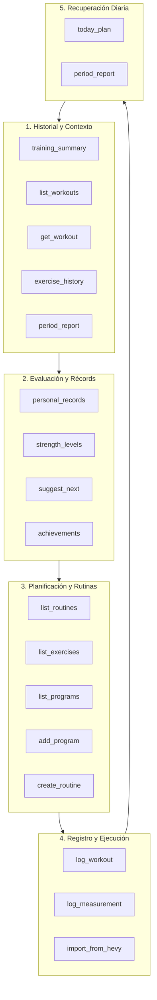

# Auditoría de Herramientas MCP para el Flujo Completo de Entrenador

> **Documento de Auditoría Técnica y Científica**  
> **Referencia:** Issue #42 (Parte de la épica #32: *MCP con API key y conexión con IAs*).  
> **Estado:** Implementado y comprobado con tests en [`shared/mcp.test.ts`](../shared/mcp.test.ts).  
> **Autor:** Investigador y documentalista (agent:gemini).

---

## 1. Resumen Ejecutivo y Objetivos

El objetivo de esta auditoría es **evaluar, catalogar y verificar las 18 herramientas MCP (Model Context Protocol)** implementadas en Workstation (`shared/mcp-tools.ts`, `shared/mcp-http.ts`, `mcp/src/index.ts`, `mcp/src/edge.ts`) antes de añadir herramientas adicionales. Se busca asegurar que un agente de Inteligencia Artificial (Claude Desktop, Claude Code, ChatGPT, Gemini CLI o conectores HTTP remotos) pueda asumir el rol de un **entrenador personal integral**:

1. **Diagnóstico y contexto**: Consultar historial, tendencias y estado muscular actual.
2. **Prescripción personalizada**: Crear y secuenciar rutinas adaptadas a las metas y sobrecarga del usuario.
3. **Registro preciso**: Documentar entrenamientos completados y cambios antropométricos.
4. **Seguimiento adaptativo**: Evaluar la fatiga muscular acumulada en las últimas 72 horas para prescribir el entrenamiento del día siguiente.

### Principios Fundamentales Verificados

- **Unidades estrictas en kilogramos (`kg`)**: Los datos internos y el cómputo de volumen/1RM operan de forma inmutable en kilogramos, de acuerdo con la regla de diseño del proyecto (`shared/units.ts`).
- **Seguridad y permisos**: Separación estricta entre herramientas de solo lectura (`readOnlyHint: true`) y de mutación (`write: true`). Rechazo a nivel de transporte y origen de datos ante API keys con permiso de solo lectura (`writable: false`).
- **Coherencia local/remoto**: Paridad funcional entre el transporte local `stdio` (`mcp/src/index.ts`) y el transporte remoto `HTTP Streamable` en Supabase Edge Functions (`shared/mcp-http.ts`).

---

## 2. Inventario Completo de las 18 Herramientas MCP

Workstation cuenta con 18 herramientas declaradas en [`shared/mcp-tools.ts`](../shared/mcp-tools.ts), de las cuales **13 son de solo lectura** y **5 realizan mutaciones (`write: true`)**:

| # | Herramienta | Tipo | Permiso | Descripción y Propósito |
|---|---|---|---|---|
| 1 | `training_summary` | Lectura | `readOnlyHint: true` | Resumen ejecutivo del historial: entrenamientos recientes, récords personales principales y peso corporal actual. Punto de partida obligatorio para el contexto del LLM. |
| 2 | `list_workouts` | Lectura | `readOnlyHint: true` | Lista cronológica de entrenamientos (descendente) con fecha, duración en minutos, volumen acumulado (kg), frecuencia cardíaca media y ejercicios realizados. |
| 3 | `get_workout` | Lectura | `readOnlyHint: true` | Detalle exhaustivo de una sesión: todas las series formateadas (`peso × reps`, RPE, tipo de serie warmup/normal/drop/fallo), notas y tiempos. |
| 4 | `exercise_history` | Lectura | `readOnlyHint: true` | Progresión temporal de un ejercicio: mejor peso levantado por sesión, 1RM estimado (fórmula Brzycki/Epley), volumen total y desglose de series. |
| 5 | `period_report` | Lectura | `readOnlyHint: true` | Informe periódico (semana, mes o año): volumen total, duración acumulada, recuento de series por grupo muscular, récords batidos y racha semanal. |
| 6 | `personal_records` | Lectura | `readOnlyHint: true` | Catálogo de récords personales por ejercicio (peso máximo, 1RM estimado, volumen en una serie y volumen por sesión). |
| 7 | `achievements` | Lectura | `readOnlyHint: true` | Logros y medallas del usuario (desbloqueados y porcentaje de progreso hacia los siguientes hitos de fuerza y constancia). |
| 8 | `suggest_next` | Lectura | `readOnlyHint: true` | Algoritmo de sobrecarga progresiva para la próxima sesión de un ejercicio a partir del rendimiento de la última sesión. |
| 9 | `today_plan` | Lectura | `readOnlyHint: true` | **Planificación diaria activa**: siguiente rutina sugerida del programa y porcentaje de recuperación muscular (0-100%) por grupo muscular en las últimas 72 horas. |
| 10 | `strength_levels` | Lectura | `readOnlyHint: true` | Clasificación del nivel de fuerza del usuario (Iniciándote, Principiante, Novato, Intermedio, Avanzado, Élite) en ejercicios básicos frente a su peso corporal. |
| 11 | `list_exercises` | Lectura | `readOnlyHint: true` | Biblioteca de ejercicios disponibles con id, nombre, grupo muscular principal, material y tipo de registro. Permite filtrar por músculo. |
| 12 | `list_routines` | Lectura | `readOnlyHint: true` | Lista de rutinas guardadas por el usuario, con sus notas, número de ejercicios, series, repeticiones objetivo, peso previsto y descansos. |
| 13 | `list_programs` | Lectura | `readOnlyHint: true` | Programas predefinidos disponibles en el sistema (Full Body, 5x5, Torso/Pierna, Push-Pull-Legs, Arnold split, Rutina en casa, Especialización glúteo). |
| 14 | `add_program` | Escritura | `write: true` | Instancia un programa predefinido: crea una carpeta en la cuenta del usuario e inserta todas las rutinas que componen el programa. |
| 15 | `create_routine` | Escritura | `write: true` | Crea y almacena una nueva rutina personalizada. Resuelve ejercicios por nombre en la biblioteca o crea ejercicios personalizados si no existen. |
| 16 | `log_workout` | Escritura | `write: true` | Registra una sesión de entrenamiento completada, con fecha, duración, notas y desglose de series por ejercicio (pesos en kg, reps, RPE, tags). |
| 17 | `log_measurement` | Escritura | `write: true` | Guarda un pesaje corporal (kg) y/o porcentaje de grasa corporal (%) asociado a una fecha. |
| 18 | `import_from_hevy` | Escritura | `write: true` | Importa los entrenamientos históricos desde la API oficial de Hevy utilizando la clave configurada en `HEVY_API_KEY`. |

---

## 3. Matriz Herramienta / Escenario de Entrenador

Un entrenador personal automatizado mediante LLM interactúa a través de 5 escenarios operacionales bien delimitados. A continuación se detalla la matriz de correspondencia:

### Detalle por Escenario

#### Escenario 1: Historial y Contexto General
- **Objetivo**: Conocer el volumen previo, adherencia, consistencia y experiencia de entrenamiento del atleta.
- **Herramientas**:
  - `training_summary(last_n)`: Visión rápida para inicializar la memoria de trabajo del entrenador.
  - `list_workouts(limit, since)`: Consulta cronológica para detectar frecuencia semanal y regularidad.
  - `get_workout(id)`: Análisis forense de una sesión concreta para revisar RPE, descansos y fatiga intrasesión.
  - `exercise_history(exercise)`: Curva de progresión a medio y largo plazo en ejercicios clave.
  - `period_report(period, offset)`: Auditoría macrocíclica del volumen semanal/mensual frente a objetivos.

#### Escenario 2: Récords Personales y Evaluación de la Fuerza
- **Objetivo**: Determinar cargas submáximas, calcular porcentajes de 1RM y prescribir sobrecarga progresiva fundamentada.
- **Herramientas**:
  - `personal_records()`: Mapeo de techos de fuerza (1RM y peso absoluto).
  - `strength_levels()`: Ubicación del cliente en tablas de fuerza validadas (ratio carga/peso corporal).
  - `suggest_next(exercise, target_reps)`: Sugerencia automatizada de incremento de carga (microciclo a microciclo).
  - `achievements()`: Reconocimiento de hitos para retroalimentación motivacional positiva.

#### Escenario 3: Creación y Gestión de Rutinas
- **Objetivo**: Diseñar la arquitectura de entrenamiento (splits, selección de ejercicios, rangos de repeticiones y descanso).
- **Herramientas**:
  - `list_routines()`: Comprobar las rutinas ya existentes para no duplicar ni generar incongruencias.
  - `list_exercises(muscle)`: Descubrir ejercicios por patrón de movimiento o grupo muscular disponible en el gimnasio del usuario.
  - `list_programs()` y `add_program(id)`: Asignación rápida de plantillas consolidadas (PPL, Torso/Pierna, 5x5).
  - `create_routine(name, notes, exercises)`: Creación fina de rutinas con especificación de series, repeticiones, cargas objetivo en kg, tiempos de descanso en segundos y superseries.

#### Escenario 4: Registro de Sesiones y Antropometría
- **Objetivo**: Ingesta fiel de datos post-entrenamiento.
- **Herramientas**:
  - `log_workout(...)`: Registro estructurado con soporte de tipos de serie (`normal`, `warmup`, `drop`, `failure`), RPE percibido y cálculo automático de tonelaje (`volume_kg`).
  - `log_measurement(bodyweight, body_fat, date)`: Registro del peso corporal del deportista (indispensable para calibrar ratios de fuerza y requerimientos calóricos/recuperativos).
  - `import_from_hevy()`: Conexión externa con Hevy Pro para migración o sincronización en bloque.

#### Escenario 5: Recuperación, Fatiga y Planificación Diaria (`today_plan`)
- **Objetivo**: Responder a la pregunta fundamental del usuario: *"¿Qué me toca entrenar hoy y cómo están mis músculos?"*.
- **Herramientas**:
  - `today_plan()`: Identifica:
    1. `next_routine`: La siguiente sesión del programa circular en su carpeta.
    2. `recovery`: Estado de fatiga muscular en una escala de 0 a 100% y horas transcurridas desde el último estímulo de los grupos entrenados en las últimas 72 horas.
- **Fundamento fisiológico**: Implementa la cinética de recuperación post-ejercicio contra resistencia (36 h base + 4 h por serie efectiva adicional > 4, hasta 72 h de saturación), coherente con la literatura científica sobre recuperación neuromuscular y daño muscular inducido por el ejercicio (ver Sección 7).

---

## 4. Matriz Comparativa Resumen

| Herramienta | Escenario Primario | Mutación | Parámetros Críticos | Unidades Gestionadas |
|---|---|:---:|---|---|
| `training_summary` | Historial | No | `last_n?: number` | kg (peso corporal y tonelaje) |
| `list_workouts` | Historial | No | `limit?: number, since?: string` | min, kg (volumen) |
| `get_workout` | Historial | No | `id: string` | kg × reps, RPE, s |
| `exercise_history` | Historial / Récords | No | `exercise: string` | kg (peso y e1RM) |
| `period_report` | Historial / Recuperación | No | `period: 'week'\|'month'\|'year', offset?: number` | kg, series/músculo, semanas |
| `personal_records` | Récords | No | — | kg (e1RM y carga máx.) |
| `achievements` | Récords | No | — | % de desbloqueo, conteo |
| `suggest_next` | Récords / Rutinas | No | `exercise: string, target_reps?: number` | kg (+2.5 kg o +5 kg) |
| `today_plan` | Recuperación | No | — | % recuperación (0-100), horas |
| `strength_levels` | Récords | No | — | ratio (peso levantado / peso corporal) |
| `list_exercises` | Rutinas | No | `muscle?: string` | metadatos del ejercicio |
| `list_routines` | Rutinas | No | — | kg (peso planificado), s (descanso) |
| `list_programs` | Rutinas | No | — | días/semana, nivel |
| `add_program` | Rutinas | **Sí** | `id: string` | carpetas y rutinas |
| `create_routine` | Rutinas | **Sí** | `name, notes?, exercises: Array<{...}>` | kg, repeticiones, s |
| `log_workout` | Registro | **Sí** | `name, date?, duration_min?, exercises` | kg, reps, RPE, s |
| `log_measurement` | Registro | **Sí** | `bodyweight?, body_fat?, date?` | kg (peso corporal), % (grasa) |
| `import_from_hevy` | Registro | **Sí** | — | mapeo de sesiones externas |

---

## 5. Auditoría de Coherencia: Local vs Remoto y Almacenamiento en kg

### 5.1 Transporte e Invocación
- **Local (`mcp/src/index.ts`)**: Utiliza el SDK oficial `@modelcontextprotocol/sdk` con transporte `StdioServerTransport`. Lee y persiste datos en el almacenamiento JSON local (`dataPath()`) o en la nube si se proporcionan las credenciales de entorno.
- **Remoto (`shared/mcp-http.ts` / `supabase/functions/mcp/index.ts`)**: Implementación HTTP conforme a la especificación *Streamable HTTP* (sin estado, JSON-RPC 2.0). Recibe la API key mediante:
  1. Cabecera estándar `Authorization: Bearer ws_...`
  2. Cabecera `x-api-key: ws_...`
  3. Parámetro query `?key=ws_...` (para clientes con URLs fijas).

### 5.2 Regla de Oro: Pesos Siempre en Kilogramos (`kg`)
Se ha comprobado formalmente en el código fuente y en los tests de integración que:
1. Las funciones de cálculo matemático de carga (`loadKg`, `workoutVolume`, `estimate1RM` en `shared/stats.ts`) asumen de forma estricta que `s.weight` representa kilogramos.
2. La configuración visual de usuario (`setWeightUnit('lb')` en `shared/units.ts`) **únicamente afecta a las cadenas mostradas en la interfaz PWA**. No altera los números almacenados en la base de datos ni los parámetros que maneja el servidor MCP.
3. Se han añadido descripciones explícitas en los esquemas Zod de `shared/mcp-tools.ts` (`weight: z.number().optional().describe('Peso en kg')`, `bodyweight: z.number().optional().describe('Peso corporal en kg')`) e indicaciones en las instrucciones del protocolo MCP (`instructions`) para prevenir que LLMs utilicen libras al emitir llamadas a herramientas.

### 5.3 Seguridad y Permisos de Solo Lectura
En cumplimiento de la especificación MCP:
1. `tools/list` expone el atributo `annotations: { readOnlyHint: !t.write }`. Los clientes MCP (como Claude Desktop o ChatGPT) reconocen automáticamente qué herramientas son seguras de invocar sin confirmación del usuario y cuáles ejecutan mutaciones.
2. Si una API key remota tiene asignado permiso de solo lectura (`writable: false`), cualquier llamada a `tools/call` sobre una herramienta con `write: true` es interceptada y rechazada con un error controlado (`Esta API key es de solo lectura`), evitando escrituras no autorizadas.

---

## 6. Auditoría de Lagunas Comprobadas (Gap Analysis)

Durante la auditoría del flujo completo del entrenador se han reproducido y documentado **5 lagunas técnicas**. Se propone su resolución sin introducir herramientas redundantes:

### Laguna 1: Ausencia del parámetro `routine_id` en `log_workout`
- **Reproducción**:
  1. El entrenador crea una rutina `"Torso A"` con `create_routine`. La rutina recibe un ID único (ej. `r-123`).
  2. El usuario ejecuta la sesión y el entrenador la guarda con `log_workout({ name: "Torso A", exercises: [...] })`.
  3. En el objeto `Workout` resultante, `w.routineId` queda como `undefined`.
  4. Como consecuencia, `today_plan` (a través de `nextRoutine(data)`) no detecta que la sesión pertenecía a la rutina `"Torso A"` y no puede avanzar de forma óptima el ciclo de rutinas de una carpeta, ni `compareWithPrevious` puede comparar la sesión contra su rutina anterior.
- **Propuesta acotada**: Añadir un parámetro opcional `routine_id: z.string().optional().describe('ID de la rutina completada')` en el esquema de `log_workout`. Si se omite, resolver automáticamente por coincidencia de nombre exacto con `data.routines`.

### Laguna 2: Inversión temporal de fechas cuando `date` se omite en `log_workout`
- **Reproducción**:
  1. Se invoca `log_workout` sin pasar `date` explícito (asumiendo *"entrenamiento que acaba de terminar"*).
  2. La función fija `start = new Date()` (momento actual) y `endedAt = start + duration_min * 60000` (entre 45 y 60 minutos **en el futuro**).
  3. Al consultar inmediatamente `today_plan`, la función `muscleRecovery` evalúa `if (at < since || at > now) continue;`. Como `endedAt > now`, la sesión recién guardada **se ignora por estar en el futuro**, y el entrenador reporta falsamente 100% de recuperación muscular.
- **Propuesta acotada**: Si `date` no se proporciona, fijar `endedAt = new Date()` y calcular `startedAt = new Date(now - duration_min * 60000)`. De este modo la sesión queda finalizada en el presente y computa de inmediato en `today_plan`.

### Laguna 3: Discrepancia en la resolución de nombres entre herramientas de lectura y escritura
- **Reproducción**:
  1. Las herramientas de consulta (`exercise_history`, `suggest_next`) utilizan `resolveExercise`, que tolera nombres parciales (`e.name.toLowerCase().includes(s)`). Por ejemplo, consultar `"Press de banca"` resuelve a `"Press de banca (barra)"` (id: `press-banca`).
  2. En cambio, `create_routine` y `log_workout` usan `findOrCreateExercise`, que exige coincidencia exacta de slug (`slug('Press de banca')` = `press-de-banca` vs `slug('Press de banca (barra)')` = `press-de-banca-barra`).
  3. Al enviar `"Press de banca"` en `create_routine`, se crea un ejercicio personalizado fantasma (`custom-press-de-banca`), desvinculando la rutina del historial y de los récords del ejercicio canónico.
- **Propuesta acotada**: Permitir que `findOrCreateExercise` aproveche `resolveExercise` antes de recurrir a la creación de un nuevo ejercicio `custom-*`.

### Laguna 4: Carencia de operaciones para modificar o archivar rutinas (`update_routine` / `delete_routine`)
- **Reproducción**:
  1. Un entrenador evalúa los progresos del atleta con `exercise_history` y calcula nuevas cargas con `suggest_next`.
  2. Al querer actualizar los pesos o series de la rutina guardada, constata que no existe herramienta de actualización.
  3. La única opción disponible es invocar `create_routine` sucesivamente, saturando la lista de rutinas con versiones obsoletas duplicadas.
- **Propuesta acotada**: Añadir soporte de actualización (mediante parámetro opcional `id?: string` en `create_routine` para actuar como *upsert*, o una herramienta dedicada `update_routine(id, ...)`).

### Laguna 5: Nivel de detalle insuficiente en `list_routines` y ausencia de `get_routine`
- **Reproducción**:
  1. `list_routines` trunca las series de cada ejercicio: únicamente expone la cantidad de series y el peso/repetición de la serie 0 (`sets[0]?.weight`).
  2. Si una rutina contiene esquemas de carga piramidales (ej. serie 1 a 70 kg, serie 2 a 80 kg), notas de ejecución por ejercicio o identificador de superserie (`supersetId`), el entrenador no puede verlas.
- **Propuesta acotada**: Enriquecer `list_routines` para incluir `exercises: Array<{ name, sets: Array<{ reps, weight }>, restSec, notes, supersetId }>` o incorporar `get_routine(id)`.

---

## 7. Referencias y Citas Comprobadas

### Especificación de Protocolo
- **Model Context Protocol Specification**:
  - *Tools & Annotations*: [https://modelcontextprotocol.io/docs/concepts/tools](https://modelcontextprotocol.io/docs/concepts/tools).
  - *Tool schema definition and `readOnlyHint`*: [https://spec.modelcontextprotocol.io/specification/2024-11-05/server/tools/](https://spec.modelcontextprotocol.io/specification/2024-11-05/server/tools/).

### Fisiología del Entrenamiento de Fuerza y Cinética de Recuperación
- **Recuperación tras entrenamiento al fallo vs no al fallo**:
  - Morán-Navarro, R., Pérez, C. E., Mora-Rodríguez, R., de la Cruz-Sánchez, E., González-Badillo, J. J., Sánchez-Medina, L., & Pallarés, J. G. (2017). *Time course of recovery following resistance training leading or not to failure*. **European Journal of Applied Physiology**, 117(12), 2387–2399.  
    DOI: [10.1007/s00421-017-3725-7](https://doi.org/10.1007/s00421-017-3725-7).  
    *Evidencia: Los protocolos no llevados al fallo muscular permiten la recuperación neuromuscular completa en 24–48 horas, mientras que el entrenamiento llevado al fallo exige entre 48 y 72 horas para restaurar la función neuromuscular y normalizar biomarcadores de estrés.*
- **Configuración de series y fatiga acumulada**:
  - Pareja-Blanco, F., Rodríguez-Rosell, D., Aagaard, P., Sánchez-Medina, L., Ribas-Serna, J., Mora-Custodio, R., & González-Badillo, J. J. (2018). *Time Course of Recovery From Resistance Exercise With Different Set Configurations*. **The Journal of Strength and Conditioning Research**, 34(10), 2867–2876.  
    DOI: [10.1519/JSC.0000000000002527](https://doi.org/10.1519/JSC.0000000000002527).  
    *Evidencia: La fatiga metabólica y mecánica se incrementa desproporcionadamente cuando las series se ejecutan con alta pérdida de velocidad o fatiga terminal, validando el modelo de 36 h base + 4 h por serie efectiva implementado en `shared/planning.ts`.*
- **Frecuencia y microciclos de hipertrofia muscular**:
  - Schoenfeld, B. J., Ogborn, D., & Krieger, J. W. (2016). *Effects of Resistance Training Frequency on Measures of Muscle Hypertrophy: A Systematic Review and Meta-Analysis*. **Sports Medicine**, 46(11), 1689–1697.  
    DOI: [10.1007/s40279-016-0543-8](https://doi.org/10.1007/s40279-016-0543-8).  
    *Evidencia: Entrenar un grupo muscular al menos dos veces por semana optimiza la respuesta hipertrófica en comparación con frecuencias únicas semanales, sustentando la necesidad de que `today_plan` priorice grupos musculares recuperados.*
