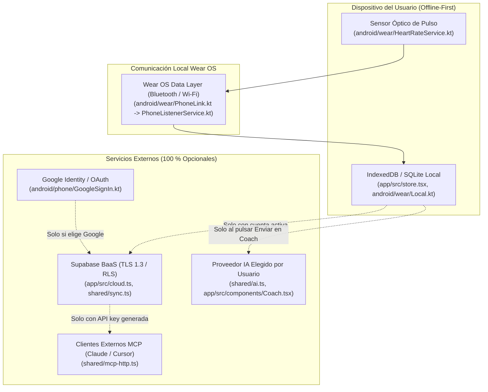
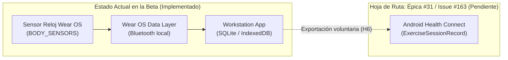

# Declaraciones de Seguridad de los Datos y Salud para Google Play

> **Documento normativo de privacidad, seguridad y cumplimiento regulatorio de Google Play Console**  
> **Referencia:** Issue [#160](https://github.com/adriarroyo08/WorkStation/issues/160) (Parte de la épica [#125](https://github.com/adriarroyo08/WorkStation/issues/125): *Estabilidad y preparación de la beta*).  
> **Ámbito:** Módulo móvil Android (`:phone`) y módulo de reloj Wear OS (`:wear`).  
> **Estado:** Borrador técnico de ingeniería preparado para la beta cerrada; pendiente de validación y firma por **[Adrián]**.  
> **Relación con otros documentos:** Complementa la auditoría de seguridad [#138](https://github.com/adriarroyo08/WorkStation/issues/138) ([docs/seguridad.md](seguridad.md)), los requisitos de borrado de cuenta de [#146](https://github.com/adriarroyo08/WorkStation/issues/146) y la política de privacidad general ([PRIVACY.md](../PRIVACY.md)).

> [!CAUTION]
> **Descargo de responsabilidad y naturaleza del documento:**  
> Este documento contiene especificaciones técnicas y un borrador preparatorio de respuestas para los cuestionarios de Google Play Console basado estrictamente en el código fuente y la arquitectura actual del repositorio. **No constituye asesoramiento legal, jurídico ni de cumplimiento normativo formal (RGPD / Google Play Developer Program Policies).** Ninguna declaración debe enviarse a Google Play Console ni publicarse sin la revisión, cumplimentación de los datos personales reservados y aprobación expresa de **[Adrián]**.

---

## 1. Inventario Trazable de Datos y Servicios del Repositorio

La arquitectura de WorkStation está diseñada con un enfoque prioritario en la soberanía de los datos del usuario y el funcionamiento estricto sin conexión (*offline-first*). A continuación se inventaría cada categoría de datos tratada por el software, distinguiendo taxativamente entre **almacenamiento local**, **transferencia en tránsito** y **servicios de terceros**, con trazabilidad directa a los ficheros del repositorio.

### 1.1. Cuenta y Autenticación

- **Descripción y alcance:** Dirección de correo electrónico, contraseña (gestionada y almacenada exclusivamente en forma de hash seguro por Supabase Auth; nunca en claro), identificador único de usuario (`user_id` en formato UUID v4) y tokens de sesión (access token JWT y refresh token). El uso de cuenta es 100 % opcional: la app es plenamente funcional sin registrarse.
- **Trazabilidad en el repositorio:**
  - Lógica de cliente y estado de sesión: [app/src/cloud.ts](../app/src/cloud.ts).
  - Componentes de interfaz de registro e inicio de sesión: [app/src/components/Account.tsx](../app/src/components/Account.tsx) y [app/src/components/AuthLanding.tsx](../app/src/components/AuthLanding.tsx).
  - Tipos de datos sincronizados: [shared/types.ts](../shared/types.ts).
- **Almacenamiento local:** Clave de persistencia de sesión `ws-auth` en `localStorage` / IndexedDB gestionada por la biblioteca `@supabase/supabase-js`, y configuración en IndexedDB (`cloud-config`, `cloud-pending`).
- **Transferencia / Tránsito:** Peticiones HTTPS cifradas bajo TLS 1.3 hacia los endpoints de autenticación de Supabase (`/auth/v1`).
- **Terceros involucrados:** Supabase Inc. (proveedor de Backend-as-a-Service) y Google LLC (únicamente si el usuario elige autenticarse mediante Google OAuth / Credential Manager).

### 1.2. Entrenamientos y Planificación Deportiva

- **Descripción y alcance:** Identificador de sesión (`id`), nombre del entrenamiento, marca temporal de inicio (`startedAt`), duración en segundos, notas personales del atleta, listado de ejercicios realizados, series planificadas y ejecutadas (peso en kilogramos, repeticiones efectivas, indicador de esfuerzo RIR o escala RPE, tipo de serie: normal, calentamiento, fallo o descendente, distancia o duración según corresponda).
- **Trazabilidad en el repositorio:**
  - Definiciones de modelo y contratos inmutables: [shared/types.ts](../shared/types.ts) (`Workout`, `WorkoutExercise`, `WorkoutSet`, `Routine`).
  - Almacén de datos y despachador de acciones: [app/src/store.tsx](../app/src/store.tsx).
  - Motor de cálculo de diferencias y sincronización: [shared/sync.ts](../shared/sync.ts).
  - Servicios nativos de fondo en smartphone: [android/phone/src/main/java/com/workstation/app/WorkoutService.kt](../android/phone/src/main/java/com/workstation/app/WorkoutService.kt) y [android/phone/src/main/java/com/workstation/app/PhoneListenerService.kt](../android/phone/src/main/java/com/workstation/app/PhoneListenerService.kt).
  - Modelo y almacenamiento autónomo en reloj: [android/wear/src/main/java/com/workstation/app/Local.kt](../android/wear/src/main/java/com/workstation/app/Local.kt) y [android/wear/src/main/java/com/workstation/app/PhoneLink.kt](../android/wear/src/main/java/com/workstation/app/PhoneLink.kt).
- **Almacenamiento local:** Base de datos IndexedDB local (`workstation-data`) en el smartphone Android y cliente web; base de datos SQLite / Room local en el smartwatch Wear OS ([Local.kt](../android/wear/src/main/java/com/workstation/app/Local.kt)).
- **Transferencia / Tránsito:** Canal bidireccional local cifrado punto a punto mediante *Wear OS Data Layer* (`Wearable.DataClient` / `MessageClient` por Bluetooth o Wi-Fi local); subida HTTPS (TLS 1.3) hacia la base de datos Supabase (`/rest/v1/records` o llamada RPC `api_upsert`) únicamente si el usuario activa la sincronización voluntaria.
- **Terceros involucrados:** Ninguno en modo local desconectado. Supabase Inc. si la sincronización en la nube está activa.

### 1.3. Medidas Corporales y Registro Físico

- **Descripción y alcance:** Fecha de registro, peso corporal en kilogramos y notas contextuales asociadas a la medición.
- **Fotos de progreso:** Las fotografías tomadas para comparar el estado físico se guardan **exclusivamente en el almacenamiento IndexedDB local del dispositivo**. En estricta conformidad con [PRIVACY.md](../PRIVACY.md), las fotos nunca se sincronizan, nunca se envían a Supabase ni se transmiten a ningún servidor externo.
- **Trazabilidad en el repositorio:**
  - Definición de tipos: [shared/types.ts](../shared/types.ts) (`Measurement`).
  - Interfaz de usuario: [app/src/components/Measurements.tsx](../app/src/components/Measurements.tsx).
  - Cálculo de métricas y tendencias: [shared/stats.ts](../shared/stats.ts).
  - Sincronización en la nube: [shared/sync.ts](../shared/sync.ts).
- **Almacenamiento local:** Base de datos IndexedDB (`workstation-data`).
- **Transferencia / Tránsito:** HTTPS (TLS 1.3) hacia Supabase únicamente si la sincronización en la nube está habilitada por el usuario.
- **Terceros involucrados:** Ninguno en local; Supabase Inc. con sincronización activa.

### 1.4. Frecuencia Cardíaca (Pulso Biométrico)

- **Descripción y alcance:** Frecuencia cardíaca en pulsaciones por minuto (BPM) capturada en tiempo real durante la sesión de entrenamiento deportivo, pulso medio acumulado (`heartRateAvg`), pulso máximo (`heartRateMax`) y muestras temporales asociadas a las series ejecutadas (`hr`). No se realiza análisis electrocardiográfico ni diagnóstico médico.
- **Trazabilidad en el repositorio:**
  - Declaración de permisos de hardware en Wear OS: [android/wear/src/main/AndroidManifest.xml](../android/wear/src/main/AndroidManifest.xml) (`android.permission.BODY_SENSORS`, `android.permission.health.READ_HEART_RATE`, `android.permission.FOREGROUND_SERVICE_HEALTH`).
  - Servicio de lectura del sensor continuo: [android/wear/src/main/java/com/workstation/app/HeartRateService.kt](../android/wear/src/main/java/com/workstation/app/HeartRateService.kt).
  - Transmisión de muestras al teléfono: [android/wear/src/main/java/com/workstation/app/PhoneLink.kt](../android/wear/src/main/java/com/workstation/app/PhoneLink.kt).
  - Recepción de pulso en el teléfono: [android/phone/src/main/java/com/workstation/app/PhoneListenerService.kt](../android/phone/src/main/java/com/workstation/app/PhoneListenerService.kt).
  - Integración en la sesión de entrenamiento: [shared/types.ts](../shared/types.ts) y [app/src/components/WorkoutLogger.tsx](../app/src/components/WorkoutLogger.tsx).
- **Almacenamiento local:** Lectura desde el sensor óptico del reloj -> persistencia en memoria y SQLite del reloj ([Local.kt](../android/wear/src/main/java/com/workstation/app/Local.kt)) -> transferido al teléfono e incrustado en el objeto JSON `Workout` en IndexedDB.
- **Transferencia / Tránsito:** Transmisión local cifrada mediante *Wear OS Data Layer*; si el usuario tiene sincronización en la nube activa, el dato de pulso viaja integrado dentro del JSON del entrenamiento hacia Supabase vía HTTPS (TLS 1.3).
- **Terceros involucrados:** Ninguno por defecto. Supabase Inc. si la sincronización está activa.

### 1.5. Supabase (Backend como Servicio)

- **Descripción y alcance:** Base de datos relacional PostgreSQL con seguridad a nivel de fila (RLS), autenticación y Edge Functions. Aloja las colecciones `records` (entrenamientos, rutinas, carpetas, ejercicios personalizados, medidas y ajustes), hashes SHA-256 de API keys en `api_keys` y métricas de cuota en `api_key_usage`.
- **Trazabilidad en el repositorio:**
  - Conexión de cliente y canal de tiempo real: [app/src/cloud.ts](../app/src/cloud.ts).
  - Esquema y migraciones de seguridad: [supabase/migrations/](../supabase/migrations/).
  - Variables de entorno de compilación: [.github/workflows/pages.yml](../.github/workflows/pages.yml) y [.github/workflows/android.yml](../.github/workflows/android.yml) (`VITE_SUPABASE_URL`, `VITE_SUPABASE_ANON_KEY`).
- **Almacenamiento local:** Caché de cambios pendientes en IndexedDB (`cloud-pending`, `cloud-config`).
- **Transferencia / Tránsito:** HTTPS / WSS (TLS 1.3) directo entre cliente y Supabase.
- **Terceros involucrados:** Supabase Inc.

### 1.6. Credenciales del Protocolo MCP (Model Context Protocol)

- **Descripción y alcance:** Claves de API secretas (`ws_...`) creadas voluntariamente por el usuario para permitir que asistentes de inteligencia artificial de escritorio (como Claude Desktop o Cursor) consulten su historial de entrenamiento mediante el protocolo MCP.
- **Trazabilidad en el repositorio:**
  - Servidor HTTP JSON-RPC y validación de claves: [shared/mcp-http.ts](../shared/mcp-http.ts).
  - Gestión e interfaz de claves de usuario: [app/src/components/ApiKeys.tsx](../app/src/components/ApiKeys.tsx).
  - Adaptador de base de datos y control de límites de tasa: [shared/cloud-source.ts](../shared/cloud-source.ts), [docs/mcp-limites.md](mcp-limites.md) y [docs/auditoria-mcp-entrenador.md](auditoria-mcp-entrenador.md).
  - Esquema de claves en base de datos: [supabase/migrations/002_api_keys.sql](../supabase/migrations/002_api_keys.sql).
- **Almacenamiento local:** La clave en texto claro se muestra una única vez al usuario al generarla; la app nativa almacena únicamente en preferencias privadas (`SharedPreferences`) una clave delegada de escritura para la subida de entrenos del reloj en segundo plano ([android/phone/src/main/java/com/workstation/app/WatchWorkouts.kt](../android/phone/src/main/java/com/workstation/app/WatchWorkouts.kt)). En Supabase se almacena exclusivamente el hash SHA-256.
- **Transferencia / Tránsito:** Cabecera HTTP `Authorization: Bearer ws_...` cifrada bajo TLS 1.3.
- **Terceros involucrados:** Supabase Edge Functions (donde se ejecuta el servidor MCP).

### 1.7. Google Identity y Servicios de Play

- **Descripción y alcance:** Inicio de sesión único (*Single Sign-On*) mediante Google Credential Manager en Android. Se recibe un token de identidad criptográfico (ID Token) con el correo electrónico y nombre del perfil para crear o vincular la sesión en Supabase.
- **Trazabilidad en el repositorio:**
  - Puente nativo en smartphone: [android/phone/src/main/java/com/workstation/app/GoogleSignIn.kt](../android/phone/src/main/java/com/workstation/app/GoogleSignIn.kt) y [android/phone/src/main/java/com/workstation/app/NativeBridge.kt](../android/phone/src/main/java/com/workstation/app/NativeBridge.kt).
  - Integración web: [app/src/native.ts](../app/src/native.ts) y [app/src/cloud.ts](../app/src/cloud.ts).
- **Almacenamiento local:** El token de Google es efímero en memoria y se descarta tras intercambiarlo por la sesión de Supabase.
- **Transferencia / Tránsito:** Comunicación interna IPC con Google Play Services y posterior envío del token a Supabase Auth por HTTPS.
- **Terceros involucrados:** Google LLC.

### 1.8. Proveedores del Módulo Coach IA

- **Descripción y alcance:** Asistente interactivo de entrenamiento que responde dudas y planifica rutinas. Si el usuario decide utilizarlo, debe introducir su propia clave de API personal (*Bring Your Own Key*). Al formular una consulta, se remite al proveedor elegido un extracto contextual del historial de entrenamientos (volumen de las últimas semanas, marcas 1RM estimadas, series por grupo muscular y biblioteca de ejercicios) junto con fragmentos de artículos científicos propios de WorkStation.
- **Trazabilidad en el repositorio:**
  - Definición de proveedores y cliente de chat: [shared/ai.ts](../shared/ai.ts).
  - Proveedores soportados: Google Gemini (`generativelanguage.googleapis.com`), Groq (`api.groq.com`), OpenRouter (`openrouter.ai`), Ollama local (`localhost:11434`, sin salida a internet) o endpoint compatible con OpenAI.
  - Componente de interfaz de Coach: [app/src/components/Coach.tsx](../app/src/components/Coach.tsx).
  - Extracción de métricas de entrenamiento para el prompt: [shared/stats.ts](../shared/stats.ts) (`trainingSummary`).
  - Inyección de contexto de artículos editoriales: [shared/article-search.ts](../shared/article-search.ts).
- **Almacenamiento local:** La clave de API del proveedor se almacena en el navegador/WebView en IndexedDB (`settings`). El historial de mensajes se conserva en memoria durante la sesión.
- **Transferencia / Tránsito:** Peticiones HTTPS POST directas desde el dispositivo al proveedor seleccionado por el usuario.
- **Terceros involucrados:** El proveedor de IA específico configurado por el usuario (Google LLC, Groq Inc., OpenRouter o ninguno si se utiliza un modelo local con Ollama).

### 1.9. Proveedores de Medios y Servicios Complementarios

- **ExerciseDB (RapidAPI):** Descarga de animaciones GIF de ejercicios si el usuario proporciona su clave personal de RapidAPI ([shared/exercisedb.ts](../shared/exercisedb.ts)). No se transmiten datos de entrenamiento.
- **free-exercise-db (GitHub):** Descarga de imágenes libres de técnica deportiva servidas estáticamente desde `raw.githubusercontent.com`. GitHub ve la petición web estándar.
- **Lector de noticias biomédicas:** Descarga periódica de feeds RSS/Atom abiertos de investigación deportiva ([shared/news.ts](../shared/news.ts)). No se envía información personal ni de actividad física.
- **Alojamiento web:** La aplicación PWA se aloja estáticamente en GitHub Pages (`adriarroyo08.github.io`).

---

## 2. Borrador de Respuestas para la Sección de Seguridad de los Datos (Data Safety)

Borrador estructurado para cumplimentar el cuestionario de **Seguridad de los datos** en Google Play Console (*App content > Data safety*), fundamentado en la documentación oficial de Google Play ([Google Play Help: answer/10787469](https://support.google.com/googleplay/android-developer/answer/10787469), consultada el 9 de noviembre de 2026).

### 2.1. Preguntas Iniciales Generales

| Pregunta en Play Console | Respuesta propuesta | Justificación técnica |
| :--- | :---: | :--- |
| **¿Tu aplicación recopila o comparte alguno de los tipos de datos de usuario requeridos?** | **Sí** | Aunque la app es *offline-first* y no requiere registro para funcionar localmente, la activación voluntaria de la sincronización en la nube o del módulo Coach transmite datos fuera del terminal. |
| **¿Todos los datos recopilados por la app se cifran en tránsito?** | **Sí** | Todas las comunicaciones de red hacia Supabase, Google y proveedores de IA emplean protocolos seguros HTTPS / WSS con TLS 1.3. La sincronización local Wear OS está cifrada por el subsistema Bluetooth/Wi-Fi de Google Play Services. |
| **¿Proporcionas a los usuarios un método para solicitar que se eliminen sus datos?** | **Sí** | Los datos locales se eliminan inmediatamente desde *Perfil > Ajustes > Datos > Borrar datos locales*. La eliminación de cuenta en la nube se encuentra en desarrollo en [#146](https://github.com/adriarroyo08/WorkStation/issues/146) y contará con enlace web público. |

### 2.2. Desglose Detallado por Tipo de Datos

#### Categoría A: Información Personal

1. **Dirección de correo electrónico (*Email address*)**
   - **¿Se recopila?** Sí (Opcional; únicamente si el usuario decide crear una cuenta de sincronización en Supabase o iniciar sesión con Google).
   - **¿Se comparte?** No (no se comparte con terceros comerciales ni publicitarios; solo lo procesa el backend Supabase para la gestión de acceso).
   - **Procesamiento efímero:** No (se almacena en el registro de autenticación mientras la cuenta exista).
   - **¿Es obligatorio para usar la app?** No (opcional; el usuario puede entrenar sin cuenta).
   - **Fines de recopilación:**
     - *Funcionalidad de la aplicación (App functionality)*: Autenticación, recuperación de contraseña y enlace de datos.
     - *Gestión de la cuenta (Account management)*: Identificación del titular de la cuenta.

2. **Nombre (*Name*)**
   - **¿Se recopila?** Sí (Opcional; obtenido automáticamente solo si el usuario inicia sesión mediante Google OAuth).
   - **¿Se comparte?** No.
   - **¿Es obligatorio?** No.
   - **Fines:** *Funcionalidad de la aplicación* (mostrar el nombre en la cabecera del perfil).

3. **Identificadores de usuario (*User IDs*)**
   - **¿Se recopila?** Sí (UUID interno generado por Supabase Auth al registrarse).
   - **¿Se comparte?** No.
   - **¿Es obligatorio?** No (solo existe si se activa la cuenta).
   - **Fines:** *Funcionalidad de la aplicación* y *Gestión de la cuenta*.

#### Categoría B: Salud y Actividad Física

1. **Información sobre actividad física (*Fitness info*)**
   - **Datos incluidos:** Historial de entrenamientos de gimnasio, series, ejercicios, repeticiones, peso levantado en kilogramos, tiempo de descanso y volumen de carga.
   - **¿Se recopila?** Sí (se transfiere a la nube únicamente si el usuario activa la sincronización en Supabase o realiza una consulta al Coach IA).
   - **¿Se comparte?** No (nunca se comparte con intermediarios publicitarios, aseguradoras ni redes de análisis).
   - **Procesamiento efímero:** No (se guarda en la base de datos del usuario).
   - **¿Es obligatorio?** No (en modo puramente local sin sincronización, el dato reside exclusivamente en el dispositivo y no constituye recopilación remota bajo las directrices de Play Console).
   - **Fines:** *Funcionalidad de la aplicación* (registro deportivo, progresión de fuerza y cálculo de estadísticas).

2. **Otras mediciones de salud o estado físico (*Other health or fitness data*)**
   - **Datos incluidos:** Frecuencia cardíaca en pulsaciones por minuto (BPM) registrada mediante el smartwatch Wear OS, y peso corporal anotado en medidas.
   - **¿Se recopila?** Sí (mismo criterio: transferido a Supabase solo si la sincronización está activa; de lo contrario reside en SQLite/IndexedDB local).
   - **¿Se comparte?** No.
   - **¿Es obligatorio?** No (el uso del reloj y el registro de peso son opcionales).
   - **Fines:** *Funcionalidad de la aplicación* (seguimiento del esfuerzo cardiovascular durante el entrenamiento y cálculo de ratios de fuerza relativa).

#### Categoría C: Rendimiento de la Aplicación y Diagnósticos

1. **Registros de fallos y diagnósticos (*Crash logs / Diagnostics*)**
   - **¿Se recopila activamente por código de la app?** **No**.
   - **Aclaración técnica:** WorkStation **no** integra SDKs de analítica de terceros (no incluye Firebase Crashlytics, Sentry, Mixpanel ni herramientas similares). Google Play Console recopila métricas operativas anónimas del sistema operativo Android (Android Vitals: tasas de ANR y cierres inesperados), las cuales están exentas de declaración como recopilación activa según las directrices de Google Play siempre que la app no use un SDK propio.

#### Categoría D: Datos Expresamente NO Recopilados

En el formulario de Play Console se marcarán explícitamente como **No recopilados** (*Not collected*) los siguientes tipos de datos:
- **Ubicación (*Location*):** Ni precisa ni aproximada (la app no solicita permisos de GPS).
- **Información financiera (*Financial info*):** Sin números de tarjeta, cuentas bancarias ni compras dentro de la app (la app es 100 % gratuita).
- **Fotos y vídeos (*Photos and videos*):** No recopilados remotamente. Como se especifica en [PRIVACY.md](../PRIVACY.md), las fotos de progreso son locales estrictas en IndexedDB y no salen del dispositivo.
- **Archivos y documentos (*Files and docs*):** No recopilados fuera de las copias de seguridad JSON/CSV generadas y guardadas por el propio usuario en su almacenamiento local.
- **Audio, mensajes, contactos, calendario y navegación web:** No se accede a ellos ni se recopilan.

---

## 3. Borrador de la Declaración de Aplicaciones de Salud (Health Apps Declaration)

Conforme a la política de **Contenido y servicios de salud** de Google Play ([Google Play Help: answer/12261419](https://support.google.com/googleplay/android-developer/answer/12261419), consultada el 9 de noviembre de 2026), todas las aplicaciones publicadas deben cumplimentar la declaración de salud en *Consola de Play > Política > Contenido de la app > Aplicaciones de salud*.

### 3.1. Respuestas del Formulario

| Campo del formulario | Opción a marcar | Justificación técnica y normativa |
| :--- | :--- | :--- |
| **¿Tu aplicación ofrece funciones de salud o accede a datos de salud?** | **Sí** | La aplicación lee la frecuencia cardíaca mediante sensores ópticos en Wear OS y registra el peso corporal y entrenamientos deportivos. |
| **Categorías de salud aplicables** | **Actividad y estado físico (*Activity and fitness*)** | La app está concebida exclusivamente para el entrenamiento de fuerza y la condición física general en sala de musculación o gimnasio doméstico. |
| **Subcategoría específica** | **Seguimiento de entrenamientos y ejercicio (*Workout and exercise tracking*)** | Registro de rutinas, series de musculación, tiempos de descanso y pulsaciones asociadas al esfuerzo deportivo. |
| **Categorías médicas o clínicas** | **Ninguna seleccionada** | La app no ofrece diagnóstico, dosificación farmacológica, triaje clínico ni monitorización de patologías médicas. |

### 3.2. Justificación de Permisos Biométricos en Wear OS

El módulo de reloj inteligente Wear OS ([android/wear/src/main/AndroidManifest.xml](../android/wear/src/main/AndroidManifest.xml)) declara permisos de salud que deben justificarse estrictamente:

1. **`android.permission.BODY_SENSORS` (hasta API 35):**  
   - *Finalidad:* Acceder al sensor óptico de fotopletismografía (PPG) del reloj para leer el pulso en tiempo real durante la serie de ejercicio mediante `Sensor.TYPE_HEART_RATE` ([HeartRateService.kt](../android/wear/src/main/java/com/workstation/app/HeartRateService.kt)).  
   - *Restricción de uso:* Se activa únicamente durante un entrenamiento iniciado y se desactiva de forma inmediata al finalizar o cancelar la sesión.

2. **`android.permission.health.READ_HEART_RATE` (Wear OS 6 / API 36+):**  
   - *Finalidad:* Permiso granular introducido en versiones modernas de Android para acotar la lectura del pulso cardíaco sin otorgar acceso indiscriminado a otros sensores corporales.

3. **`android.permission.FOREGROUND_SERVICE_HEALTH`:**  
   - *Finalidad:* Ejecutar [HeartRateService.kt](../android/wear/src/main/java/com/workstation/app/HeartRateService.kt) como servicio en primer plano asociado a una notificación visible continua en el reloj, permitiendo que las pulsaciones se sigan monitorizando y se vibre al finalizar el temporizador de descanso aun cuando la pantalla del reloj se atenúe para ahorrar batería (*Always-on Display* / modo ambiente).

### 3.3. Descargo de Responsabilidad Médica Obligatorio (*Medical Disclaimer*)

Para cumplir con las directrices de Google Play para aplicaciones de salud y bienestar, la descripción en Play Store y la pantalla de ajustes de la aplicación deben incorporar el siguiente descargo normativo:

> **Aviso médico:**  
> WorkStation es una herramienta deportiva orientada al registro personal de entrenamientos de fuerza y mejora de la condición física general. WorkStation **no es un dispositivo médico ni un software clínico**, y sus mediciones (incluidas la frecuencia cardíaca y la estimación de carga) se proporcionan con fines exclusivamente informativos y deportivos. La aplicación no debe emplearse para el diagnóstico, prevención, seguimiento, tratamiento ni alivio de enfermedades o alteraciones cardiovasculares. Consulte siempre con un profesional sanitario antes de comenzar cualquier plan de ejercicio físico intenso.

---

## 4. Diferenciación frente a Android Health Connect (Pendiente en #31 y #163)

Es imperativo trazar una distinción rigurosa entre las capacidades implementadas a día de hoy en el repositorio y la futura integración con el marco **Android Health Connect** ([developer.android.com: Health Connect guide](https://developer.android.com/health-and-fitness/guides/health-connect), consultada el 9 de noviembre de 2026):

1. **Estado en el código actual:**
   - En la aplicación para smartphone ([android/phone/src/main/AndroidManifest.xml](../android/phone/src/main/AndroidManifest.xml)) **no se solicita ningún permiso de Health Connect** (no figuran permisos del espacio de nombres `android.permission.health.*` en el teléfono).
   - El puente de finalización de entreno en [android/phone/src/main/java/com/workstation/app/WorkoutService.kt](../android/phone/src/main/java/com/workstation/app/WorkoutService.kt) y [app/src/native.ts](../app/src/native.ts) (`workoutEnded()`) no interactúa con Health Connect.
   - El pulso se adquiere única y exclusivamente en el reloj Wear OS a través de la API estándar de sensores de Android ([HeartRateService.kt](../android/wear/src/main/java/com/workstation/app/HeartRateService.kt)).

2. **Funcionalidad futura planificada:**
   - La exportación optativa de sesiones completadas hacia Health Connect está identificada como el hueco competitivo **H6** frente a Hevy en [docs/revision-hevy.md](revision-hevy.md), encuadrada dentro de la épica [#31](https://github.com/adriarroyo08/WorkStation/issues/31) y especificada detalladamente en la issue abierta [#163](https://github.com/adriarroyo08/WorkStation/issues/163).
   - Dicha integración exigirá definir el contrato web/nativo, gestionar permisos en tiempo de ejecución, evitar duplicidades con `ExerciseSessionRecord` y actualizar `PRIVACY.md`.

3. **Instrucción para las declaraciones de Google Play:**
   - **NO declarar integración con Health Connect en esta fase:** En el panel de Google Play Console **no** se debe marcar la casilla de integración con Health Connect ni declarar permisos de lectura/escritura de dicho marco. Declarar permisos o funciones de Health Connect sin que existan en el manifiesto o código del binario subido provocaría el rechazo automático de la versión por incoherencia entre el manifiesto y la declaración de contenido (*Inaccurate Health Declaration*).

---

## 5. Retención, Eliminación y Tareas Pendientes del Responsable

### 5.1. Políticas de Retención y Supresión de Datos

| Ámbito | Periodo de retención | Procedimiento de eliminación | Estado en el repositorio |
| :--- | :--- | :--- | :--- |
| **Almacenamiento Local (Móvil y Web)** | Indefinido mientras el usuario conserve los datos de la app o el navegador. | *Perfil > Ajustes > Datos > Borrar datos locales*. Se eliminan todas las bases IndexedDB, preferencias y cachés locales. | **Completamente operativo e implementado** en [app/src/components/Settings.tsx](../app/src/components/Settings.tsx). |
| **Almacenamiento Local (Reloj Wear OS)** | Se borra automáticamente el entreno (`/workstation/workout/<id>`) una vez transferido y confirmado por el móvil. | Borrado automático tras acuse de recibo ([WatchWorkouts.kt](../android/phone/src/main/java/com/workstation/app/WatchWorkouts.kt)), o manual al desinstalar la app del reloj. | **Completamente operativo e implementado** en [Local.kt](../android/wear/src/main/java/com/workstation/app/Local.kt). |
| **Almacenamiento en Nube (Supabase)** | Mientras la cuenta de usuario esté activa. | El usuario debe poder borrar su cuenta desde la app y solicitarlo por vía web externa; al borrarse la cuenta, deben eliminarse en cascada sus filas en `records`, `api_keys`, `api_key_usage` y `welcome_sent`. | **Pendiente de implementación en issue [#146](https://github.com/adriarroyo08/WorkStation/issues/146)** (hallazgo de seguridad S-05). |

### 5.2. Requisito de Google Play para Eliminación de Cuentas (URL Externa)

De conformidad con la política oficial de Google Play sobre eliminación de cuentas ([Google Play Help: answer/13327111](https://support.google.com/googleplay/android-developer/answer/13327111), consultada el 9 de noviembre de 2026), toda app que permita crear cuentas debe proporcionar:

1. Un mecanismo accesible dentro de la propia aplicación para eliminar la cuenta y los datos asociados (especificado en [#146](https://github.com/adriarroyo08/WorkStation/issues/146)).
2. **Un enlace web público accesible fuera de la app:** Un recurso web (formulario o página informativa con instrucciones y contacto) donde cualquier usuario pueda solicitar la supresión completa de su cuenta y registros sin necesidad de reinstalar la aplicación en su terminal.

> [!IMPORTANT]
> **[Adrián] Tarea pendiente de publicación web:**  
> Adrián debe designar la URL pública canónica para la solicitud de borrado de cuentas (por ejemplo, una página alojada en GitHub Pages bajo `https://adriarroyo08.github.io/WorkStation/borrar-cuenta.html` o un formulario de solicitud directo) e introducirla en la sección *Seguridad de los datos > Eliminación de datos* de Google Play Console.

### 5.3. Cuadro de Identidad del Responsable y Acciones Reservadas

Para preservar la integridad de la documentación y evitar inventar datos jurídicos, se señalan explícitamente mediante **[Adrián]** todos los campos que requieren asignación personal:

| Concepto legal / regulatorio | Valor actual / Estado | Acción requerida por Adrián |
| :--- | :--- | :--- |
| **Identidad del responsable del tratamiento** | **[Adrián]** (Pendiente) | Indicar nombre completo, documento de identidad (NIF/DNI) y domicilio legal de contacto para la política de privacidad formal. |
| **Buzón oficial de privacidad y ejercicio de derechos** | **[Adrián]** (Pendiente) | Definir la dirección de correo electrónico pública para atender solicitudes de acceso, rectificación y supresión (RGPD). |
| **URL definitiva de la Política de Privacidad** | `https://adriarroyo08.github.io/WorkStation/PRIVACY.md` (Borrador técnico) | Validar si se utilizará la versión de GitHub Pages o un dominio personalizado validado por **[Adrián]**. |
| **Aprobación de la política de borrado de cuenta (#146)** | En tramitación técnica | Revisar y validar la redacción final de `PRIVACY.md` tras completar la implementación de la issue [#146](https://github.com/adriarroyo08/WorkStation/issues/146). |
| **Cumplimentación en Play Console** | No completado | Trasladar las respuestas de este borrador a los formularios de Play Console tras su validación personal. |

---

## 6. Fuentes Oficiales y Normativas

Todas las declaraciones y respuestas estructuradas en este documento se han fundamentado en la documentación oficial para desarrolladores emitida por Google Play y Android:

| Fuente oficial | Organismo / Plataforma | URL canónica de referencia | Fecha de consulta |
| :--- | :--- | :--- | :--- |
| **Proporcionar información para la sección Seguridad de los datos de Google Play** (*Provide information for Google Play's Data safety section*) | Google Play Console Help | `https://support.google.com/googleplay/android-developer/answer/10787469` | 9 de noviembre de 2026 |
| **Política sobre Contenido y servicios de salud** (*Health Content and Services policy*) | Google Play Developer Policy Center | `https://support.google.com/googleplay/android-developer/answer/12261419` | 9 de noviembre de 2026 |
| **Requisitos de eliminación de cuentas de aplicaciones de Google Play** (*Google Play's app account deletion requirements*) | Google Play Console Help | `https://support.google.com/googleplay/android-developer/answer/13327111` | 9 de noviembre de 2026 |
| **Política de datos del usuario de Google Play** (*Google Play User Data policy*) | Google Play Developer Policy Center | `https://support.google.com/googleplay/android-developer/answer/101449` | 9 de noviembre de 2026 |
| **Guía de integración de Android Health Connect** (*Health Connect developer documentation*) | Android Developers | `https://developer.android.com/health-and-fitness/guides/health-connect` | 9 de noviembre de 2026 |
| **Directrices de calidad de aplicaciones para Wear OS** (*Wear OS app quality guidelines*) | Android Developers | `https://developer.android.com/docs/quality-guidelines/wear-app-quality` | 9 de noviembre de 2026 |
