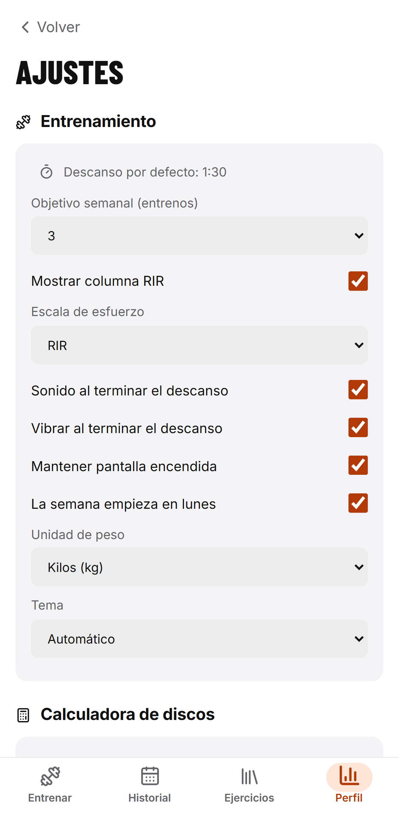
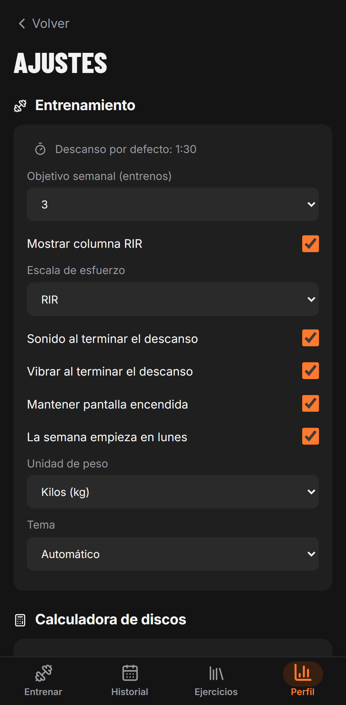
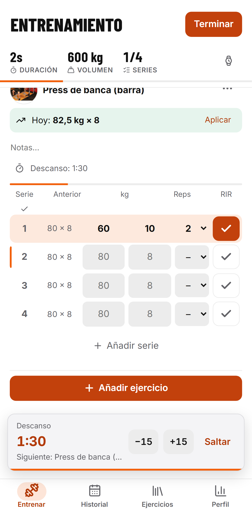
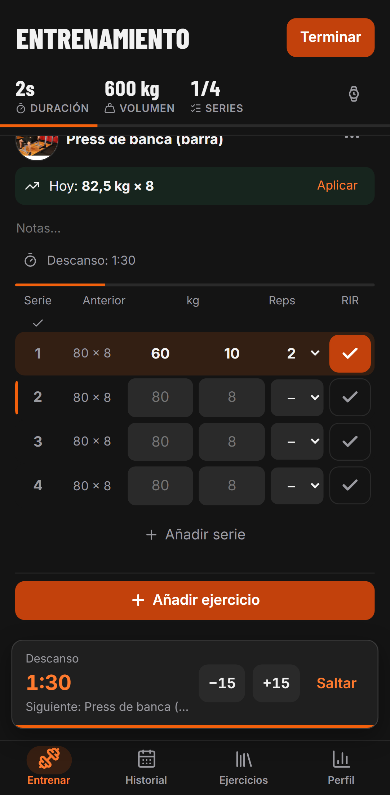
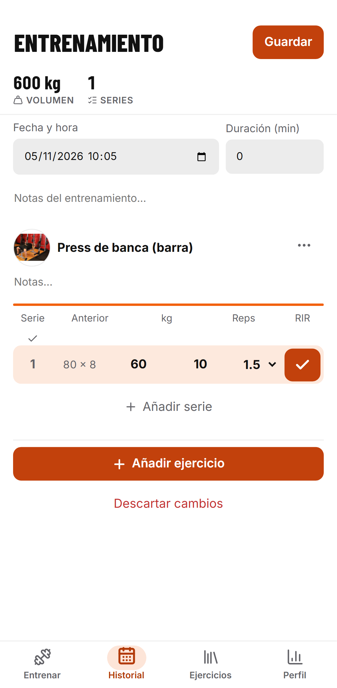
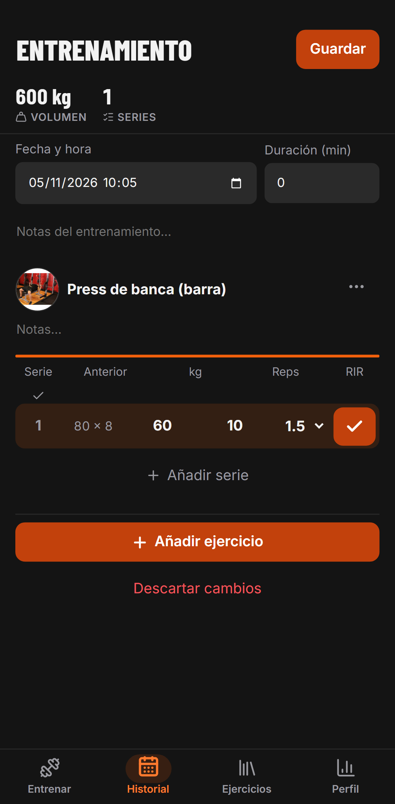

## Verificación de #85

Ejecutada en este PC con Chromium/Playwright, viewport Pixel 7, temas claro y oscuro y movimiento reducido.

- `npm run check`: lint, tipos, 194 tests y builds correctos.
- `npm --prefix app run build` y suite E2E completa: 66 tests correctos.
- Cambio de escala mediante teclado (foco, flecha abajo y Enter).
- Auditoría axe WCAG 2.1 AA en Ajustes, registro y edición: sin infracciones en ambos temas.
- RIR 2 se guarda y exporta en CSV como RPE 8. Al cambiar preferencia se vuelve a mostrar 8 sin cambiar la serie.
- Editar RPE 8,5 y reabrir como RIR muestra 1,5; vaciar, guardar y reabrir conserva el vacío. Ocultar la columna sigue respetando showRpe.

| Flujo | Claro | Oscuro |
| --- | --- | --- |
| Ajustes |  |  |
| Registro |  |  |
| Edición |  |  |
