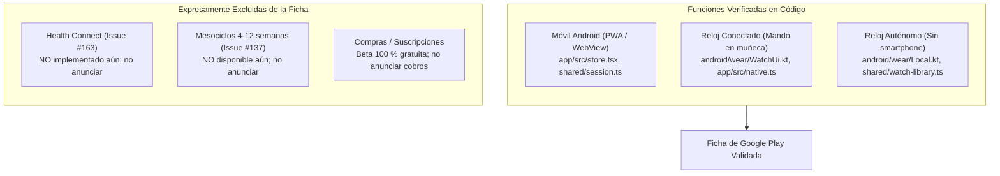
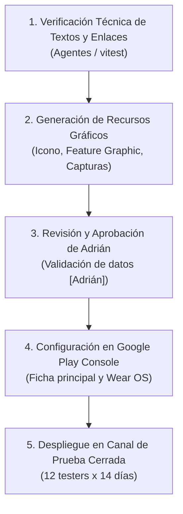

# Ficha de Google Play y Wear OS para la Beta Cerrada

> **Documento normativo de publicación, metadatos y recursos de tienda de Google Play Console**  
> **Referencia:** Issue [#161](https://github.com/adriarroyo08/WorkStation/issues/161) (Parte de la épica [#125](https://github.com/adriarroyo08/WorkStation/issues/125): *Estabilidad y preparación de la beta*).  
> **Ámbito:** Ficha principal de Google Play (Smartphone Android) y factor de forma específico Wear OS (`:phone` y `:wear`).  
> **Hito del proyecto:** Febrero de 2027 (Apertura de la beta cerrada en Google Play y Wear OS), conforme a [ROADMAP.md](../ROADMAP.md) y [docs/plan-beta.md](plan-beta.md).  
> **Estado:** Borrador técnico de ingeniería preparado para la beta cerrada; pendiente de revisión y publicación por **[Adrián]**.  
> **Monetización:** Fase 100 % gratuita, sin pasarelas de pago ni cobros activados; todas las acciones dependientes de trámites personales se identifican mediante **[Adrián]**.

> [!CAUTION]
> **Descargo de responsabilidad y naturaleza del documento:**  
> Este documento contiene especificaciones técnicas, borradores de textos promocionales e inventario de recursos visuales para Google Play Console basados estrictamente en el código fuente actual del repositorio. **No constituye publicación efectiva ni autorización de subida a producción.** Ningún recurso ni texto debe publicarse en Google Play Console sin la revisión, cumplimentación de los datos personales reservados y aprobación expresa de **[Adrián]**.

---

## 1. Fuentes Oficiales y Normativa de Google Play Console

Todos los textos, recuentos de caracteres, formatos de imagen y requisitos técnicos de esta especificación se ciñen a las directrices oficiales vigentes de Google Play y Android Developers:

| Documento oficial de Google | URL de referencia | Fecha de consulta |
| :--- | :--- | :--- |
| **Política de metadatos de Google Play** (*Metadata policy and store listing promotion*) | `https://support.google.com/googleplay/android-developer/answer/9898842` | 9 de noviembre de 2026 |
| **Añadir recursos de vista previa para promocionar tu aplicación** (*Add preview assets to showcase your app*) | `https://support.google.com/googleplay/android-developer/answer/9866151` | 9 de noviembre de 2026 |
| **Directrices de calidad de aplicaciones para Wear OS** (*Wear OS app quality guidelines*) | `https://developer.android.com/docs/quality-guidelines/wear-app-quality` | 9 de noviembre de 2026 |
| **Empaquetar y distribuir aplicaciones para Wear OS** (*Package and distribute Wear OS apps*) | `https://developer.android.com/training/wearables/packaging` | 9 de noviembre de 2026 |
| **Requisitos de pruebas para nuevas cuentas personales de desarrollador** (*App testing requirements for new personal developer accounts*) | `https://support.google.com/googleplay/android-developer/answer/14151465` | 9 de noviembre de 2026 |
| **Gestionar versiones para diferentes factores de forma en canales específicos** (*Manage releases for different form factors on specific tracks*) | `https://support.google.com/googleplay/android-developer/answer/13295490` | 9 de noviembre de 2026 |

---

## 2. Parámetros de Publicación, Identidad y Contacto

Conforme a las directrices de [ROADMAP.md](../ROADMAP.md), [docs/plan-beta.md](plan-beta.md) y [docs/declaraciones-play.md](declaraciones-play.md), los datos de identidad jurídica, titularidad y contacto quedan reservados para la formalización personal por parte del titular:

```
+---------------------------------------------------------------------------------+
|  PARÁMETROS DE CONFIGURACIÓN DE FICHA EN GOOGLE PLAY CONSOLE                    |
+---------------------------------------------------------------------------------+
|  Identificador de paquete (Package ID) : com.workstation.app                    |
|  Nombre de la app (Play Console)       : WorkStation                            |
|  Categoría principal                   : Salud y bienestar (Health & Fitness)   |
|  Subcategoría / Etiqueta deportiva     : Deportes / Entrenamiento de fuerza     |
|  Modelo comercial                      : Gratuita (Free)                        |
|  Publicidad en la app                  : No contiene anuncios                   |
|  Compras integradas (In-App Purchases) : No activadas (0,00 €)                  |
|  Declaración Ley Servicios Digitales   : No comerciante (Non-trader)            |
+---------------------------------------------------------------------------------+
```

### 2.1. Identidad y Contacto Reservados a Adrián

| Campo de Google Play Console | Valor en borrador / Acción requerida | Responsable |
| :--- | :--- | :--- |
| **Nombre del desarrollador** (*Developer name*) | **[Adrián]** (Nombre personal o denominación del estudio registrada en Play Console). | **[Adrián]** |
| **Correo electrónico de contacto** (*Support email*) | **[Adrián]** (Buzón oficial de soporte técnico para probadores y usuarios). | **[Adrián]** |
| **Sitio web oficial** (*Website URL*) | **[Adrián]** (Dominio web del proyecto o repositorio de WorkStation). | **[Adrián]** |
| **Número de teléfono de contacto** (*Phone*) | **[Adrián]** (Requerido opcionalmente en ficha pública de desarrollador según política europea). | **[Adrián]** |
| **URL de la política de privacidad** (*Privacy Policy URL*) | **[Adrián]** (Enlace público web HTTPS a la política de privacidad formal, sincronizado con [PRIVACY.md](../PRIVACY.md) y [docs/declaraciones-play.md](declaraciones-play.md)). | **[Adrián]** |
| **Dirección física del desarrollador** | **[Adrián]** (Domicilio registrado en la verificación de identidad de Google Play Console). | **[Adrián]** |

---

## 3. Textos Oficiales de la Ficha Principal (Móvil y General)

La ficha principal en castellano se redacta cumpliendo estrictamente con la *Metadata Policy* de Google Play: sin mayúsculas injustificadas, sin emojis en el título, sin reclamos publicitarios de ranking ("la mejor", "#1", "premiada") ni menciones a precios o términos como "gratis" en el nombre.

### 3.1. Título de la Aplicación (App Title)

```text
WorkStation: Diario de Fuerza
```

- **Límite oficial de Google Play:** Máximo 30 caracteres.
- **Recuento de caracteres:** **29 caracteres** (incluyendo espacios).
- **Estado de validación:** Cumple la normativa vigente.

### 3.2. Descripción Breve (Short Description)

```text
Registra tus entrenamientos de fuerza, series y pulso en el móvil y en Wear OS.
```

- **Límite oficial de Google Play:** Máximo 80 caracteres.
- **Recuento de caracteres:** **79 caracteres** (incluyendo espacios).
- **Estado de validación:** Cumple la normativa vigente.

### 3.3. Descripción Completa (Full Description)

```text
WorkStation es tu diario y planificador de entrenamiento de fuerza y gimnasio, diseñado bajo una filosofía de soberanía total de datos, funcionamiento sin conexión (offline-first) y rigor científico.

Sin muros de pago, sin publicidad molesta y sin rastreadores comerciales: registra tus rutinas, controla tus series y descansos, y monitoriza tu progreso de manera limpia y precisa, tanto en tu teléfono Android como en tu reloj inteligente Wear OS.

REGISTRO DE ENTRENAMIENTO COMPLETO EN EL MÓVIL
• Diario ágil: anota pesos, repeticiones efectivas y esfuerzo percibido (selector RIR y escala RPE).
• Variedad de series: soporte para series efectivas, aproximación o calentamiento, series al fallo y series descendentes (drop sets).
• Superseries y biseries: organiza ejercicios agrupados con descansos coordinados.
• Ejercicios con peso corporal: registra dominadas, fondos o flexiones con lastre añadido o asistencia, considerando automáticamente tu historial de peso corporal.
• Temporizador inteligente: cuenta atrás visual y sonora configurable por ejercicio con avisos de descanso.
• Doble progresión: define rangos de repeticiones y progresión por ejercicio para maximizar tus ganancias de fuerza.
• Estimación de 1RM y volumen: cálculo instantáneo de tu repetición máxima teórica y volumen total por grupo muscular.

INTEGRACIÓN PROFUNDA CON WEAR OS: CONECTADO Y AUTÓNOMO
WorkStation exprime al máximo tu reloj con Wear OS (versión 3.0 o superior):

1. Reloj Conectado (Control en la muñeca):
• Controla la sesión activa desde la muñeca mientras el teléfono permanece en el banco o la mochila.
• Marca series completadas con un solo toque y ajusta peso y repeticiones al instante.
• Temporizador háptico: vibración suave en la muñeca al concluir el descanso, con botones para sumar 30 segundos o saltar.
• Frecuencia cardíaca en tiempo real: lectura continua del sensor de pulso del reloj, mostrando tus pulsaciones (BPM) durante las series y calculando pulso medio y máximo.

2. Reloj Autónomo (Entrena sin el móvil):
• Deja el teléfono en casa o en la taquilla: transfiere previamente tu biblioteca de ejercicios y rutinas al reloj.
• Inicia entrenamientos libres o selecciona tus rutinas habituales directamente desde la pantalla de Wear OS.
• Añade ejercicios y registra cada serie con autocompletado de los pesos de la sesión anterior.
• Sincronización diferida automática: al terminar tu entrenamiento en el reloj, los datos se transfieren de forma transparente a tu smartphone en cuanto ambos dispositivos vuelvan a conectarse por Bluetooth o Wi-Fi.

CIENCIA DEL ENTRENAMIENTO Y DIVULGACIÓN
• Biblioteca de ejercicios categorizada por grupos musculares y patrones de movimiento anatómicos.
• Fichas de activación muscular y nivel de evidencia científica contrastada.
• Artículos divulgativos integrados para lectura sin conexión basados en estudios y metaanálisis.
• Lector de noticias biomédicas y de rendimiento deportivo con actualización en caché.

SOBERANÍA Y PRIVACIDAD DE DATOS
• Offline-first: todos tus datos se almacenan en la memoria local de tu dispositivo (IndexedDB en el móvil y base de datos local en el reloj). La app funciona al 100 % sin cobertura.
• Fotografías privadas: tus fotos de evolución física se guardan de forma estrictamente local y jamás se transmiten a la red.
• Copias de seguridad y migración: importa fácilmente tu historial desde copias CSV de Strong y exporta todos tus datos en JSON abierto cuando lo desees.
• Sincronización en la nube opcional: si deseas sincronizar entre varios dispositivos, puedes activar opcionalmente la copia cifrada con tu cuenta.
• Conexión para asistentes de IA: servidor compatible con el protocolo abierto MCP (Model Context Protocol) mediante claves de API seguras revocables.

WorkStation es un software deportivo en fase beta cerrada. No incluye funciones de diagnóstico ni prescripción médica.
```

- **Límite oficial de Google Play:** Máximo 4000 caracteres.
- **Recuento de caracteres:** **3881 caracteres** (incluyendo espacios).
- **Margen de seguridad:** 119 caracteres libres disponibles.
- **Estado de validación:** Cumple la normativa vigente.

---

## 4. Textos Oficiales de la Ficha Específica para Wear OS

Google Play Console permite configurar metadatos dedicados para el factor de forma Wear OS cuando la experiencia en el reloj presenta flujos especializados:

### 4.1. Título Wear OS (Wear OS App Title)

```text
WorkStation: Diario de Fuerza
```

- **Límite oficial de Google Play:** Máximo 30 caracteres.
- **Recuento de caracteres:** **29 caracteres**.
- **Estado de validación:** Cumple la normativa vigente.

### 4.2. Descripción Breve Wear OS (Wear OS Short Description)

```text
Registra tus series de fuerza, descansos y pulso desde tu smartwatch Wear OS.
```

- **Límite oficial de Google Play:** Máximo 80 caracteres.
- **Recuento de caracteres:** **77 caracteres** (incluyendo espacios).
- **Estado de validación:** Cumple la normativa vigente.

### 4.3. Descripción Completa Wear OS (Wear OS Full Description)

```text
WorkStation para Wear OS traslada el registro de tus entrenamientos de fuerza a la muñeca, permitiéndote entrenar con máxima concentración tanto si llevas tu teléfono móvil como si decides dejarlo en la taquilla.

DISEÑADA ESPECÍFICAMENTE PARA SMARTWATCHES WEAR OS
• Interfaz limpia y de alto contraste: optimizada para pantallas circulares y cuadradas con tipografía clara y botones táctiles adaptados al uso en el gimnasio.
• Funcionamiento ágil con una sola mano: anota tus marcas y avanza de serie sin interrumpir el ritmo de la sesión.

DOS MODOS DE USO FLEXIBLES:

1. Modo Conectado (Control remoto del smartphone):
• Utiliza tu reloj como mando a distancia de la sesión iniciada en la aplicación móvil de WorkStation.
• Consulta en pantalla el ejercicio actual, el número de serie y los valores de peso y repeticiones conseguidos en la última sesión.
• Marca series completadas al instante con sincronización inmediata con el teléfono.
• Temporizador de descanso en muñeca: cuenta atrás visual con avisos por vibración háptica al concluir y accesos rápidos para añadir 30 segundos o reanudar.
• Monitorización del pulso cardíaco en vivo: lectura en tiempo real mediante el sensor biométrico del reloj (BPM) integrada en la serie.

2. Modo Autónomo (Entrenamiento independiente sin smartphone):
• Entrena libremente sin cargar con el teléfono móvil durante tu sesión de gimnasio.
• Recibe en el reloj tu biblioteca personalizada de ejercicios, descansos y rutinas planificadas transferidas previamente desde el móvil.
• Inicia entrenamientos libres o ejecuta rutinas completas directamente desde la app de Wear OS.
• Explora el catálogo y añade ejercicios en mitad de la sesión según disponibilidad de máquinas en la sala.
• Registro completo de series: peso en kg, repeticiones y tiempo, conservando la referencia de sesiones anteriores.
• Registro continuo de frecuencia cardíaca durante toda la sesión autónoma.
• Sincronización diferida inteligente: tu entrenamiento finalizado se almacena de forma segura en la memoria local del reloj y se transmite automáticamente a tu teléfono móvil en cuanto se restablezca la conexión Bluetooth o Wi-Fi.

PRIVACIDAD Y RENDIMIENTO
• Almacenamiento local seguro en el reloj.
• Sin publicidad, sin suscripciones obligatorias y con consumo optimizado de batería durante el entrenamiento deportivo.
```

- **Límite oficial de Google Play:** Máximo 4000 caracteres.
- **Recuento de caracteres:** **2342 caracteres** (incluyendo espacios).
- **Margen de seguridad:** 1658 caracteres libres disponibles.
- **Estado de validación:** Cumple la normativa vigente.

---

## 5. Matriz de Trazabilidad Técnica: Funciones Disponibles vs. Pendientes

Para asegurar la veracidad de la ficha de tienda y prevenir rechazos por funcionalidades engañosas (*Misleading Claims Policy* de Google Play), cada característica anunciada se contrasta directamente con el código fuente del repositorio.



### 5.1. Funciones Disponibles y Trazabilidad en Repositorio

| Capacidad del sistema | Entorno de ejecución | Ficheros fuente de trazabilidad | Comportamiento verificado en código |
| :--- | :--- | :--- | :--- |
| **Registro de series y descansos** | Smartphone | [app/src/store.tsx](../app/src/store.tsx), [shared/session.ts](../shared/session.ts) | Soporte de series normales, calentamiento, fallo y descendentes (`SetType`). Temporizador configurable. |
| **Esfuerzo RIR / RPE** | Smartphone | [shared/types.ts](../shared/types.ts), [app/src/components/WorkoutLogger.tsx](../app/src/components/WorkoutLogger.tsx) | Campos `rir` y `rpe` persistidos en `WorkoutSet`. |
| **Peso corporal y lastres** | Smartphone | [shared/units.ts](../shared/units.ts), [shared/bodyweight-load.ts](../shared/bodyweight-load.ts) | Integración de peso corporal del atleta con carga adicional o asistencia en kg. |
| **Doble progresión** | Smartphone | [shared/progression.ts](../shared/progression.ts) | Detección de rangos de repeticiones superados y recomendación de incremento de peso. |
| **Estimación de 1RM y volumen** | Smartphone | [shared/stats.ts](../shared/stats.ts) | Cálculo de 1RM con fórmula Brzycki/Epley y agregación de volumen por grupo muscular. |
| **Biblioteca y activación anatómica** | Smartphone | [shared/exercises.ts](../shared/exercises.ts), [shared/exercise-evidence.ts](../shared/exercise-evidence.ts) | Mapa muscular por intensidades (`exerciseActivation`) y nivel de evidencia científica. |
| **Importación de datos Strong** | Smartphone | [shared/strong.ts](../shared/strong.ts) | Parser CSV de copias de seguridad de Strong compatible con codificaciones UTF-8 e ISO-8859-1. |
| **Artículos y noticias offline** | Smartphone | [shared/articles.ts](../shared/articles.ts), [shared/news.ts](../shared/news.ts) | Contenido estático empaquetado y lector RSS/Atom con almacenamiento y caché local. |
| **Asistente MCP y API Keys** | Smartphone / Backend | [shared/mcp-tools.ts](../shared/mcp-tools.ts), [shared/mcp-http.ts](../shared/mcp-http.ts) | Protocolo MCP expuesto con endpoints seguros y claves de API revocables. |
| **Sincronización en la nube** | Smartphone | [app/src/cloud.ts](../app/src/cloud.ts), [shared/sync.ts](../shared/sync.ts) | Sincronización voluntaria con Supabase bajo TLS 1.3 con RLS y login Google OAuth nativo. |
| **Reloj conectado (Mando)** | Wear OS + Teléfono | [android/wear/src/main/java/com/workstation/app/WatchUi.kt](../android/wear/src/main/java/com/workstation/app/WatchUi.kt), [app/src/native.ts](../app/src/native.ts) | Pantallas `SetScreen` y `RestScreen` controlando la sesión activa del smartphone por *Data Layer*. |
| **Frecuencia cardíaca en vivo** | Wear OS + Teléfono | [android/wear/src/main/java/com/workstation/app/HeartRateService.kt](../android/wear/src/main/java/com/workstation/app/HeartRateService.kt), [android/phone/src/main/java/com/workstation/app/PhoneListenerService.kt](../android/phone/src/main/java/com/workstation/app/PhoneListenerService.kt) | Foreground service con notificación persistente; muestreo continuo de pulso en BPM transmitido cada 5 s. |
| **Reloj autónomo (Sin móvil)** | Wear OS independiente | [android/wear/src/main/java/com/workstation/app/Local.kt](../android/wear/src/main/java/com/workstation/app/Local.kt), [shared/watch-library.ts](../shared/watch-library.ts) | Sesiones locales independientes (`LWorkout`), biblioteca precargada, lista de pendientes y subida diferida. |

### 5.2. Funciones Pendientes Expresamente Excluidas de la Ficha

Para garantizar la honestidad de la ficha y cumplir con la política de metadatos de Google Play, las siguientes funciones en desarrollo **no deben mencionarse como disponibles en la tienda**:

1. **Android Health Connect:**  
   - *Estado en repositorio:* Planificada en la issue [#163](https://github.com/adriarroyo08/WorkStation/issues/163) (rama pendiente de implementación en el módulo móvil).  
   - *Directriz de tienda:* **No citar Health Connect ni sincronización con Google Fit en ningún texto de tienda.** Solo se mencionará cuando la integración esté completada y verificada en producción.
2. **Mesociclos y Periodización Avanzada por % de 1RM:**  
   - *Estado en repositorio:* Planificada en la issue [#137](https://github.com/adriarroyo08/WorkStation/issues/137) (programas de 4 a 12 semanas con progresión porcentual de carga).  
   - *Directriz de tienda:* **No anunciar planificador de mesociclos ni bloques de periodización como disponibles.** La ficha solo anuncia rutinas, ejercicios individuales y doble progresión.
3. **Planes de Suscripción o Cobros:**  
   - *Estado en repositorio:* Conforme a [ROADMAP.md](../ROADMAP.md), la monetización (suscripciones de sincronización o cuotas de computación IA) está expresamente aplazada hasta que se formalice el alta de actividad económica del estudio.  
   - *Directriz de tienda:* La ficha declara la aplicación como 100 % gratuita, sin pagos dentro de la aplicación ni periodos de prueba condicionados a suscripción.

---

## 6. Inventario de Recursos Gráficos y Especificaciones Oficiales

De acuerdo con el documento oficial de soporte de Google Play [Add preview assets to showcase your app](https://support.google.com/googleplay/android-developer/answer/9866151), a continuación se definen los recursos obligatorios y sus especificaciones técnicas exactas:

```
+----------------------------------------------------------------------------------------------------+
|  INVENTARIO DE RECURSOS GRÁFICOS EXIGIDOS PARA GOOGLE PLAY Y WEAR OS                               |
+----------------------+--------------------+---------------+----------------------------------------+
|  Recurso             | Dimensiones        | Formato       | Requisitos específicos de Google Play  |
+----------------------+--------------------+---------------+----------------------------------------+
|  Icono de la app     | 512 x 512 px       | PNG 32-bit    | sRGB, máx. 1024 KB. Cuadrado completo.  |
|                      |                    | (con alfa)    | Google aplica esquinas y sombra 3D.    |
+----------------------+--------------------+---------------+----------------------------------------+
|  Gráfico de funciones| 1024 x 500 px      | JPEG o PNG    | 24-bit sin alfa. Máx. 1 MB. Enfoque    |
|  (Feature Graphic)   |                    | (sin alfa)    | central para tolerar recortes de UI.   |
+----------------------+--------------------+---------------+----------------------------------------+
|  Capturas Smartphone | 1080 x 2400 px     | JPEG o PNG    | 24-bit sin alfa. Mínimo 2, máx. 8.     |
|                      | (relación 20:9)    |               | Ratio entre 1:2 y 2:1. Pantalla real.  |
+----------------------+--------------------+---------------+----------------------------------------+
|  Capturas Wear OS    | 450 x 450 px       | PNG o JPEG    | Ratio obligatorio 1:1. Fondo negro     |
|                      | (o 512 x 512 px)   | (sin alfa)    | liso (#000000). Mínimo 1, máx. 8.      |
|                      |                    |               | PROHIBIDO marco de reloj o mockups.    |
+----------------------+--------------------+---------------+----------------------------------------+
```

### 6.1. Reglas Específicas para Capturas de Pantalla de Wear OS

Google Play aplica una política de revisión rigurosa para las capturas de Wear OS:
1. **Relación de aspecto 1:1 obligatoria:** Las imágenes deben ser estrictamente cuadradas (ej. 450x450 px o 512x512 px), representativas de la visualización en reloj.
2. **Prohibición de marcos de hardware (*No device mockups*):** La captura no debe incluir biseles, correas, carcasas metálicas ni botones físicos de ningún smartwatch.
3. **Prohibición de texto decorativo exterior:** No se admiten cartelas, títulos flotantes ni fondos de marketing alrededor del reloj.
4. **Fondo negro liso:** No usar fondos transparentes en los bordes; el fondo debe ser negro puro (`#000000`), idéntico al tema de alto contraste de [WatchUi.kt](../android/wear/src/main/java/com/workstation/app/WatchUi.kt).

---

## 7. Guion Detallado de Capturas con Datos Ficticios

Para ilustrar de forma fidedigna la experiencia de usuario sin comprometer la privacidad de ningún atleta real, se establece un **perfil ficticio estandarizado de prueba**:

- **Nombre del atleta de demostración:** Carlos Gómez (ficticio).
- **Peso corporal registrado:** 78,5 kg.
- **Rutina de muestra:** "Torso Fuerza - Sesión A".
- **Unidades:** Kilogramos (kg) y segundos (s).

### 7.1. Guion de Capturas para Teléfono Android (Smartphone)

Se define un conjunto de 6 capturas secuenciales en resolución nativa de 1080 x 2400 px:

```
+------------------------------------------------------------------------------------------------------+
|  GUION DE CAPTURAS: SMARTPHONE (1080 x 2400 px)                                                     |
+-----+---------------------------+---------------------------------------+----------------------------+
| Núm | Pantalla de la aplicación | Elementos visuales destacados         | Datos ficticios en pantalla|
+-----+---------------------------+---------------------------------------+----------------------------+
|  01 | Diario de entrenamiento   | Pantalla activa con tabla de series,  | Ejercicio: Press banca     |
|     | en vivo (WorkoutLogger)   | tipo de serie (efectiva, calentamiento| Serie 1: 80 kg x 8 (RIR 2) |
|     |                           | y fallo) y temporizador de descanso.  | Serie 2: 85 kg x 6 (RIR 1) |
|     |                           | Temporizador circular en 01:45.       | Serie 3: 85 kg x 5 (Fallo) |
+-----+---------------------------+---------------------------------------+----------------------------+
|  02 | Selector de ejercicios y  | Ficha interactiva de ejercicio con    | Ejercicio: Dominadas       |
|     | carga de peso corporal    | desglose de peso corporal base (78 kg)| Modo: Lastre añadido       |
|     |                           | y lastre (+15 kg). Historial reciente.| Serie: +15 kg x 6 reps     |
+-----+---------------------------+---------------------------------------+----------------------------+
|  03 | Catálogo anatómico y      | Tarjeta de ejercicio con silueta      | Ejercicio: Sentadilla tras.|
|     | mapa de activación        | muscular sombreada por nivel de       | Cuádriceps: Principal      |
|     |                           | activación y badge de evidencia alta. | Glúteo: Secundario         |
|     |                           | Enlace a fuentes científicas.         | Evidencia: Contrastada     |
+-----+---------------------------+---------------------------------------+----------------------------+
|  04 | Resumen de entrenamiento  | Métricas finales de sesión: volumen   | Duración: 58 min           |
|     | y récord estimado (1RM)   | total en kg, series efectivas totales | Volumen: 8.420 kg          |
|     |                           | y récord de 1RM estimado (102,5 kg).  | Nuevo 1RM: 102,5 kg        |
+-----+---------------------------+---------------------------------------+----------------------------+
|  05 | Historial y evolución de  | Gráfica temporal de peso corporal con | Rango: 3 meses             |
|     | medidas corporales        | media semanal y listado de mediciones | Peso inicial: 80,2 kg      |
|     |                           | estrictamente locales.                | Peso actual: 78,5 kg       |
+-----+---------------------------+---------------------------------------+----------------------------+
|  06 | Biblioteca científica     | Listado de artículos de divulgación   | Artículo destacado:        |
|     | offline y noticias        | con nivel de evidencia, conclusiones  | "Volumen óptimo semanal    |
|     |                           | clave y citas bibliográficas DOI.     | para hipertrofia"          |
+-----+---------------------------+---------------------------------------+----------------------------+
```

### 7.2. Guion de Capturas para Smartwatch Wear OS

Se define un conjunto de 5 capturas en formato cuadrado de 450 x 450 px (relación 1:1), correspondientes a la interfaz real de [WatchUi.kt](../android/wear/src/main/java/com/workstation/app/WatchUi.kt):

```
+------------------------------------------------------------------------------------------------------+
|  GUION DE CAPTURAS: WEAR OS (450 x 450 px - Ratio 1:1 - Sin marcos)                                  |
+-----+---------------------------+---------------------------------------+----------------------------+
| Núm | Pantalla de Wear OS       | Elementos visuales destacados         | Datos ficticios en pantalla|
+-----+---------------------------+---------------------------------------+----------------------------+
|  01 | Pantalla de inicio        | Botón principal de entrenamiento      | Estado: Teléfono conectado |
|     | (`HomeScreen`)            | rápido, selector de rutinas ("Torso") | Rutina: "Torso Fuerza A"   |
|     |                           | e indicador de conexión Bluetooth.    | Pulso en reposo: 72 BPM    |
+-----+---------------------------+---------------------------------------+----------------------------+
|  02 | Registro de serie activa  | Nombre del ejercicio, indicador de    | Ejercicio: Press banca     |
|     | (`SetScreen`)             | serie actual ("Serie 2 de 4"),        | Anterior: 80 kg x 8 reps   |
|     |                           | valores previos y botón de completar. | Actual: 85 kg x 6 reps     |
+-----+---------------------------+---------------------------------------+----------------------------+
|  03 | Temporizador de descanso  | Cuenta atrás circular prominente,     | Tiempo restante: 01:15     |
|     | (`RestScreen`)            | pulsaciones en directo en rojo (BPM), | Frecuencia cardíaca: 134   |
|     |                           | botón para sumar +30s y saltar.       | Siguiente: Press inclinado |
+-----+---------------------------+---------------------------------------+----------------------------+
|  04 | Navegación de ejercicios  | Lista compacta de ejercicios en sesión| 1. Press banca (3/3) ✓     |
|     | (`ExercisesScreen`)       | en modo autónomo sin teléfono;        | 2. Dominadas (1/3)         |
|     |                           | opción de añadir nuevo movimiento.    | 3. Press militar (0/3)     |
+-----+---------------------------+---------------------------------------+----------------------------+
|  05 | Resumen fin de entreno    | Pantalla de cierre de sesión en reloj | Duración: 52 min           |
|     | (`SummaryScreen`)         | con series completadas, volumen       | Series realizadas: 18      |
|     |                           | total y estado "Pendiente de sincronizar".| Pulso medio: 128 BPM   |
+-----+---------------------------+---------------------------------------+----------------------------+
```

---

## 8. Procedimiento de Verificación y Tareas Exclusivas de Adrián

Para que la publicación en Google Play Console se lleve a cabo sin incidencias ni requerimientos de subsanación, se establece el siguiente protocolo de actuación:



### 8.1. Verificaciones Técnicas Automatizadas

- **Recuentos de caracteres:** Validados mediante pruebas unitarias en `shared/ficha-play.test.ts`.
- **Integridad de enlaces:** Comprobación de que todos los enlaces relativos a documentos y ficheros fuente existen físicamente en el repositorio.
- **Suite de integración:** Ejecución obligatoria de `npm run check`.

### 8.2. Checklist para Adrián Antes de la Publicación

- [ ] **Validar identidad de desarrollador:** Confirmar el nombre de desarrollador visible en Play Console (**[Adrián]**).
- [ ] **Aportar buzón de soporte:** Introducir la dirección de correo electrónico pública de contacto (**[Adrián]**).
- [ ] **Publicar URL de privacidad:** Alojar la política de privacidad accesible por HTTPS en un servidor público y enlazarla en Play Console (**[Adrián]**).
- [ ] **Confirmar declaración DSA:** Verificar en el panel de Play Console la casilla de "No comerciante", coherente con la gratuidad de la beta.
- [ ] **Revisar capturas de tienda:** Comprobar que las imágenes capturadas en los dispositivos reales coinciden con los formatos y el guion ficticio especificado en la sección 7.
- [ ] **Configurar factor de forma Wear OS:** En *Configuración avanzada > Factores de forma*, habilitar Wear OS y vincular el paquete `:wear:bundleRelease`.

---

## 9. Anexo: Enlaces Relativos del Repositorio

- [ROADMAP.md](../ROADMAP.md) — Planificación estratégica y calendario de la beta cerrada (febrero de 2027).
- [PRIVACY.md](../PRIVACY.md) — Política de privacidad general de WorkStation.
- [docs/plan-beta.md](plan-beta.md) — Plan de pruebas y protocolo de la beta cerrada para Google Play y Wear OS.
- [docs/declaraciones-play.md](declaraciones-play.md) — Borradores de Seguridad de los datos y declaración de apps de salud.
- [docs/seguridad.md](seguridad.md) — Auditoría de seguridad técnica, RLS y gestión de claves.
- [app/src/native.ts](../app/src/native.ts) — Puente nativo entre la interfaz web y el sistema Android.
- [app/src/store.tsx](../app/src/store.tsx) — Almacén de datos local y gestión de estado del smartphone.
- [android/wear/src/main/java/com/workstation/app/WatchUi.kt](../android/wear/src/main/java/com/workstation/app/WatchUi.kt) — Interfaz de usuario Compose para reloj Wear OS.
- [android/wear/src/main/java/com/workstation/app/Local.kt](../android/wear/src/main/java/com/workstation/app/Local.kt) — Gestión de entrenamiento autónomo y almacenamiento local en Wear OS.
- [android/wear/src/main/java/com/workstation/app/HeartRateService.kt](../android/wear/src/main/java/com/workstation/app/HeartRateService.kt) — Servicio de lectura del sensor biométrico de pulso en Wear OS.
- [android/wear/src/main/java/com/workstation/app/PhoneLink.kt](../android/wear/src/main/java/com/workstation/app/PhoneLink.kt) — Transmisión por Wear OS Data Layer.
- [android/phone/src/main/java/com/workstation/app/PhoneListenerService.kt](../android/phone/src/main/java/com/workstation/app/PhoneListenerService.kt) — Receptor de mensajes y pulso del reloj en el smartphone.
- [android/phone/src/main/java/com/workstation/app/WorkoutService.kt](../android/phone/src/main/java/com/workstation/app/WorkoutService.kt) — Servicio de fondo de entrenamiento en smartphone.
- [shared/types.ts](../shared/types.ts) — Definición de modelos de datos (`Workout`, `WorkoutSet`, `Exercise`).
- [shared/session.ts](../shared/session.ts) — Lógica de gestión de series y descansos.
- [shared/stats.ts](../shared/stats.ts) — Fórmulas de cálculo de 1RM estimado y volumen deportivo.
- [shared/units.ts](../shared/units.ts) — Normalización de unidades en kilogramos y conversiones.
- [shared/strong.ts](../shared/strong.ts) — Importador de datos históricos desde copias CSV de Strong.
- [shared/articles.ts](../shared/articles.ts) — Colección de artículos de evidencia científica offline.
- [shared/news.ts](../shared/news.ts) — Lector de noticias y normalizador de fuentes biomédicas.
- [shared/mcp-tools.ts](../shared/mcp-tools.ts) — Servidor y esquemas de herramientas para el protocolo MCP.
- [shared/sync.ts](../shared/sync.ts) — Motor de sincronización cifrada con Supabase.
