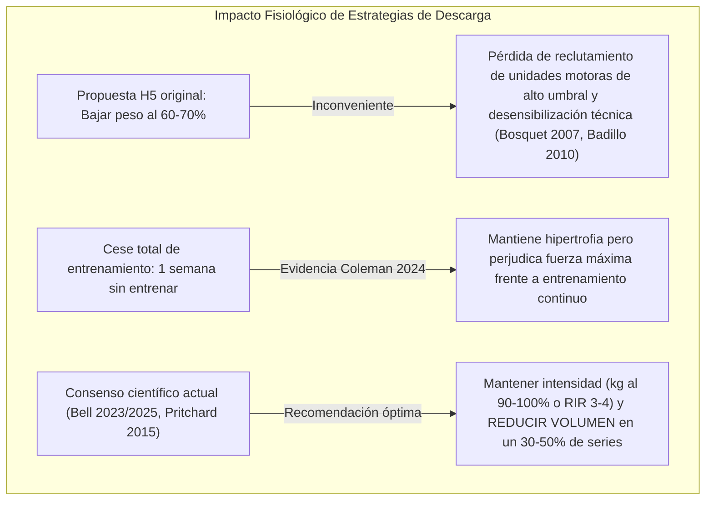

# Investigación sobre detección de estancamiento y recomendación de descarga (deload)

> **Documento de fundamentación científica y técnica**  
> **Fecha de investigación y redacción:** 4 de noviembre de 2026  
> **Épica relacionada:** Parte de [#31](https://github.com/adriarroyo08/WorkStation/issues/31) (Revisión exhaustiva frente a Hevy)  
> **Issue resuelta:** [#86](https://github.com/adriarroyo08/WorkStation/issues/86) (Investigar evidencia y límites para detectar estancamiento y recomendar descarga)  
> **Precedentes en el repositorio:** Propuesta H5 de `docs/revision-hevy.md` (PR [#67](https://github.com/adriarroyo08/WorkStation/pull/67) / Issue [#38](https://github.com/adriarroyo08/WorkStation/issues/38))  
> **Objetivo:** Fundamentar científicamente la propuesta H5 antes de codificar heurísticas; contrastar la literatura empírica sobre estancamiento (*plateau*), escala de esfuerzo (RPE/RIR) y estrategias de descarga (*deload*); auditar el modelo de datos de Workstation en `shared/`; y definir una especificación técnica verificable separando los datos observables de cualquier afirmación fisiológica no comprobable.

---

## 1. Preguntas de investigación y metodología

### 1.1. Preguntas de investigación

Para fundamentar de forma rigurosa la detección de estancamiento y la prescripción de descargas en Workstation, esta investigación responde a cuatro preguntas estructuradas:

1. **P1 (Umbral de estancamiento):** ¿Existe un criterio biológico o estadístico validado en la literatura científica que defina un número fijo de "sesiones consecutivas sin progreso" como estancamiento o meseta (*plateau*) en el entrenamiento de fuerza?
2. **P2 (Rol y precisión del RPE/RIR):** ¿Cómo contribuyen las escalas subjetivas de esfuerzo percibido (RPE de Borg / RIR de Zourdos y Helms) a distinguir la falta de progreso por fatiga acumulada frente a la falta de sobrecarga voluntaria, y cuáles son sus márgenes de error sistemático?
3. **P3 (Estrategias de descarga eficaces):** ¿Qué manipulaciones de variables (reducción de volumen de series, reducción de intensidad de carga o cese temporal absoluto) maximizan la disipación de fatiga preservando la masa muscular y las adaptaciones neurales de fuerza?
4. **P4 (Límites epistemológicos en software de registro):** ¿Qué puede afirmar legítimamente una aplicación móvil a partir exclusivamente de marcas de tiempo, series, repeticiones, kilos y notas, sin incurrir en diagnósticos fisiológicos infundados de fatiga central o sobreentrenamiento?

### 1.2. Metodología de búsqueda y selección

- **Bases de datos bibliográficas:** PubMed / MEDLINE, Web of Science, Scopus, Google Scholar y registros de preprints científicos (OSF, SportRxiv).
- **Estrategias de búsqueda booleanas:**
  - `("deload" OR "deloading" OR "taper" OR "tapering") AND ("resistance training" OR "strength training") AND ("fatigue" OR "adaptation" OR "hypertrophy")`
  - `("plateau" OR "stagnation") AND ("resistance training" OR "muscle growth")`
  - `("rating of perceived exertion" OR "repetitions in reserve" OR "RPE" OR "RIR") AND ("autoregulation" OR "fatigue monitoring") AND "resistance training"`
  - `("overtraining" OR "overreaching" OR "unexplained underperformance") AND ("resistance training" OR "strength")`
- **Criterios de inclusión:**
  - Ensayos clínicos controlados y aleatorizados (ECA) con mediciones directas de rendimiento o morfología muscular.
  - Revisiones sistemáticas y metaanálisis indexados en publicaciones con revisión por pares.
  - Consensos internacionales formales de sociedades científicas (ACSM, ECSS) o paneles Delphi internacionales de entrenadores e investigadores.
- **Criterios de exclusión:** Artículos de divulgación sin metodología reproducible, testimonios comerciales de software de entrenamiento y publicaciones en revistas sin revisión por pares.
- **Fecha de consulta y comprobación activa:** 4 de noviembre de 2026. Todas las fuentes listadas han sido comprobadas con DOI resuelto o enlace primario directo.

---

## 2. Catálogo de fuentes científicas verificadas

La siguiente tabla recoge las fuentes primarias y revisiones sistemáticas que fundamentan las conclusiones de este informe:

| Identificador | Autores | Año | Título | Revista / Publicación | DOI / URL primaria | Fecha de consulta |
| :--- | :--- | :---: | :--- | :--- | :--- | :---: |
| **Bell-2023** | Bell, L., Strafford, B. W., Coleman, M., et al. | 2023 | *Integrating Deloading into Strength and Physique Sports Training Programmes: An International Delphi Consensus Approach* | *Sports Medicine - Open*, 9(1): 87 | [10.1186/s40798-023-00633-0](https://doi.org/10.1186/s40798-023-00633-0) | 2026-11-04 |
| **Bell-2025** | Bell, L., Strafford, B. W., Snarr, R. L., et al. | 2025 | *A Practical Approach to Deloading: Recommendations and Considerations for Strength and Physique Sports* | *Strength & Conditioning Journal*, 47(2) | [10.1519/SSC.0000000000000910](https://doi.org/10.1519/SSC.0000000000000910) | 2026-11-04 |
| **Coleman-2024** | Coleman, M., Burke, R., Piñero, A., Maldonado, J., Fisher, J. P., Peñailillo, L., Swinton, P. A., & Schoenfeld, B. J. | 2024 | *Gaining more from doing less? The effects of a one-week deload period during supervised resistance training on muscular adaptations* | *PeerJ*, 12: e16777 | [10.7717/peerj.16777](https://doi.org/10.7717/peerj.16777) ([PMID 38234383](https://pubmed.ncbi.nlm.nih.gov/38234383/)) | 2026-11-04 |
| **Kataoka-2024** | Kataoka, R., Vasenina, E., Loenneke, J. P., & Buckner, S. L. | 2024 | *The Plateau in Muscle Growth with Resistance Training: An Exploration of Possible Mechanisms* | *Sports Medicine*, 54(1): 31–48 | [10.1007/s40279-023-01932-y](https://doi.org/10.1007/s40279-023-01932-y) | 2026-11-04 |
| **Bosquet-2007** | Bosquet, L., Montpetit, J., Arvisais, D., & Mujika, I. | 2007 | *Effects of Tapering on Performance: A Meta-Analysis* | *Medicine & Science in Sports & Exercise*, 39(8): 1358–1365 | [10.1249/mss.0b013e31806010e0](https://doi.org/10.1249/mss.0b013e31806010e0) | 2026-11-04 |
| **Pritchard-2015** | Pritchard, H. J., Tod, D. A., Barnes, M. J., Keogh, J. W. L., & McGuigan, M. R. | 2015 | *Effects and Mechanisms of Tapering in Maximizing Muscular Strength* | *Strength & Conditioning Journal*, 37(2): 72–83 | [10.1519/SSC.0000000000000125](https://doi.org/10.1519/SSC.0000000000000125) | 2026-11-04 |
| **Pritchard-2016** | Pritchard, H. J., Keogh, J. W. L., Barnes, M. J., & McGuigan, M. R. | 2016 | *Tapering Practices of New Zealand's Elite Raw Powerlifters* | *Journal of Strength and Conditioning Research*, 30(7): 1796–1804 | [10.1519/JSC.0000000000001292](https://doi.org/10.1519/JSC.0000000000001292) | 2026-11-04 |
| **Meeusen-2013** | Meeusen, R., Duclos, M., Foster, C., Fry, A., Gleeson, M., Nieman, D., Raglin, J., Rietjens, G., Steinacker, J., & Urhausen, A. | 2013 | *Prevention, diagnosis, and treatment of the overtraining syndrome: Joint consensus statement of the European College of Sport Science and the American College of Sports Medicine* | *Medicine & Science in Sports & Exercise*, 45(1): 186–205 | [10.1249/MSS.0b013e318279a10a](https://doi.org/10.1249/MSS.0b013e318279a10a) | 2026-11-04 |
| **Zourdos-2016** | Zourdos, M. C., Klemp, A., Dolan, C., Quiles, J. M., Schau, K. A., Jo, E., Helms, E., Esgro, B., Duncan, S., Garcia Merino, S., & Blanco, R. | 2016 | *Novel Resistance Training-Specific Rating of Perceived Exertion Scale Measuring Repetitions in Reserve* | *Journal of Strength and Conditioning Research*, 30(1): 267–275 | [10.1519/JSC.0000000000001049](https://doi.org/10.1519/JSC.0000000000001049) | 2026-11-04 |
| **Helms-2016** | Helms, E. R., Cronin, J., Storey, A., & Zourdos, M. C. | 2016 | *Application of the Repetitions in Reserve-Based Rating of Perceived Exertion Scale for Resistance Training* | *Strength & Conditioning Journal*, 38(4): 42–49 | [10.1519/SSC.0000000000000218](https://doi.org/10.1519/SSC.0000000000000218) | 2026-11-04 |
| **Halperin-2022** | Halperin, I., Malleron, T., Har-Nir, I., Androulakis-Korakakis, P., Wolf, M., Fisher, J., & Steele, J. | 2022 | *Accuracy in Predicting Repetitions to Task Failure in Resistance Exercise: A Scoping Review and Exploratory Meta-analysis* | *Sports Medicine*, 52(2): 377–390 | [10.1007/s40279-021-01559-x](https://doi.org/10.1007/s40279-021-01559-x) | 2026-11-04 |
| **Laurent-2011** | Laurent, C. M., Green, J. M., Bishop, P. A., Sjökvist, J., Schumacker, R. E., Richardson, M. T., & Curtner-Smith, M. | 2011 | *A practical approach to monitoring recovery: development of a perceived recovery status scale* | *Journal of Strength and Conditioning Research*, 25(3): 620–628 | [10.1519/JSC.0b013e3181c69ec6](https://doi.org/10.1519/JSC.0b013e3181c69ec6) | 2026-11-04 |
| **Foster-1998** | Foster, C. | 1998 | *Monitoring training in athletes with reference to overtraining syndrome* | *Medicine & Science in Sports & Exercise*, 30(7): 1164–1168 | [10.1097/00005768-199807000-00023](https://doi.org/10.1097/00005768-199807000-00023) | 2026-11-04 |
| **Badillo-2010** | González-Badillo, J. J., & Sánchez-Medina, L. | 2010 | *Movement velocity as a measure of loading intensity in resistance training* | *International Journal of Sports Medicine*, 31(5): 347–352 | [10.1055/s-0030-1248333](https://doi.org/10.1055/s-0030-1248333) | 2026-11-04 |
| **Moran-2017** | Morán-Navarro, R., Pérez, C. E., Mora-Rodríguez, R., de la Cruz-Sánchez, E., González-Badillo, J. J., Sánchez-Medina, L., & Pallarés, J. G. | 2017 | *Time course of recovery following resistance training leading or not to failure* | *European Journal of Applied Physiology*, 117(12): 2387–2399 | [10.1007/s00421-017-3725-7](https://doi.org/10.1007/s00421-017-3725-7) | 2026-11-04 |

---

## 3. Contraste de la evidencia frente a dogmas de entrenamiento

### 3.1. Número de sesiones sin progreso: ausencia de umbral biológico universal

En la cultura del gimnasio y en rutinas lineales populares (Starting Strength, StrongLifts 5×5), se ha extendido la regla de que **"3 sesiones consecutivas fallando con el mismo peso definen un estancamiento y obligan a resetear o descargar un 10% de la carga"**.

Sin embargo, el contraste con la literatura científica revela:

1. **Inexistencia de un umbral biológico validado:** No existe ningún estudio que demuestre que 3 sesiones (ni 2, ni 4) constituyan un punto de inflexión fisiológico donde la supercompensación cesa o se acumula fatiga patológica. Es una **heurística arbitraria de progresión lineal** útil para novatos en fases tempranas, pero carece de fundamentación empírica como regla científica universal (*Kataoka et al., 2024*).
2. **No linealidad de la adaptación en intermedios y avanzados:** A medida que el practicante gana experiencia, el ritmo de ganancia de fuerza e hipertrofia se ralentiza exponencialmente. En levantadores intermedios o avanzados, permanecer 3 o 4 semanas con la misma carga efectiva sin incrementar repeticiones es un comportamiento estadístico y fisiológico completamente normal dentro de un mesociclo (*Kataoka et al., 2024*). Calificar esto automáticamente como "estancamiento patológico" provocaría prescripciones prematuras de descargas, interrumpiendo el estímulo adaptativo.
3. **Múltiples dimensiones del progreso no observables en la carga externa:** Un atleta puede no haber incrementado repeticiones ni kilos, pero haber progresado de forma sustancial en:
   - **Velocidad media propulsiva (MPV):** Mayor velocidad a la misma carga absoluta indica incremento directo de fuerza dinámica (*Badillo-2010*).
   - **Percepción del esfuerzo (RPE):** Realizar 100 kg × 8 reps a RPE 9,5 en la sesión 1 y a RPE 8,0 en la sesión 3 representa una mejora adaptativa inequívoca, a pesar de que el producto $\text{kg} \times \text{reps}$ sea idéntico.
   - **Calidad y rango técnico de movimiento:** Mayor profundidad en sentadilla o menor rebote inercial.

> [!WARNING]
> **Conclusión para Workstation:** Ningún algoritmo de la app debe rotular "3 sesiones sin subir" como una verdad científica de fatiga ni como una necesidad médica de descarga. Debe tratarse estrictamente como una **heurística configurable de rendimiento observable en carga externa**.

### 3.2. Papel y limitaciones psicométricas del RPE y RIR

La integración de escalas de esfuerzo basadas en repeticiones en reserva (RPE/RIR, *Zourdos-2016*; *Helms-2016*) aporta un valor capital, pero introduce importantes sesgos metodológicos:

1. **Discriminación de causas de no progresión:**
   - Si un usuario realiza 80 kg × 8 reps durante 3 sesiones consecutivas a **RPE 7** (3 repeticiones en recámara), no existe estancamiento ni sobrecarga neuromuscular: el usuario simplemente está siguiendo una rutina submáxima fija o autorregulando de manera conservadora.
   - Si el usuario realiza 80 kg × 8 reps a **RPE 9,5** en la primera sesión, y en las dos siguientes cae a 7 reps a RPE 10 y 6 reps a RPE 10 con fallo concéntrico, se observa una degradación objetiva del rendimiento con esfuerzo máximo sostenido.
2. **Error de calibración subjetiva (*Halperin-2022*):**
   - El metaanálisis de Halperin et al. demuestra que los practicantes de fuerza cometen un error medio sistemático de **1 a 2 repeticiones en la estimación del RIR**, tendiendo a subestimar su capacidad real (declaran RIR 1 o 2 cuando en realidad les quedaban 3 o 4 repeticiones antes del fallo).
   - La precisión mejora notablemente a intensidades altas ($\ge 80\%$ 1RM) y cuando el esfuerzo se aproxima al fallo ($\text{RPE} \ge 8,5$), pero se degrada severamente en series de altas repeticiones ($>12$) y en practicantes con menos de 1 año de experiencia.
3. **Contaminación por factores ajenos al entrenamiento:**
   - La percepción de esfuerzo es sensible a la restricción aguda de sueño, el estrés laboral o psicosocial, la deshidratación y la administración de cafeína. Un RPE elevado en una sesión aislada no refleja necesariamente daño muscular estructural ni depleción sostenida de glucógeno.

### 3.3. Reducción de carga vs reducción de series: refutación de la propuesta original H5

La propuesta inicial H5 en `docs/revision-hevy.md` sugería como prescripción de descarga:
> *"reducir la carga habitual al 60-70% o reducir el número de series al 50%"*

El contraste con la literatura sobre *deloading* y *tapering* revela que **esta sugerencia contiene un error fisiológico sustancial**:



1. **Mantener la intensidad de carga es prioritario (*Bosquet-2007*, *Pritchard-2015*):**
   - En el metaanálisis de Bosquet et al. sobre *tapering* en deportes de fuerza y resistencia, se constató que **reducir la intensidad de la carga produce descensos del rendimiento**. La adaptación neural y la coordinación intermuscular dependen de la preservación de tensiones mecánicas elevadas.
   - Bajar la carga al 60-70% (por ejemplo, pasar de 100 kg a 60 kg) transforma un ejercicio de alta tensión mecánica en un estímulo puramente regenerativo de bajo umbral motor, que a menudo deja al atleta con sensación de "descoordinación" al retomar la carga habitual.
2. **La variable primaria a reducir es el volumen (número de series efectivas):**
   - El panel Delphi internacional de expertos (*Bell-2023*) y las guías prácticas (*Bell-2025*) establecen un consenso abrumador: la descarga óptima consiste en **reducir el volumen entre un 30% y un 50% de las series de trabajo habituales** (por ejemplo, de 4 series a 2 series por ejercicio), manteniendo la carga estable (o reduciéndola como mucho un 5-10% si hay dolor articular) y alejándose del fallo concéntrico ($\text{RIR } 3\text{ a }4$, en torno a $\text{RPE } 6\text{–}7$).
3. **El cese total de entrenamiento es contraproducente para la fuerza (*Coleman-2024*):**
   - Coleman et al. (2024) evaluaron en un ensayo controlado aleatorizado si una semana de descanso absoluto a mitad de un programa de 9 semanas aportaba beneficios adicionales.
   - **Resultado:** No hubo diferencias en hipertrofia muscular (la masa muscular se mantuvo idéntica), pero **el grupo que continuó entrenando sin parar obtuvo mayores ganancias de fuerza en miembros inferiores** que el grupo que paró una semana entera.
   - Por tanto, la descarga recomendada en Workstation debe ser siempre **activa** (mantener el patrón de movimiento con menos series) y no prescribir inactividad completa salvo por prescripción médica.

### 3.4. Separación entre métricas observables y fatiga fisiológica

El consenso internacional de la ACSM y la ECSS sobre el síndrome de sobreentrenamiento (*Meeusen-2013*) establece una taxonomía rigurosa:

- **Fatiga aguda:** Disminución temporal del rendimiento limitada a una sesión o 24–48 horas posteriores (*Moran-2017*).
- **Sobrealcance funcional (*Functional Overreaching*, FOR):** Caída transitoria del rendimiento que, tras un periodo de descarga o descanso de días a un par de semanas, resulta en supercompensación.
- **Sobrealcance no funcional (*Non-Functional Overreaching*, NFOR):** Caída del rendimiento que persiste durante semanas o meses, acompañada de alteraciones psicológicas y bioquímicas.
- **Síndrome de Sobreentrenamiento (*Overtraining Syndrome*, OTS):** Trastorno multisistémico crónico severo con desregulación neuroendocrina, inmunológica y anímica que tarda meses o años en revertir.

> [!CAUTION]
> **Límite epistemológico:** Ninguna aplicación informática que opere exclusivamente con variables mecánicas (pesos y repeticiones) puede diagnosticar FOR, NFOR ni OTS. Declarar que un usuario padece "fatiga del sistema nervioso central" o "sobreentrenamiento" sin hemogramas, monitorización hormonal ni evaluación psiquiátrica es una pseudociencia irresponsable.
> 
> La aplicación debe limitar su lenguaje a **"Rendimiento estabilizado"** o **"Meseta de repeticiones registradas"**, ofreciendo estrategias de gestión de volumen sin atribuir causas fisiológicas indemostrables.

---

## 4. Auditoría del modelo de datos de Workstation (`shared/`)

Para determinar qué señales puede procesar Workstation y cuáles faltan, se ha analizado exhaustivamente el código del núcleo común en `shared/`:

### 4.1. `shared/stats.ts`: datos disponibles y carencias analíticas

```typescript
// Estructura actual de una sesión agregada por ejercicio en stats.ts
export interface ExerciseSession {
  workoutId: string;
  date: string;
  sets: WorkoutSet[];
  bestWeight: number;
  best1RM: number;
  bestSetVolume: number;
  volume: number;
  maxReps: number;
  totalReps: number;
  maxDuration: number;
  maxDistance: number;
}
```

- **Capacidades presentes:**
  - `exerciseHistory(data, exerciseId)` genera una serie cronológica ordenada por fecha con cada sesión en la que se realizó el ejercicio.
  - Se filtran de forma consistente las series efectivas mediante `countsAsWorkSet(s)` (`s.done && s.type !== 'warmup'`).
  - Se calcula el 1RM estimado por fórmula de Epley (`estimate1RM`), permitiendo comparar series de distintas combinaciones de peso y repeticiones dentro del rango de 1 a 10 reps.
  - Se dispone del array crudo de series `sets: WorkoutSet[]`, lo que permite inspeccionar valores de `rpe`, `weight`, `reps` y `type` (`normal`, `warmup`, `drop`, `failure`).
- **Carencias analíticas en `stats.ts`:**
  - No existe ninguna función que calcule **tendencias o pendientes de cambio** entre sesiones consecutivas de un ejercicio (primeras derivadas de volumen o 1RM).
  - No se computa la media ni la evolución temporal del RPE de las series efectivas.
  - La función `estimate1RM` utiliza la ecuación de Epley lineal ($w \times (1 + r/30)$), cuya fiabilidad decae fuertemente por encima de las 10 repeticiones.

### 4.2. `shared/progression.ts`: miopía histórica y ausencia de descarga

- **Capacidades presentes:**
  - `suggestNext(prev: WorkoutSet[], ex?: Exercise, targetReps?: number)` propone el peso de la siguiente sesión evaluando el peso máximo de trabajo (`top`) y el cumplimiento de las repeticiones objetivo.
  - Incluye un filtro incipiente de esfuerzo: si el promedio de RPE en las series al peso máximo supera 8,5 (`hard`), evita subir el peso y propone sumar una repetición (`action: 'reps'`).
- **Deficiencias críticas detectadas:**
  - **Miopía estricta de una sola sesión:** La función recibe únicamente el array `prev` de la última sesión realizada. Carece por completo de memoria histórica de las últimas 2, 3 o 4 sesiones.
  - **Bucle infinito de repetición:** Si el usuario no alcanza las repeticiones objetivo, `suggestNext` devuelve sistemáticamente `{ action: 'repeat', reason: 'Te faltaron reps...' }`. Si el usuario falla 5 sesiones seguidas, la función sigue respondiendo `repeat` indefinidamente sin alertar de estancamiento ni ofrecer alternativas.
  - **Tratamiento del RPE ausente:** Si el usuario no introduce RPE (caso muy común), `rpes.length === 0`, por lo que `hard` evalúa a `false`. Esto puede inducir a una sugerencia errónea de subir peso (`action: 'up'`) si el usuario completó las repeticiones al fallo absoluto (RIR 0 implícito).

### 4.3. `shared/planning.ts`: desconexión entre recuperación temporal y rendimiento

- **Capacidades presentes:**
  - `muscleRecovery(data, now)` calcula un índice de recuperación teórica por grupo muscular basándose en el tiempo transcurrido desde el último entrenamiento ($36\text{ h} + 4\text{ h}$ por serie por encima de 4, con tope de 72 horas).
  - `compareWithPrevious(data, workoutId)` compara volumen total, series y duración entre sesiones completas de una misma rutina.
- **Deficiencias críticas detectadas:**
  - **Modelo cinético no adaptativo:** `muscleRecovery` asume que transcurridas 72 horas cualquier músculo está al 100% de recuperación, con independencia de que el rendimiento real del atleta en ese músculo esté en caída libre o estancado durante un mes.
  - No existe ningún cruce de datos entre la fatiga modelada en `planning.ts` y las series históricas de `stats.ts`.

### 4.4. Sesgos, ruido y distorsiones del modelo en condiciones reales

Cualquier algoritmo que pretenda detectar estancamiento en Workstation debe anticipar y neutralizar cinco sesgos estructurales:

| Sesgo / Factor de distorsión | Mecanismo del sesgo en Workstation | Impacto en la detección | Mitigación requerida |
| :--- | :--- | :--- | :--- |
| **Sustitución de variante de ejercicio** | Cambiar de press de banca con barra a press inclinado con mancuernas, o de sentadilla libre a prensa. | La carga y el patrón cambian de `exerciseId`; no es estancamiento, es un estímulo distinto. | La evaluación debe aislarse estrictamente por `exerciseId`, sin mezclar históricos entre ejercicios. |
| **Alteración del orden de ejercicios** | Realizar sentadilla como cuarto ejercicio de una rutina de pierna tras extensiones y prensa, habiendo sido el primer ejercicio la sesión anterior. | Caída acusada de repeticiones por fatiga intra-sesión previa, no por estancamiento crónico. | Advertir al usuario de que el orden de los ejercicios en la sesión influye de manera decisiva en el rendimiento registrado. |
| **Sesiones truncadas o incompletas** | El usuario dispone de 20 minutos por motivos laborales y solo realiza 1 de las 4 series habituales. | Caída artificial del volumen total y posible menor entrega de repeticiones. | Ignorar sesiones que no alcancen un número mínimo de series efectivas completadas ($\ge 2$ series con `done: true`). |
| **Omisión del registro de RPE** | La mayoría de los usuarios no introduce el campo opcional `rpe` en `WorkoutSet`. | Algoritmos que requieran RPE obligatorio quedan inoperativos para la mayoría de los usuarios. | Diseñar un criterio dual: análisis cinemático primario (peso × reps) y ponderación de certidumbre secundaria si existe RPE registrado. |
| **Saltos forzados de material (*plate jumps*)** | En mancuernas, el salto mínimo suele ser de 2 kg por mancuerna (4 kg en total); en barras, 2,5 kg (discos de 1,25 kg por lado). | En ejercicios accesorios pequeños (elevaciones laterales), pasar de 10 a 12 kg supone un incremento del 20%, lo que estanca las repeticiones durante semanas. | Permitir tolerancia de repeticiones antes de declarar meseta cuando el incremento relativo de la carga supera el 5%. |

---

## 5. Criterios observables, ejemplos y especificación verificable para H5

A continuación se desarrolla la especificación formal del módulo de estancamiento y descarga, cumpliendo con la exigencia de **no implementar código definitivo en esta issue, pero dejar el contrato técnico completo, cerrado y listo para implementación por `agent:codex`**.

### 5.1. Definición formal de criterios observables

Se define el estado de rendimiento de un ejercicio a partir de la comparación de sus últimas $N$ sesiones efectivas:

1. **Elegibilidad de la serie histórica:**
   - Se toman las sesiones de `exerciseHistory(data, exerciseId)`.
   - Deben existir **al menos 3 sesiones consecutivas válidas** ($S_1, S_2, S_3$) en los últimos 45 días naturales.
   - Si el intervalo entre dos sesiones consecutivas es superior a 21 días, la serie se reinicia (se considera desentrenamiento o readaptación, no estancamiento de sobrecarga).
   - Cada sesión debe contener al menos 2 series efectivas (`countsAsWorkSet`).
2. **Evaluación de la métrica de rendimiento ($P$):**
   - Para cada sesión $S_k$, se toma la mejor serie efectiva al peso máximo de trabajo ($W_{\max}$):
     $$P_k = \text{loadKg}(s) \times \left(1 + \frac{\text{reps}(s)}{30}\right)$$
   - Se considera **meseta de rendimiento** si:
     $$\max(P_1, P_2, P_3) - \min(P_1, P_2, P_3) \le 0{,}02 \times \max(P_1, P_2, P_3)$$
     (es decir, variación inferior al 2% durante 3 sesiones consecutivas con el mismo peso techo).
3. **Ponderación del esfuerzo (RPE):**
   - **Estancamiento confirmado con fatiga alta:** Si en las 3 sesiones el RPE promedio de las series al peso máximo es $\ge 9{,}0$ (o se han registrado fallos concéntricos `failure` / $\text{RPE } 10$).
   - **Meseta técnica o submáxima:** Si la variación es $\le 2\%$, pero el RPE medio es $\le 8{,}0$ (o no está registrado). Se informa como meseta observable sin prescribir descarga obligatoria.

### 5.2. Tabla de casos reales de historial

A continuación se ilustra el comportamiento esperado del evaluador ante cuatro escenarios representativos modelados con las interfaces de Workstation:

| Escenario | Sesión 1 ($S_1$) | Sesión 2 ($S_2$) | Sesión 3 ($S_3$) | Diagnóstico observable | Acción recomendada |
| :--- | :--- | :--- | :--- | :--- | :--- |
| **Caso A: Estancamiento con esfuerzo máximo** | Press militar: 3× 50 kg × 5 reps @ RPE 9,5 | Press militar: 3× 50 kg × 5 reps @ RPE 10 | Press militar: 1× 50 kg × 5 reps, 2× 50 kg × 4 reps @ RPE 10 | **Estancamiento severo con alta fatiga subjetiva.** El rendimiento decrece con esfuerzo máximo repetido. | Recomendar sesión o semana de descarga activa: mantener 50 kg reduciendo de 3 a 1-2 series efectivas con RPE 6–7. |
| **Caso B: Meseta voluntaria / submáxima** | Sentadilla: 3× 100 kg × 8 reps @ RPE 7 | Sentadilla: 3× 100 kg × 8 reps @ RPE 7 | Sentadilla: 3× 100 kg × 8 reps @ RPE 7,5 | **Meseta de carga sin fatiga limitante.** El usuario tiene al menos 2-3 reps en recámara. | No recomendar descarga. Sugerir incremento de carga (+2,5 kg) o buscar repeticiones adicionales hacia el techo del rango. |
| **Caso C: Laguna temporal prolongada** | Peso muerto: 3× 140 kg × 5 reps (hace 35 días) | Peso muerto: 3× 130 kg × 5 reps (hace 7 días) | Peso muerto: 3× 130 kg × 5 reps (hoy) | **Reinicio por desentrenamiento transitorio.** No hay sobrecarga acumulada continua. | Ignorar $S_1$. Evaluar solo $S_2$ y $S_3$ como readaptación progresiva normal; no sugerir descarga. |
| **Caso D: Registro incompleto / sin RPE** | Fondos: 3× +15 kg × 8 reps (sin RPE) | Fondos: 3× +15 kg × 8 reps (sin RPE) | Fondos: 3× +15 kg × 8 reps (sin RPE) | **Meseta de repeticiones registradas (certidumbre moderada).** No se puede evaluar el esfuerzo interno. | Aviso informativo prudente: "Llevas 3 sesiones con el mismo resultado. Si sientes fatiga, considera una descarga; si te sentiste cómodo, intenta sumar una repetición." |

### 5.3. Pautas de comunicación y textos prudentes para el usuario

Para garantizar la honestidad científica y respetar la autonomía del usuario, la interfaz debe regirse por reglas de comunicación no dogmáticas:

| Lo que NUNCA debe decir Workstation | Lo que SÍ debe comunicar Workstation | Justificación científica |
| :--- | :--- | :--- |
| *"Estás sobreentrenado"* | *"Llevas 3 sesiones consecutivas completando el mismo peso y repeticiones en este ejercicio."* | El sobreentrenamiento es un diagnóstico médico complejo (*Meeusen-2013*). La app solo observa números en una pantalla. |
| *"Tu sistema nervioso central está agotado"* | *"Si notas fatiga acumulada o molestias en las articulaciones, una descarga de series puede ayudarte a asimilar el trabajo."* | La fatiga central no se mide con repeticiones (*Kataoka-2024*). |
| *"Debes bajar el peso un 30% obligatoriamente"* | *"Sugerencia opcional: reduce a la mitad las series efectivas en la próxima sesión manteniendo el peso para disipar fatiga."* | Reducir en exceso la carga perjudica la fuerza (*Bosquet-2007*, *Bell-2023*). La descarga debe ser decisión del usuario. |
| *"Has llegado a tu límite genético en banca"* | *"El progreso en levantadores con experiencia no es lineal sesión a sesión. Variar el rango de repeticiones puede renovar el estímulo."* | Las adaptaciones en fuerza son asintóticas y no lineales (*Kataoka-2024*). |

### 5.4. Decisiones abiertas para la implementación

Antes de que `agent:codex` implemente la lógica y la interfaz de H5, se dejan formalizadas las siguientes alternativas de diseño:

1. **Alcance de la descarga: ¿Por ejercicio (*micro-deload*) o por rutina completa (*mesocycle deload*)?**
   - *Alternativa 1 (Recomendada para H5 inicial):* **Descarga localizada por ejercicio.** Si el usuario se estanca en press militar pero sigue progresando en sentadilla y dominadas, solo se propone reducir el volumen en press militar. Es más flexible y compatible con rutinas torso/pierna o empuje/tracción.
   - *Alternativa 2:* **Descarga global de la rutina o semana de descarga.** Proponer una semana de descarga completa en toda la rutina. Se alinea mejor con programas periodizados en bloque, pero resulta frustrante para usuarios recreativos que solo se han atascado en un levantamiento accesorio.
2. **Interacción con el motor de Doble Progresión (H2 / PR [#89](https://github.com/adriarroyo08/WorkStation/pull/89)):**
   - En una rutina con rangos (ej. 8–12 reps), el estancamiento no ocurre al no subir de peso, sino al no poder superar un determinado número de repeticiones dentro del rango durante 3 sesiones consecutivas (ej. estancado en 10 reps con 80 kg). La función de detección debe ser compatible con la especificación de `repsMin` y `reps` definida en `docs/doble-progresion.md`.
3. **Canal de presentación de la recomendación:**
   - *Opción A (No intrusiva en PWA):* Un chip o badge informativo secundario dentro de la tarjeta del ejercicio en `WorkoutLogger.tsx`, visible únicamente al desplegar el ejercicio o junto a la sugerencia de sobrecarga.
   - *Opción B (Servidor MCP y Coach IA):* Exponer el estado en `shared/mcp-tools.ts` mediante la herramienta `today_plan` o una herramienta dedicada `check_stagnation`, de modo que el Coach IA pueda consultar si un ejercicio requiere descarga antes de proponer cambios en el plan del día.

---

## 6. Especificación técnica verificable (Contrato para H5)

Este contrato describe los tipos, firmas y pruebas que deberán implementarse en `shared/deload.ts` (o `shared/stats.ts`) y `shared/deload.test.ts` cuando se ejecute la issue de implementación de H5.

### 6.1. Definición de tipos TypeScript (`shared/deload.ts`)

```typescript
import type { Exercise, Workout, WorkoutSet, WorkstationData } from './types';

export type StagnationConfidence = 'alta' | 'moderada' | 'baja';

export type StagnationType =
  | 'ninguno'              // El ejercicio progresa normalmente
  | 'estancamiento_esfuerzo' // 3+ sesiones al mismo peso con RPE >= 9 o fallos
  | 'meseta_rendimiento'    // 3+ sesiones con variación < 2% sin RPE alto
  | 'historico_insuficiente'; // Menos de 3 sesiones o intervalo > 21 días

export interface StagnationReport {
  exerciseId: string;
  type: StagnationType;
  confidence: StagnationConfidence;
  consecutiveSessions: number;
  lastWeightKg: number;
  averageRpe?: number;
  recommendation?: DeloadRecommendation;
}

export interface DeloadRecommendation {
  strategy: 'volumen' | 'reseteo_ligero' | 'mantener';
  // Reducción aconsejada de series (típicamente 50% de las habituales)
  suggestedSetsFactor: number; // Ej: 0.5 (reducir a la mitad)
  // Factor de carga sobre el peso habitual (típicamente 0.95 - 1.0; nunca < 0.85)
  suggestedWeightFactor: number; // Ej: 1.0 (mantener peso) o 0.9 (bajada ligera)
  targetRir: number; // RIR objetivo recomendado (típicamente 3-4 reps en recámara)
  userMessage: string;
  rationale: string;
}
```

### 6.2. Firmas de funciones puras requeridas

```typescript
/**
 * Evalúa las últimas sesiones de un ejercicio en el historial para detectar mesetas
 * de rendimiento según los criterios observables de 3 sesiones en <= 45 días.
 */
export function evaluateStagnation(
  data: WorkstationData,
  exerciseId: string,
  now?: string, // ISO date para testing determinista
): StagnationReport;

/**
 * Genera la prescripción de descarga activa recomendada por la literatura científica
 * (reducción de series al 50%, manteniendo intensidad de carga con 3-4 RIR).
 */
export function createDeloadSuggestion(
  report: StagnationReport,
  exercise?: Exercise,
): DeloadRecommendation | null;
```

### 6.3. Criterios de verificación para tests unitarios futuros (`shared/deload.test.ts`)

Cuando se implemente H5, la suite de pruebas unitarias deberá verificar los siguientes casos concretos:

1. **Progresión activa normal:** 3 sesiones consecutivas aumentando 2,5 kg o sumando repeticiones devuelve `type: 'ninguno'`.
2. **Estancamiento con RPE $\ge 9$:** 3 sesiones con 50 kg × 5 reps a RPE 9,5 devuelve `type: 'estancamiento_esfuerzo'`, `confidence: 'alta'`, y una recomendación con `suggestedSetsFactor: 0.5` y `suggestedWeightFactor: 1.0`.
3. **Meseta submáxima con RPE 7:** 3 sesiones con 100 kg × 8 reps a RPE 7 devuelve `type: 'meseta_rendimiento'`, `confidence: 'moderada'`, sin forzar una reducción drástica de series.
4. **Reinicio por intervalo de inactividad:** Sesiones separadas por más de 21 días descartan la serie temporal previa y devuelven `type: 'historico_insuficiente'`.
5. **Sesiones truncadas o con calentamiento:** Sesiones con una sola serie efectiva o compuestas exclusivamente por calentamientos (`type: 'warmup'`) son excluidas del conteo de las 3 sesiones válidas.
6. **Preservación de carga en la descarga:** La recomendación de descarga nunca devuelve un `suggestedWeightFactor` menor a 0,85, garantizando que no se prescriban descargas al 60-70% desaconsejadas por la evidencia científica.
