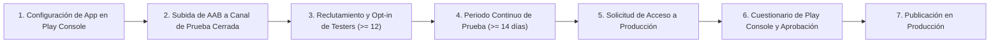
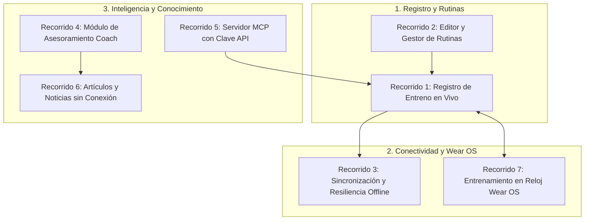
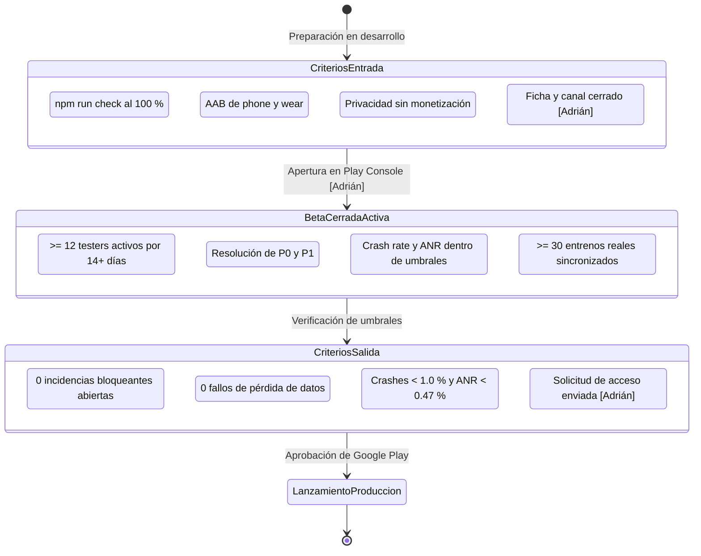

# Plan de pruebas de la beta cerrada de WorkStation (Android y Wear OS)

> **Documento normativo de aseguramiento de la calidad (QA) y operaciones de lanzamiento**  
> **Referencia:** Issue [#128](https://github.com/adriarroyo08/WorkStation/issues/128) (Parte de la épica [#125](https://github.com/adriarroyo08/WorkStation/issues/125): *Estabilidad y preparación de la beta*).  
> **Hito del proyecto:** Febrero de 2027 (Apertura de beta cerrada en Google Play y Wear OS), conforme a [ROADMAP.md](../ROADMAP.md).  
> **Estado:** Borrador completo para preparación técnica y organizativa.  
> **Monetización:** Fase 100 % gratuita, sin pasarelas de pago ni cobros activados; todas las acciones dependientes del alta de actividad o trámites personales se identifican mediante **[Adrián]**.

---

## 1. Objetivo de la Beta Cerrada

El propósito de la beta cerrada de **WorkStation** en Android y Wear OS es someter la aplicación a condiciones reales y exigentes de uso deportivo antes de su distribución pública general en Google Play. Frente a competidores consolidados como Hevy o Strong (analizados en [docs/revision-hevy.md](revision-hevy.md)), WorkStation propone una arquitectura centrada en la soberanía de los datos, el funcionamiento local estricto (*offline-first*), la extensión con asistentes de Inteligencia Artificial mediante el protocolo abierto MCP y la sincronización multidispositivo en tiempo real entre teléfono y reloj inteligente.

La beta cerrada persigue los siguientes objetivos específicos y medibles:

1. **Validación de la experiencia real en gimnasio**: Comprobar la usabilidad durante sesiones intensas de fuerza (facilidad de interacción con una sola mano, manipulación con sudor o tiza, legibilidad bajo iluminación variable y rapidez para registrar series y descansos).
2. **Robustez y consistencia *offline-first***: Garantizar que un entrenamiento completado sin conexión a internet o con cobertura deficiente se registre, persista de manera inmutable en el almacenamiento local del dispositivo y se sincronice con el backend Supabase al recuperar la conexión sin duplicidades ni pérdida de datos.
3. **Estabilidad y fiabilidad del ecosistema Android y Wear OS**: Evaluar el canal de comunicación bidireccional en tiempo real entre teléfono y reloj mediante el *Wear OS Data Layer*, comprobando tanto el registro simultáneo de series como el funcionamiento autónomo desacoplado del reloj cuando el usuario se aleja del teléfono.
4. **Validación funcional de los pilares del producto**:
   - Registro de entrenamiento con cálculo de volumen, 1RM estimado y soporte de series efectivas con peso corporal histórico ([shared/units.ts](../shared/units.ts)).
   - Motor de doble progresión con rangos de repeticiones y selector de esfuerzo RIR/RPE.
   - Importación fiable de historiales externos (ficheros CSV de Strong, mediante [shared/strong.ts](../shared/strong.ts)).
   - Biblioteca de artículos de divulgación científica offline y lector de noticias de investigación ([shared/articles.ts](../shared/articles.ts), [shared/news.ts](../shared/news.ts)).
   - Conexión del asistente de entrenamiento a través del servidor MCP con clave de API ([docs/auditoria-mcp-entrenador.md](auditoria-mcp-entrenador.md), [docs/mcp-limites.md](mcp-limites.md)).
5. **Monitorización de métricas de rendimiento y salud técnica**: Cumplir los umbrales de Google Play Android Vitals (tasas de cierres inesperados, ANR y consumo de batería).
6. **Cumplimiento de los requisitos regulatorios de Google Play**: Completar la prueba cerrada obligatoria para cuentas personales de desarrollador creada por Google, recabando la evidencia y métricas necesarias para superar el cuestionario de acceso al canal de Producción.

---

## 2. Requisitos Oficiales de Google Play para la Prueba Cerrada

Google exige a todos los desarrolladores con **cuentas personales creadas a partir del 13 de noviembre de 2023** superar una fase obligatoria de prueba cerrada antes de poder solicitar la publicación de cualquier aplicación en el canal de Producción abierto.



### 2.1. Criterios Mandatarios de Google Play (Regla 12 x 14)

1. **Canal de prueba cerrada obligatorio**: La prueba debe ejecutarse específicamente en una pista de **Prueba cerrada** (*Closed testing track*). Las pruebas internas (*Internal testing*) y las pruebas abiertas (*Open testing*) no computan para desbloquear el acceso a producción en cuentas personales.
2. **Umbral mínimo de probadores**: Se requiere un mínimo de **12 probadores** únicos dados de alta y con participación activa en la prueba.
   > [!NOTE]
   > En el lanzamiento original de la política en noviembre de 2023 se exigían 20 probadores. La documentación oficial vigente de Google Play Console establece el requisito mínimo en 12 probadores. Por seguridad operativa y para evitar que bajas accidentales interrumpan el cómputo, este plan fija un objetivo de reclutamiento de 20 a 25 probadores.
3. **Duración mínima continua**: Los probadores deben permanecer suscritos a la prueba cerrada durante al menos **14 días consecutivos**. Si el número de probadores activos cae por debajo de 12 durante la ventana de tiempo, el periodo continuo se interrumpe y debe restablecerse.
4. **Instalación y aceptación formal**: Los participantes deben aceptar la invitación a través del enlace de aceptación web (`https://play.google.com/apps/testing/com.workstation.app`) o mediante la app de Google Play en su terminal, e instalar el paquete distribuido por Google Play. La instalación manual por APK (*sideloading*) no es registrada por Google Play Console ni cuenta para el cumplimiento del requisito.
5. **Interacción y retroalimentación real**: Google evalúa la actividad real de los probadores (aperturas de la aplicación, interacción con las funciones y comentarios recibidos). El acceso a producción puede ser rechazado si no se demuestra uso efectivo durante los 14 días.
6. **Cuestionario de solicitud de acceso a producción**: Tras completar los 14 días con 12 probadores continuos, se habilita el botón **Solicitar acceso a producción** en el panel de control de Play Console. Adrián deberá responder a un formulario estructurado en tres apartados:
   - *Información sobre la prueba cerrada*: metodología de reclutamiento, características del grupo y niveles de interacción alcanzados.
   - *Información sobre la aplicación*: propósito de WorkStation, público objetivo y propuesta de valor frente al mercado.
   - *Preparación para la fase de producción*: resumen de los comentarios y problemas reportados por los testers, lista de correcciones y mejoras aplicadas durante la beta, y justificación de por qué la app está lista para el público general.
7. **Verificación del desarrollador**: **[Adrián]** debe completar la verificación de identidad personal exigida por Google Play y la vinculación de un dispositivo físico Android de verificación a través de la app Play Console para desarrolladores.
8. **Factor de forma Wear OS**: El soporte para reloj inteligente debe declararse en Play Console mediante *Configuración > Configuración avanzada > Factores de forma > Wear OS*, asociando el artefacto compilado para reloj al canal de prueba cerrada específico.

### 2.2. Fuentes Oficiales de Google Play

| Documento oficial de Google | URL de referencia | Fecha de consulta |
| :--- | :--- | :--- |
| **Requisitos de pruebas de aplicaciones para las nuevas cuentas personales de desarrollador** (*App testing requirements for new personal developer accounts*) | `https://support.google.com/googleplay/android-developer/answer/14151465?hl=es` | 8 de noviembre de 2026 |
| **Configurar una prueba abierta, cerrada o interna** (*Set up an open, closed, or internal test*) | `https://support.google.com/googleplay/android-developer/answer/9845334?hl=es` | 8 de noviembre de 2026 |
| **Gestionar versiones para diferentes factores de forma en canales específicos** (*Manage releases for different form factors on specific tracks*) | `https://support.google.com/googleplay/android-developer/answer/13295490?hl=es` | 8 de noviembre de 2026 |
| **Directrices de calidad de aplicaciones para Wear OS** (*Wear OS app quality guidelines*) | `https://developer.android.com/docs/quality-guidelines/wear-app-quality` | 8 de noviembre de 2026 |
| **Empaquetar y distribuir aplicaciones para Wear OS** (*Package and distribute Wear OS apps*) | `https://developer.android.com/training/wearables/packaging` | 8 de noviembre de 2026 |
| **Requisitos del nivel de API de destino para aplicaciones de Google Play** (*Target API level requirements for Google Play apps*) | `https://support.google.com/googleplay/android-developer/answer/11926878?hl=es` | 8 de noviembre de 2026 |

---

## 3. Perfil, Dimensionamiento y Selección de Probadores

### 3.1. Dimensionamiento del Grupo de Prueba

Para cumplir de forma segura el requisito regulatorio de 12 probadores continuos durante 14 días sin riesgo de interrupción por cancelaciones, bajas accidentales o periodos de inactividad, se establece una **cohorte objetivo de 20 a 25 probadores**.

```
+---------------------------------------------------------------------------------+
|  POBLACIÓN TOTAL DE LA BETA CERRADA: 20 - 25 PROBADORES                         |
+---------------------------------------------------------------------------------+
|                                                                                 |
|  [=== Colectivo Móvil Android: 20-25 probadores ===]                             |
|  - Uso continuado de registro en smartphone durante 14+ días consecutivos.     |
|                                                                                 |
|  [=== Subgrupo Wear OS: 6-8 probadores ===]                                     |
|  - Disponen de reloj Wear OS 3.0+ emparejado con su smartphone Android.         |
|                                                                                 |
|  [=== Subgrupo MCP e IA: 3-5 probadores ===]                                    |
|  - Disponen de cliente de IA de escritorio (Claude Desktop, Cursor, Gemini).    |
|                                                                                 |
|  [=== Margen de seguridad regulatorio ===]                                       |
|  - Mínimo de Google: 12 probadores continuos.                                   |
|  - Colchón de reserva frente a bajas: +8 a +13 probadores adicionales (66-108 %).|
+---------------------------------------------------------------------------------+
```

### 3.2. Criterios de Selección y Perfil de Usuario

Se seleccionarán probadores que cumplan las siguientes características:

1. **Frecuencia deportiva**: Personas que practiquen entrenamiento de fuerza de forma activa entre 3 y 6 días por semana en gimnasio comercial, centro deportivo o gimnasio doméstico (*home gym*).
2. **Diversidad de niveles y metodologías**:
   - *Iniciación*: Usuarios que necesitan claridad en la selección de ejercicios, instrucciones y seguimiento guiado de repeticiones y descansos.
   - *Intermedios*: Usuarios que siguen rutinas estructuradas (Torso/Pierna, Empuje/Tirón/Pierna, Fullbody) y aplican progresión de cargas semana a semana.
   - *Avanzados / Fuerza competitiva*: Usuarios que cuantifican el esfuerzo mediante RIR/RPE, calculan 1RM, planifican descargas y necesitan registrar ejercicios complejos con peso corporal y lastres.
3. **Usuarios con experiencia previa en aplicaciones de fuerza**:
   - Probadores que utilicen actualmente **Hevy** o **Strong**, con el fin de evaluar la curva de aprendizaje, comparar la ergonomía en sala y verificar la migración de datos mediante el importador CSV de Strong.
4. **Usuarios con reloj Wear OS**: Al menos 6 probadores con smartwatch que incorpore Wear OS 3.0 o superior (Samsung Galaxy Watch, Google Pixel Watch o Mobvoi TicWatch) para someter a prueba la sincronización *Data Layer*, el sensor de pulso y la desconexión Bluetooth.
5. **Usuarios técnicos / entusiastas de IA**: Al menos 3 usuarios familiarizados con herramientas de IA (Claude Desktop, Cursor o scripts HTTP) para probar el ciclo de vida de claves de API de WorkStation y la consulta de rutinas mediante MCP.

### 3.3. Proceso de Incorporación de Probadores

1. **Alta en lista de distribución de Google**: **[Adrián]** creará un grupo de Google (*Google Group*) o cargará el listado de direcciones de correo de las cuentas de Google de los probadores en la sección *Prueba cerrada > Probadores* de Google Play Console.
2. **Distribución del enlace de opt-in**: Se remitirá a los probadores el enlace de suscripción a la prueba cerrada (`https://play.google.com/apps/testing/com.workstation.app`).
3. **Confirmación de instalación**: Se verificará que cada probador acepte el programa, descargue la aplicación directamente desde la app de Play Store y complete un primer inicio de sesión.
4. **Compromiso de permanencia**: Se solicitará explícitamente a los probadores que no se den de baja de la pista de prueba durante al menos 16 días consecutivos para asegurar el cumplimiento del cómputo oficial de Google.

---

## 4. Dispositivos, Versiones de Android y Wear OS

WorkStation se compone de dos módulos nativos Android compilados con Gradle 8.13 y AGP 8.9.0 ([android/build.gradle.kts](../android/build.gradle.kts)): el contenedor móvil (`:phone`), que aloja la aplicación web PWA compilada mediante `WebViewAssetLoader`, y el cliente de reloj (`:wear`), desarrollado de forma 100 % nativa con Jetpack Compose for Wear OS.

### 4.1. Cobertura del Módulo Móvil (Smartphone Android)

De acuerdo con la configuración de [android/phone/build.gradle.kts](../android/phone/build.gradle.kts):
- `minSdk = 26` (Android 8.0 Oreo).
- `targetSdk = 35` (Android 15).
- `compileSdk = 37`.

La matriz de pruebas en smartphone debe cubrir:

| Nivel de versión de Android | Versión de API | Justificación y áreas críticas de prueba | Dispositivos representativos |
| :--- | :--- | :--- | :--- |
| **Android 15 (Target SDK actual)** | API 35 | Hoy no basta para subir la app: Google Play exige API 36 a las apps móviles nuevas y actualizaciones desde el 31 de agosto de 2026 ([fuente oficial](https://support.google.com/googleplay/android-developer/answer/11926878?hl=es), consultada el 8 de noviembre de 2026); se corrige en #141. Verificación de diseño de borde a borde (*edge-to-edge*), gestión de privacidad y permisos de salud en segundo plano. | Google Pixel 8 / 9, Samsung Galaxy S24 |
| **Android 14** | API 34 | Comprobación del ciclo de vida de `WorkoutService` como servicio en primer plano (*Foreground Service*) con tipo `health` / `specialUse`, permisos de alarmas exactas para el temporizador de descanso (`SCHEDULE_EXACT_ALARM`). | Pixel 7, Galaxy S23, Xiaomi 13 (HyperOS) |
| **Android 12 – 13** | API 31 – 33 | Comprobación de permisos de notificación en tiempo de ejecución (`POST_NOTIFICATIONS`), integración de la API de Splash Screen nativa y temas oscuros/claros dinámicos. | Galaxy S21 / A53, OnePlus 10, Motorola Edge 30 |
| **Android 10 – 11** | API 29 – 30 | Verificación del almacenamiento con ámbito (*Scoped Storage*) al importar o exportar ficheros de copia de seguridad JSON y CSV de Strong. | Pixel 3a / 4, Galaxy S10, Xiaomi Redmi Note 9 |
| **Android 8.0 – 9.0 (Min SDK)** | API 26 – 28 | Límite inferior de soporte. Validación crítica de rendimiento del motor WebView (`androidx.webkit.WebViewAssetLoader`), consumo de memoria RAM en terminales de 2–3 GB y renderizado CSS/tipográfico. | Galaxy S8 / A8, Huawei P20 Lite, Moto G6 |

#### Capas de personalización requeridas
Se debe verificar la app en las principales capas de fabricantes Android, prestando especial atención a sus sistemas de ahorro de batería agresivos que podrían suspender el temporizador de descanso o el servicio de entreno:
- **Pixel UI / Android Stock**: Comportamiento de referencia sin optimizaciones propietarias.
- **Samsung One UI**: Gestión de servicios en segundo plano y exclusión de WorkStation de la lista de aplicaciones suspendidas.
- **Xiaomi MIUI / HyperOS**: Permisos de inicio automático y ahorro de batería sin restricciones.
- **Motorola / OnePlus / Realme**: Comportamiento de notificaciones flotantes y avisos en pantalla de bloqueo.

### 4.2. Cobertura del Módulo de Reloj (Smartwatch Wear OS)

De acuerdo con la configuración de [android/wear/build.gradle.kts](../android/wear/build.gradle.kts):
- `minSdk = 30` (Wear OS 3.0 / Android 11).
- `targetSdk = 35` (Wear OS 5 / Android 15).
- `compileSdk = 37`.

La matriz de pruebas en smartwatch debe cubrir:

| Plataforma Wear OS | Versión de API | Foco técnico de validación | Modelos de prueba requeridos |
| :--- | :--- | :--- | :--- |
| **Wear OS 5** | API 34 – 35 | Formato moderno de interfaz en Jetpack Compose, rendimiento con *Always-on Display* activo y consumo mínimo de batería durante sesiones de 90 minutos. | Google Pixel Watch 3, Samsung Galaxy Watch 7 / Ultra |
| **Wear OS 4** | API 33 | Migración de datos, respuesta táctil de botones de incremento de peso/repeticiones y estabilidad del sensor de frecuencia cardíaca continuo. | Google Pixel Watch 1 y 2, Samsung Galaxy Watch 6 |
| **Wear OS 3.0 / 3.5** | API 30 | Límite inferior de soporte. Comunicación con *Play Services Wearable* Data Layer y persistencia en base de datos local SQLite cuando el reloj está desconectado. | Samsung Galaxy Watch 4 y 5, Mobvoi TicWatch Pro 5 |

#### Factores de forma del reloj
- **Pantallas circulares**: Resolución de 384x384 px a 450x450 px, comprobando que ningún botón táctil quede recortado por los bordes redondeados.
- **Hardware de entrada rotatoria**: Interacción con la corona rotatoria (*Rotary input*) o bisel táctil para ajustar repeticiones y pesos en series.
- **Sensores biológicos**: Permiso de sensores corporales (`android.permission.BODY_SENSORS`) para la lectura continua del pulso en [HeartRateService.kt](../android/wear/src/main/java/com/workstation/app/HeartRateService.kt).

---

## 5. Recorridos de Prueba Obligatorios (Test Journeys)

Cada probador de la beta cerrada debe ejecutar y validar los siguientes siete recorridos funcionales:



### Recorrido 1: Registro de Entrenamiento en Vivo (Workout Logger)
- **Inicio de sesión**: Comenzar un entrenamiento en blanco o iniciar a partir de una rutina guardada.
- **Selección de ejercicios**: Buscar por nombre en español e inglés, filtrar por grupo muscular y por patrón de movimiento biomecánico.
- **Manipulación de series**:
  - Introducir peso (siempre almacenado en kilogramos conforme a [shared/units.ts](../shared/units.ts) y visualizado en la unidad seleccionada por el usuario).
  - Introducir repeticiones efectivas.
  - Asignar tipo de serie: normal, calentamiento (*warm-up*), fallo muscular (*failure*) o serie descendente (*drop set*).
  - Ajustar indicador de esfuerzo RIR (Repeticiones en Reserva) o escala RPE con medios puntos.
- **Asistencia de sobrecarga**: Comprobar las sugerencias automáticas del motor de doble progresión y la visualización de los rangos de repeticiones objetivo por serie.
- **Temporizador de descanso**: Activar la cuenta atrás al marcar una serie como completada; comprobar que la alarma nativa (`RestAlarmReceiver`), la vibración y la notificación persistente funcionan incluso con la pantalla apagada o la app en segundo plano.
- **Finalización y cálculo**: Guardar el entrenamiento; verificar el cálculo del volumen de carga acumulado, la estimación del 1RM y la presentación de la pantalla de resumen con desglose de récords personales (PRs).

### Recorrido 2: Rutinas y Gestión de Datos
- **Creación y edición**: Diseñar una rutina semanal con 3 a 5 ejercicios por día.
- **Edición avanzada de rangos**: Asignar rangos de repeticiones específicos por serie (p. ej., 6–8 reps en serie pesada, 8–10 en series accesorias) y usar la opción de copiar rango al resto de series del ejercicio.
- **Reorganización táctil**: Cambiar el orden de los ejercicios mediante arrastre o controles de desplazamiento.
- **Exportación y compartición**: Generar enlace web compatible con v1 y exportar rutina en formato JSON para transferirla a otro usuario.
- **Importación desde Strong**: Importar un archivo de exportación CSV real de la app Strong comprobando el mapeo correcto de ejercicios, series, cargas y fechas históricas sin pérdida de registros mediante [shared/strong.ts](../shared/strong.ts).

### Recorrido 3: Sincronización y Resiliencia Offline
- **Autenticación**: Acceder mediante cuenta de Google o credenciales de correo/contraseña.
- **Prueba estricta de modo avión**:
  1. Activar el Modo Avión en el smartphone.
  2. Iniciar y completar un entrenamiento de al menos 40 minutos con notas y múltiples series.
  3. Cerrar la aplicación forzando su cierre desde la lista de aplicaciones recientes de Android.
  4. Reabrir la aplicación aún sin internet: confirmar que la sesión completada sigue presente e íntegra en la base de datos local SQLite/PGlite.
- **Reconexión y sincronización**:
  1. Desactivar el Modo Avión y restablecer la conexión Wi-Fi o datos móviles.
  2. Comprobar que el servicio de sincronización ([shared/sync.ts](../shared/sync.ts)) traslada los datos al backend Supabase de forma inmediata y automática, sin emitir errores ni duplicar el entrenamiento.
- **Resolución de conflictos**: Modificar una rutina en un segundo dispositivo o sesión y validar que la reconciliación se produce sin sobreescrituras destructivas.

### Recorrido 4: Módulo de Asesoramiento Coach
- **Acceso y consulta**: Abrir la pestaña del Coach y solicitar un balance del volumen de entrenamiento semanal por grupo muscular.
- **Verificación de rigor científico**: Comprobar que las recomendaciones emitidas por el asistente citan exclusivamente identificadores y enlaces a artículos reales de la biblioteca editorial propia de WorkStation, sin invenciones ni referencias alucinadas.
- **Prescripción adaptativa**: Verificar que el coach desaconseja añadir volumen excesivo a grupos musculares que presenten alta fatiga estimada en las últimas 48 horas.

### Recorrido 5: Servidor MCP (Model Context Protocol)
- **Gestión de claves**: Generar una nueva clave de API `ws_...` desde el Perfil de usuario; comprobar que se muestra una única vez y que se puede configurar su vigencia y revoked status ([docs/mcp-limites.md](mcp-limites.md)).
- **Límites de tasa**: Validar que la API rechaza peticiones excesivas devolviendo el código HTTP 429 con cabecera `Retry-After`.
- **Conexión externa**: Configurar la clave en un cliente externo compatible (Claude Desktop o Cursor) apuntando a la función Edge del servidor MCP de WorkStation en Supabase.
- **Ejecución de herramientas**:
  - Herramientas de lectura: ejecutar `get_workout_history`, `check_stagnation` y `search_articles`.
  - Herramientas de modificación: ejecutar `create_routine` o `update_routine` comprobando que las herramientas con `destructiveHint: true` exigen confirmación o actúan de forma determinista.

### Recorrido 6: Artículos y Noticias sin Conexión
- **Biblioteca de artículos científicos**: Navegar por la colección de 10 artículos con evidencia científica en castellano ([shared/articles.ts](../shared/articles.ts)); verificar el renderizado de tablas de dosificación, niveles de evidencia y enlaces DOI reales ([docs/evidencia-ejercicios.md](evidencia-ejercicios.md)).
- **Filtros temáticos**: Filtrar artículos por objetivo (hipertrofia, fuerza, nutrición) y por patrón de movimiento.
- **Agregador de noticias RSS/Atom**: Acceder a la sección de noticias ([shared/news.ts](../shared/news.ts)); actualizar la lista de fuentes biomédicas; activar el modo avión y comprobar que los titulares, resúmenes y extractos previamente cacheados se pueden leer íntegramente sin conexión.

### Recorrido 7: Reloj Inteligente (Wear OS)
- **Emparejamiento inicial**: Abrir la aplicación en el móvil y en el reloj; verificar que el *Data Layer* de Wear OS establece el canal compartido con firma unificada (`keystore/workstation.jks`, [android/phone/build.gradle.kts](../android/phone/build.gradle.kts)).
- **Inicio de sesión coordinado**: Iniciar un entrenamiento en el teléfono; comprobar que la pantalla del reloj despierta automáticamente y muestra el primer ejercicio de la sesión.
- **Interacción en muñeca**:
  - Modificar peso y repeticiones desde los botones táctiles o corona del reloj.
  - Marcar serie completada desde el reloj: verificar que la serie se actualiza instantáneamente en la pantalla del teléfono.
  - Comprobar la visualización del temporizador de descanso y la vibración en muñeca al agotarse el tiempo.
- **Lectura de pulsaciones**: Comprobar que [HeartRateService.kt](../android/wear/src/main/java/com/workstation/app/HeartRateService.kt) lee las pulsaciones por minuto (BPM) del sensor óptico y las refleja en la interfaz.
- **Modo autónomo por desconexión Bluetooth**:
  1. Apagar el Bluetooth del teléfono durante el entrenamiento (simulando dejar el teléfono en la taquilla o alejarse a otra zona del gimnasio).
  2. Completar 2 series adicionales en el reloj: comprobar que la base de datos local del reloj ([Local.kt](../android/wear/src/main/java/com/workstation/app/Local.kt)) almacena las series de forma autónoma.
  3. Reactivar el Bluetooth: comprobar que el reloj transfiere el búfer acumulado al teléfono mediante [PhoneLink.kt](../android/wear/src/main/java/com/workstation/app/PhoneLink.kt) sin pérdida ni duplicidad.

---

## 6. Criterios de Entrada y Criterios de Salida Comprobables

Para garantizar un proceso de aseguramiento de calidad metódico y auditable, se definen criterios binarios (pasa / no pasa) tanto para iniciar la beta cerrada como para autorizar el paso a Producción.



### 6.1. Criterios de Entrada a la Beta Cerrada (Entry Criteria)

La beta cerrada solo podrá abrirse cuando se cumplan **todos** los requisitos siguientes:

- [ ] **Verificación técnica integral**: `npm run check` pasa al 100 % en la rama principal (`articles` + `lint` + `typecheck` + `test:coverage` con cobertura superior al 90 % + `app:build` + `mcp:build:edge`).
- [ ] **Nivel de API exigido por Google Play**: `android/phone` con `targetSdk` 36 (#141) y `android/wear` con 35 o superior.
- [ ] **Empaquetado y firma de binarios**: Compilación sin errores de los paquetes de distribución Android App Bundle (`:phone:bundleRelease` y `:wear:bundleRelease`) firmados con la clave de lanzamiento compartida.
- [ ] **Verificación *offline-first* en laboratorio**: Superada la prueba automatizada y manual de desconexión forzada de red durante un entrenamiento de 45 minutos sin pérdida de datos.
- [ ] **Contenido editorial cargado**: Los 10 artículos científicos en Markdown validados en [content/articulos/](../content/articulos/) y el catálogo de ejercicios base accesible localmente.
- [ ] **Textos legales y de privacidad en borrador**: Políticas de privacidad y condiciones de uso preparadas en borrador ([PRIVACY.md](../PRIVACY.md) y [docs/declaraciones-play.md](declaraciones-play.md), pendiente de validación), reflejando de forma estricta que la app no vende datos, no contiene publicidad comercial ni transmite datos de salud a intermediarios publicitarios.
- [ ] **[Adrián] Validación y firma legal**: Adrián aporta la identificación del responsable de protección de datos (nombre, NIF y dirección de contacto) y valida los borradores legales ([docs/declaraciones-play.md](declaraciones-play.md)).
- [ ] **Material de Google Play Store preparado**: Ficha de la tienda lista con textos para smartphone y Wear OS ([docs/ficha-play.md](ficha-play.md), pendiente de validación), inventario de icono 512x512 px, imagen destacada 1024x500 px y guion de capturas de pantalla para teléfono y Wear OS.
- [ ] **Ausencia absoluta de cobros**: Verificación de que en la app no existen módulos de pasarelas de pago (Stripe, RevenueCat), ni suscripciones en Google Play Billing, ni llamadas a servicios comerciales; la app se declara como 100 % Gratuita.
- [ ] **[Adrián] Activación en Google Play Console**: Adrián completa la verificación de cuenta y de dispositivo personal, sube los paquetes `.aab` a la pista de prueba cerrada (para móvil y factor de forma Wear OS), da de alta la lista de correos de probadores y aprueba el lanzamiento de la pista en Play Console.

### 6.2. Criterios de Salida de la Beta Cerrada (Exit Criteria)

Solo se podrá solicitar el paso a Producción pública y dar por concluida la beta si se cumplen **todas** las métricas siguientes:

- [ ] **Cumplimiento del plazo y quórum de Google Play**: Al menos **12 probadores** han permanecido suscritos de manera ininterrumpida a la prueba cerrada durante un mínimo de **14 días consecutivos** (comprobado en el informe de Play Console).
- [ ] **Cero incidencias críticas (P0) abiertas**: Cero incidencias no resueltas relacionadas con pérdida o corrupción de datos de entrenamiento, bloqueos irrecuperables de la interfaz (*crashes*) o fallos catastróficos de sincronización.
- [ ] **Cero pérdida de datos comprobada**: Cero registros de entrenamientos o series perdidas, tanto en el almacenamiento local como en la base de datos Supabase tras eventos de desconexión o reinicio.
- [ ] **Tasa de sesiones libres de fallos (Crash-Free Sessions)**: $\ge 99{,}0\ \%$ en smartphone y $\ge 98{,}5\ \%$ en Wear OS a lo largo del periodo de prueba.
- [ ] **Tasa de ANR (*Application Not Responding*)**: Tasa inferior al **$0{,}47\ \%$** en Google Play Android Vitals (umbral de mal comportamiento fijado por Google).
- [ ] **Rendimiento técnico en frío y en caliente**:
  - Tiempo de arranque en frío (*Cold Start*): $< 2{,}0$ segundos en dispositivos de gama media (Android 12+).
  - Tiempo de respuesta al abrir el Historial o el Catálogo de ejercicios: $< 500$ ms.
  - Fluidez de desplazamiento en listas de ejercicios e historial: $\ge 55$ fps sostenidos.
- [ ] **Volumen mínimo de uso validado**: Registro exitoso de al menos **30 entrenamientos completos** en condiciones reales, cubriendo al menos 3 versiones mayores de Android y 2 generaciones de Wear OS.
- [ ] **Triaje de comentarios de probadores**: Todos los comentarios recibidos a través de GitHub Issues y Play Console han sido revisados, categorizados y respondidos; las mejoras críticas se han incorporado en una versión candidata final (*Release Candidate*).
- [ ] **Cumplimentación del cuestionario de producción**: Documento con las respuestas detalladas sobre la prueba cerrada, el proceso de reclutamiento y las mejoras aplicadas preparado y revisado.
- [ ] **[Adrián] Solicitud formal de acceso a producción**: Adrián envía la solicitud de acceso a producción desde el panel de control de Play Console y recibe la confirmación favorable de Google Play.

---

## 7. Recogida y Gestión de Incidencias

### 7.1. Canales de Notificación y Registro

Para asegurar un seguimiento transparente y ordenado de los fallos detectados por los probadores, se establecen dos vías complementarias:

1. **Canal técnico principal (GitHub Issues)**:
   - Los probadores técnicos registrarán las incidencias en el repositorio público `adriarroyo08/WorkStation`.
   - Se crea y asigna la etiqueta obligatoria **`beta-feedback`** a todas las incidencias provenientes de la beta cerrada (complementada con `necesita:pc` si requiere reproducción en hardware físico).
2. **Canal de usuario no técnico**:
   - *Comentarios privados en Google Play*: Los probadores pueden enviar comentarios privados y capturas directamente desde la ficha de WorkStation en la app Google Play Store sin que se hagan públicos.
   - *Buzón de correo electrónico de soporte beta*: Dirección de contacto designada por Adrián para centralizar consultas de probadores que no dispongan de cuenta en GitHub.

### 7.2. Matriz de Priorización de Incidencias

Toda incidencia reportada se clasificará conforme a la siguiente matriz de severidad:

| Prioridad | Nivel de impacto | Ejemplos concretos en WorkStation | Tiempo de respuesta / Acción |
| :--- | :--- | :--- | :--- |
| **P0 (Bloqueante)** | **Pérdida de datos, fallo catastrófico de sincronización o bloqueo del entreno.** Impide la salida de la beta. | - Pérdida de series o notas tras salir de la app.<br>- Cierre inesperado al pulsar "Terminar entreno".<br>- Corrupción de la base de datos local SQLite/PGlite.<br>- Bloqueo completo (*deadlock*) del hilo principal. | Corrección inmediata en $< 24$ horas. Generación de versión correctora urgente (*hotfix*). |
| **P1 (Alta)** | **Fallo funcional grave con alternativa o desincronización.** Afecta a un flujo principal sin pérdida destructiva. | - Las series registradas en el reloj no se reflejan en el móvil al reconectar Bluetooth.<br>- El temporizador de descanso no suena con pantalla bloqueada.<br>- Error 500 al sincronizar con Supabase que requiere reintento manual.<br>- Clave de API MCP rechazada indebidamente por límite de tasa erróneo. | Corrección en $< 48$ horas antes de la siguiente versión de la beta. |
| **P2 (Media)** | **Defecto visual, de rendimiento o de accesibilidad.** No bloquea el entrenamiento. | - Desalineación de textos en pantallas con fuente grande.<br>- Contraste insuficiente en modo oscuro en la vista de noticias.<br>- Lentitud apreciable ($> 1$ s) al filtrar la biblioteca de artículos.<br>- Botón táctil del reloj con área de pulsación incómoda. | Planificado para la siguiente tanda semanal de refinamiento. |
| **P3 (Baja)** | **Sugerencia estética o petición menor.** | - Petición de un ejercicio adicional en el catálogo.<br>- Ajuste cosmético de espaciado o redacción de texto de ayuda.<br>- Sugerencia de ordenación en el selector de rutinas. | Evaluado para la hoja de ruta posterior al lanzamiento público. |

### 7.3. Plantilla de Informe de Fallo (Bug Report Template)

Los probadores deberán utilizar la siguiente plantilla al abrir una incidencia con la etiqueta `beta-feedback`:

```markdown
### [BETA] Resumen conciso del problema

**Componente afectado:** 
- [ ] Registro de entreno en vivo
- [ ] Rutinas y editor
- [ ] Sincronización y modo offline
- [ ] Reloj Wear OS
- [ ] Módulo Coach
- [ ] Servidor MCP / API Keys
- [ ] Artículos y noticias científicas

**Dispositivo y entorno:**
- **Modelo del dispositivo:** (ej. Samsung Galaxy S23 / Google Pixel 8 / Xiaomi 13)
- **Versión de Android:** (ej. Android 14 / Android 15)
- **Capa del fabricante:** (ej. One UI 6.1 / HyperOS / Android Stock)
- **Modelo de reloj (si aplica):** (ej. Galaxy Watch 6 / Pixel Watch 2 - Wear OS 4.0)
- **Versión de la app WorkStation:** (ej. 1.18.0 - código de versión 4)
- **Tipo de conectividad:** (Wi-Fi / Datos móviles / Modo Avión sin conexión / Bluetooth)

**Pasos detallados para reproducir el fallo:**
1. Abrir la pestaña...
2. Iniciar entreno...
3. Añadir ejercicio...
4. Marcar serie...

**Comportamiento observado (lo que falló):**
(Describir detalladamente qué ocurrió: error en pantalla, cierre súbito, valores a cero, etc.)

**Comportamiento esperado:**
(Describir qué debería haber ocurrido según la lógica habitual.)

**Impacto en los datos:**
- [ ] Se han perdido datos de entrenamiento o series
- [ ] Los datos no se sincronizan pero siguen visibles localmente
- [ ] Sin pérdida de datos (solo problema visual o de interfaz)

**Capturas de pantalla o registros (*logs*):**
(Adjuntar captura, vídeo breve o traza de error si está disponible.)
```

---

## 8. Política de Monetización y Tareas de Adrián

### 8.1. Lanzamiento Gratuito y Ausencia de Actividad Económica

En estricta coherencia con las directrices de [ROADMAP.md](../ROADMAP.md) y los principios legales del proyecto:

1. **Beta y lanzamiento público 100 % gratuitos**: WorkStation no incluye compras dentro de la aplicación (*In-App Purchases*), ni suscripciones periódicas mediante Google Play Billing, ni integración con pasarelas de pago de terceros (Stripe, RevenueCat u otros proveedores).
2. **Sin anuncios publicitarios**: La aplicación no integra kits de desarrollo de publicidad (SDKs de AdMob, Unity Ads, etc.) ni realiza seguimiento de perfiles con fines comerciales.
3. **Declaración ante la Ley de Servicios Digitales (DSA)**: En la consola de Google Play, la aplicación se declara como **No comerciante** (*non-trader*), dado que no se realiza actividad económica ni se comercializan bienes o servicios de pago.
4. **Aplazamiento de funciones Premium**: Cualquier propuesta futura de monetización (como cuotas de sincronización en la nube o límites ampliados de computación de IA para el coach) queda expresamente aplazada hasta que se formalice el alta de actividad económica del estudio (trámites fiscales 036/037 y régimen de autónomos). Ninguna función de la beta dependerá de cobros.

### 8.2. Cuadro de Responsabilidades y Acciones Exclusivas de Adrián

Para mantener una separación nítida entre las tareas técnicas automatizables por los agentes y los trámites de titularidad jurídica o personal, se identifican a continuación las acciones reservadas:

| Acción requerida | Tipo de tarea | Responsable | Criterio de verificación |
| :--- | :--- | :--- | :--- |
| Compilación de binarios (`.aab`), pruebas unitarias, E2E y verificación de código | Técnica | Agentes / CI | `npm run check` pasando al 100 % y paquetes AAB generados en `android/build/`. |
| Redacción de especificaciones, planes de prueba y documentación | Técnica | Agentes | Ficheros Markdown en `docs/` conformes con las guías del repositorio. |
| Titularidad y abono de la cuota de cuenta de desarrollador en Google Play (25 USD) | Legal / Financiera | **[Adrián]** | Cuenta personal de Google Play Console activa y validada. |
| Verificación de identidad personal del desarrollador ante Google | Legal / Personal | **[Adrián]** | Verificación DNI/Pasaporte aprobada por Google en Play Console. |
| Verificación del dispositivo físico Android del desarrollador | Técnica / Personal | **[Adrián]** | Dispositivo vinculado y comprobado mediante la app Play Console. |
| Revisión y aprobación del responsable de protección de datos en las políticas legales | Legal | **[Adrián]** | Nombre, NIF y dirección de contacto aportados e insertados en la política de privacidad y en [docs/declaraciones-play.md](declaraciones-play.md). |
| Creación de la lista de probadores y subida de paquetes al canal de prueba cerrada | Operativa | **[Adrián]** | Canal cerrado desplegado y enlace de opt-in operativo en Google Play. |
| Seguimiento del cómputo de 14 días y cumplimentación del cuestionario de producción | Operativa / Estratégica | **[Adrián]** | Respuestas enviadas en el panel de control de Play Console tras el periodo de 14 días. |
| Autorización y activación del lanzamiento en pista de Producción abierta | Decisión final | **[Adrián]** | Pulsación del botón de lanzamiento a Producción en Play Console. |
| Tramitación de alta de actividad económica (Hacienda 036/037 y RETA) para futura monetización | Fiscal / Legal | **[Adrián]** | Solo aplicable si se decide activar Premium tras la finalización y evaluación de la beta. |

---

## 9. Anexo: Enlaces y Referencias Normativas

### 9.1. Enlaces Relativos del Repositorio

- [ROADMAP.md](../ROADMAP.md) — Hoja de ruta general de noviembre de 2026 a abril de 2027.
- [README.md](../README.md) — Descripción de la arquitectura, módulos PWA, MCP y Android.
- [CONTRIBUTING.md](../CONTRIBUTING.md) — Convenciones de código, ramas, commits y verificación.
- [CHANGELOG.md](../CHANGELOG.md) — Registro histórico de cambios y versiones de la aplicación.
- [docs/revision-hevy.md](revision-hevy.md) — Análisis comparativo frente a Hevy, Strong y competidores.
- [docs/diseno.md](diseno.md) — Sistema de diseño, tokens visuales, temas y accesibilidad AA.
- [docs/auditoria-mcp-entrenador.md](auditoria-mcp-entrenador.md) — Catálogo y auditoría de herramientas MCP de entrenador.
- [docs/mcp-limites.md](mcp-limites.md) — Especificación de claves de API, revocación y límites de tasa.
- [docs/evidencia-ejercicios.md](evidencia-ejercicios.md) — Matriz de evidencia científica de ejercicios y patrones de movimiento.
- [docs/declaraciones-play.md](declaraciones-play.md) — Borradores de la sección Seguridad de los datos y de la declaración de apps de salud para Google Play (pendiente de validación).
- [docs/ficha-play.md](ficha-play.md) — Borrador de textos de tienda, recursos de Google Play y Wear OS y guion de capturas (pendiente de validación).
- [android/phone/build.gradle.kts](../android/phone/build.gradle.kts) — Configuración del módulo de aplicación para teléfono Android.
- [android/wear/build.gradle.kts](../android/wear/build.gradle.kts) — Configuración del módulo de aplicación para reloj Wear OS.
- [android/phone/src/main/AndroidManifest.xml](../android/phone/src/main/AndroidManifest.xml) — Declaración de permisos, servicios y filtros de intención del smartphone.
- [android/wear/src/main/AndroidManifest.xml](../android/wear/src/main/AndroidManifest.xml) — Declaración de características de hardware de reloj y servicios de sensor.
- [shared/units.ts](../shared/units.ts) — Gestión inmutable de unidades en kilogramos y conversiones de visualización.
- [shared/strong.ts](../shared/strong.ts) — Lógica de parseo e importación de ficheros CSV de Strong.
- [shared/mcp-tools.ts](../shared/mcp-tools.ts) — Definición y esquemas Zod de herramientas del protocolo MCP.
- [shared/articles.ts](../shared/articles.ts) — Colección y filtros de artículos de divulgación científica.
- [shared/news.ts](../shared/news.ts) — Normalización y lector de noticias biomédicas RSS/Atom.
- [shared/sync.ts](../shared/sync.ts) — Motor de sincronización local/remota y resiliencia offline.

### 9.2. Fuentes Externas Oficiales de Google Play

- **Requisitos de pruebas de aplicaciones para las nuevas cuentas personales de desarrollador**:  
  `https://support.google.com/googleplay/android-developer/answer/14151465?hl=es`  
  *Fecha de consulta: 8 de noviembre de 2026.*
- **Configurar una prueba abierta, cerrada o interna**:  
  `https://support.google.com/googleplay/android-developer/answer/9845334?hl=es`  
  *Fecha de consulta: 8 de noviembre de 2026.*
- **Gestionar versiones para diferentes factores de forma en canales específicos**:  
  `https://support.google.com/googleplay/android-developer/answer/13295490?hl=es`  
  *Fecha de consulta: 8 de noviembre de 2026.*
- **Directrices de calidad de aplicaciones para Wear OS**:  
  `https://developer.android.com/docs/quality-guidelines/wear-app-quality`  
  *Fecha de consulta: 8 de noviembre de 2026.*
- **Empaquetar y distribuir aplicaciones para Wear OS**:  
  `https://developer.android.com/training/wearables/packaging`  
  *Fecha de consulta: 8 de noviembre de 2026.*
- **Requisitos del nivel de API de destino para aplicaciones de Google Play**:  
  `https://support.google.com/googleplay/android-developer/answer/11926878?hl=es`  
  *Fecha de consulta: 8 de noviembre de 2026.*
