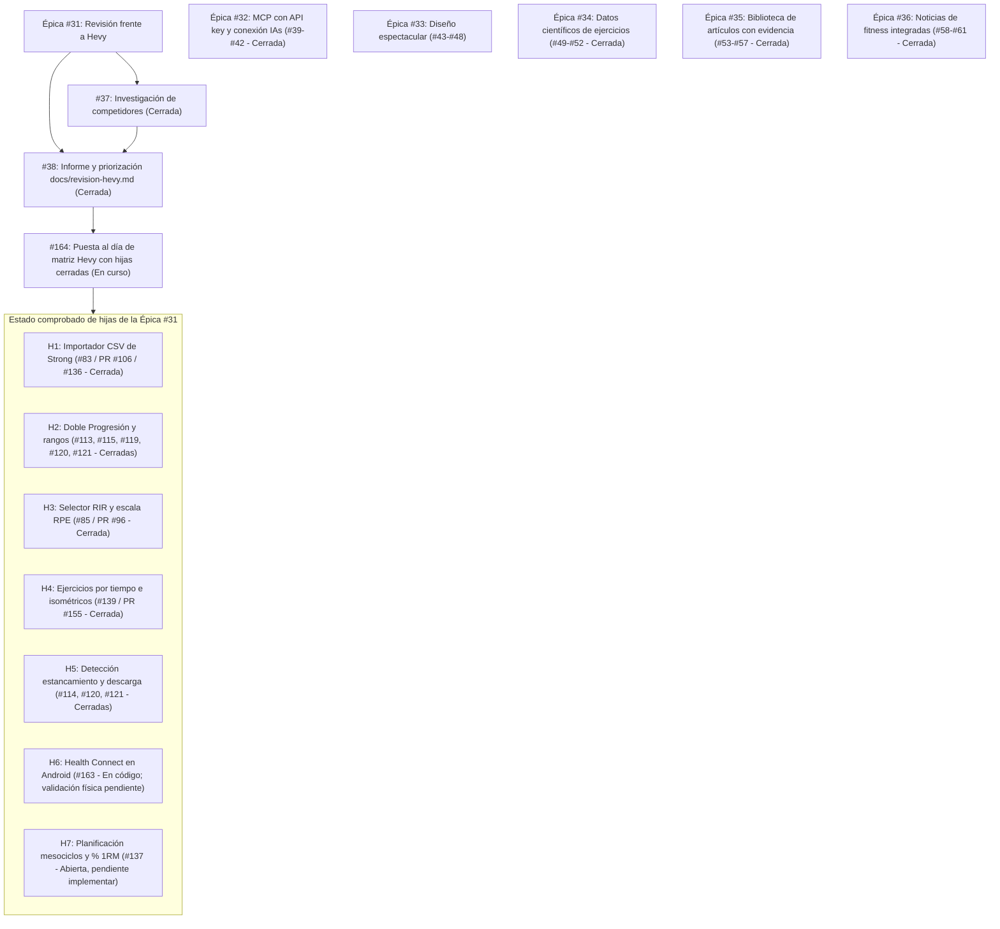

# Revisión exhaustiva frente a Hevy y priorización de huecos

> **Documento de análisis y priorización funcional**  
> **Fecha de redacción inicial:** 29 de octubre de 2026  
> **Fecha de actualización y puesta al día:** 10 de noviembre de 2026 (Revisión documental: issue [#164](https://github.com/adriarroyo08/WorkStation/issues/164))  
> **Épica relacionada:** Parte de [#31](https://github.com/adriarroyo08/WorkStation/issues/31) (Épica: revisión exhaustiva frente a Hevy)  
> **Issues resueltas/asociadas:** [#38](https://github.com/adriarroyo08/WorkStation/issues/38) (Redactar informe inicial), [#164](https://github.com/adriarroyo08/WorkStation/issues/164) (Actualizar matriz con hijas completadas y huecos pendientes)  
> **Dependencia completada:** [#37](https://github.com/adriarroyo08/WorkStation/issues/37) / [docs/investigacion-competidores.md](investigacion-competidores.md)  
> **Objetivo:** Mantener actualizada la matriz comparativa función → Hevy / Workstation / hueco frente al estado real de la base de código tras la resolución de las issues hijas [#83](https://github.com/adriarroyo08/WorkStation/issues/83), [#85](https://github.com/adriarroyo08/WorkStation/issues/85), [#113](https://github.com/adriarroyo08/WorkStation/issues/113)–[#115](https://github.com/adriarroyo08/WorkStation/issues/115), [#119](https://github.com/adriarroyo08/WorkStation/issues/119)–[#121](https://github.com/adriarroyo08/WorkStation/issues/121), [#139](https://github.com/adriarroyo08/WorkStation/issues/139), registrar con precisión el estado de la integración de Health Connect ([#163](https://github.com/adriarroyo08/WorkStation/issues/163)) y de mesociclos ([#137](https://github.com/adriarroyo08/WorkStation/issues/137)), y separar taxativamente los hechos comprobados en código de las decisiones y validaciones pendientes.

---

## 1. Contexto y mapa de épicas del proyecto

El objetivo de la épica [#31](https://github.com/adriarroyo08/WorkStation/issues/31) es que Workstation iguale y supere a **Hevy** (el estándar de referencia del mercado de registro de fuerza) y tome lo mejor de **Strong**, **Fitbod** y **Boostcamp**, manteniendo los principios irrenunciables de Workstation: **gratuito, privado, sin publicidad, offline-first y extensible mediante IA abierta**.

Para evitar duplicidades o dispersión de esfuerzos, se mapea a continuación la relación de este informe con todas las épicas e issues hijas en el repositorio, reflejando su estado actual comprobado:

### 1.1. Delimitación frente a las épicas existentes (#32–#36)

Para garantizar que ninguna de las tareas propuestas para la épica [#31](https://github.com/adriarroyo08/WorkStation/issues/31) entre en conflicto ni solape con el trabajo en marcha, se comprueba la cobertura de las otras épicas activas:

| Épica | Alcance definido | Hijas existentes | Estado frente a la comparación con Hevy |
| :--- | :--- | :--- | :--- |
| **[#32](https://github.com/adriarroyo08/WorkStation/issues/32)**: MCP con API key y conexión con IAs | Servidor MCP remoto seguro, gestión de claves `ws_...`, rate limiting y guías de conexión para Claude, Cursor y Gemini. | [#39](https://github.com/adriarroyo08/WorkStation/issues/39), [#40](https://github.com/adriarroyo08/WorkStation/issues/40), [#41](https://github.com/adriarroyo08/WorkStation/issues/41), [#42](https://github.com/adriarroyo08/WorkStation/issues/42) | **Cubre y supera** la API para desarrolladores de Hevy Pro (`hevy.com/settings?developer`). Completada. |
| **[#33](https://github.com/adriarroyo08/WorkStation/issues/33)**: Diseño espectacular | Sistema de diseño en `docs/diseno.md`, tokens, microinteracciones y rediseño de las 5 pantallas principales. | [#43](https://github.com/adriarroyo08/WorkStation/issues/43), [#44](https://github.com/adriarroyo08/WorkStation/issues/44), [#45](https://github.com/adriarroyo08/WorkStation/issues/45), [#46](https://github.com/adriarroyo08/WorkStation/issues/46), [#47](https://github.com/adriarroyo08/WorkStation/issues/47), [#48](https://github.com/adriarroyo08/WorkStation/issues/48) | **Cubre** la modernización visual frente a la UI pulida de Hevy. No proponer rediseños de pantallas base en #31. |
| **[#34](https://github.com/adriarroyo08/WorkStation/issues/34)**: Datos científicos de ejercicios | Patrones de movimiento, mapeo muscular con intensidades 0-100 y evidencia científica comprobada (citas y DOI reales). | [#49](https://github.com/adriarroyo08/WorkStation/issues/49), [#50](https://github.com/adriarroyo08/WorkStation/issues/50), [#51](https://github.com/adriarroyo08/WorkStation/issues/51), [#52](https://github.com/adriarroyo08/WorkStation/issues/52) | **Supera** el catálogo estándar de Hevy añadiendo rigor biomecánico. Completada. |
| **[#35](https://github.com/adriarroyo08/WorkStation/issues/35)**: Artículos con evidencia | Sección educativa con al menos 10 artículos en Markdown con fuentes verificadas, offline y citables por el Coach. | [#53](https://github.com/adriarroyo08/WorkStation/issues/53), [#54](https://github.com/adriarroyo08/WorkStation/issues/54), [#55](https://github.com/adriarroyo08/WorkStation/issues/55), [#56](https://github.com/adriarroyo08/WorkStation/issues/56), [#57](https://github.com/adriarroyo08/WorkStation/issues/57) | Ventaja diferencial de Workstation ausente en Hevy, Strong y Boostcamp. Completada. |
| **[#36](https://github.com/adriarroyo08/WorkStation/issues/36)**: Noticias de fitness | Agregador RSS/Atom con proxy y caché offline para investigación y novedades de entrenamiento. | [#58](https://github.com/adriarroyo08/WorkStation/issues/58), [#59](https://github.com/adriarroyo08/WorkStation/issues/59), [#60](https://github.com/adriarroyo08/WorkStation/issues/60), [#61](https://github.com/adriarroyo08/WorkStation/issues/61) | Ventaja de contenido ausente en competidores. Completada. |

---

## 2. Tabla comparativa: Función → Hevy / Workstation / Hueco

En esta tabla se detalla cada capacidad funcional evaluada, enlazando la evidencia externa pública ([Hevy](https://hevy.com), [Strong](https://www.strong.app/), [Fitbod](https://fitbod.me/), [Boostcamp](https://www.boostcamp.app/)) y los ficheros concretos de la base de código de Workstation (`app/`, `shared/`, `mcp/`, `android/`), identificando el estado exacto del hueco funcional.

### 2.1. Categoría 1: Registro de entrenamiento (Entreno)

| Función | Hevy | Contexto (Strong / Fitbod / Boostcamp) | Workstation (ficheros y rutas) | Diagnóstico del hueco |
| :--- | :--- | :--- | :--- | :--- |
| **Registro de series, repeticiones y peso** | Ilimitado y gratuito en [hevy.com](https://hevy.com). Soporte kg/lb. | Ilimitado y gratis en [strong.app](https://www.strong.app/) y [boostcamp.app](https://www.boostcamp.app/). Fitbod bloquea tras 3 entrenos ([fitbod.me/faq](https://fitbod.me/faq/)). | **Implementado**: [WorkoutLogger.tsx](../app/src/components/WorkoutLogger.tsx), [session.ts](../shared/session.ts), [types.ts](../shared/types.ts), [units.ts](../shared/units.ts). Datos en kg, conversión a lb al mostrar. | **Sin hueco**: completa paridad funcional. |
| **Tipos de series (calentamiento, drop set, fallo)** | 4 tipos en Free: Normal, Calentamiento (W), Drop Set (D), Al Fallo (F). | Strong ofrece los 4 tipos en Free ([strongapp.io/features](https://strongapp.io/features)). Boostcamp soporta los 4 tipos. | **Implementado**: [types.ts](../shared/types.ts#L52-L65), [WorkoutLogger.tsx](../app/src/components/WorkoutLogger.tsx). Selector visual e iconos por tipo. | **Sin hueco**: paridad total. |
| **Referencia a serie previa y autorrelleno** | En Free muestra peso y reps de la última sesión en columna "Previo". | Strong muestra marcas previas por serie. Fitbod ajusta pesos con algoritmo. | **Implementado**: [WorkoutLogger.tsx](../app/src/components/WorkoutLogger.tsx), [stats.ts](../shared/stats.ts). Columna "Anterior" con un toque para rellenar. | **Sin hueco**: paridad total. |
| **Temporizador de descanso por ejercicio** | Cuenta atrás con alerta sonora y ajuste manual de descanso en Free. | Strong temporizador en Free. Boostcamp inicio automático al marcar serie completada. | **Implementado**: [RestPicker.tsx](../app/src/components/RestPicker.tsx), [rest.ts](../app/src/rest.ts), [RestAlarmReceiver.kt](../android/phone/src/main/java/com/workstation/app/RestAlarmReceiver.kt). Alarma sonora, vibración y alarma exacta en Android con pantalla apagada. | **Sin hueco**: supera a Hevy en Android gracias al receptor de alarma exacto. |
| **Calculadora de discos (plate calculator)** | Disponible gratis para barra de 20 kg / estándar en [hevyapp.com/barbell-plate-calculator](https://hevyapp.com/barbell-plate-calculator/). | Strong exige PRO ($4.99/mes) para calculadora de discos. Boostcamp limita a 10 usos en Free ([boostcamp.app/pro](https://boostcamp.app/pro)). | **Implementado**: [session.ts](../shared/session.ts), [WorkoutLogger.tsx](../app/src/components/WorkoutLogger.tsx), [Settings.tsx](../app/src/components/Settings.tsx). Totalmente gratuita con colores olímpicos y configuración de discos disponibles. | **Sin hueco**: ventaja sobre Strong y Boostcamp. |
| **Calculadora de series de calentamiento** | Exclusiva de [Hevy Pro](https://hevyapp.com/hevy-pro/) ($23.99/año). | Strong exige PRO. Boostcamp exige Pro para series de calentamiento ilimitadas. | **Implementado**: [session.ts](../shared/session.ts), [WorkoutLogger.tsx](../app/src/components/WorkoutLogger.tsx). Gratuita en Workstation: calcula series al 40%, 60%, 80% y peso de barra. | **Sin hueco**: supera a Hevy al ofrecerla gratis. |
| **Superseries y reordenación** | Agrupación de ejercicios en superseries con código de color en Free. | Strong soporta superseries en Free. Boostcamp soporta superseries y circuitos. | **Implementado**: [session.ts](../shared/session.ts), [Reorder.tsx](../app/src/components/Reorder.tsx), [WorkoutLogger.tsx](../app/src/components/WorkoutLogger.tsx). Agrupación por `supersetId` y reordenación accesible por teclado/arrastre. | **Sin hueco**: paridad total. |
| **Selector de RIR (Reps In Reserve)** | Permite alternar visualización o registro de RPE (escala 6-10) y RIR (0-4 reps en recámara). | Boostcamp integra guía de RIR en todas las series ([boostcamp.app](https://www.boostcamp.app/)). Fitbod pide RPE cualitativo. | **Implementado**: [types.ts](../shared/types.ts), [effort.ts](../shared/effort.ts), [WorkoutLogger.tsx](../app/src/components/WorkoutLogger.tsx), [Settings.tsx](../app/src/components/Settings.tsx). Conmutador en Ajustes (`effortScale: 'rpe' \| 'rir'`), funciones bidireccionales `effortFromRpe` y `effortToRpe` en `shared/effort.ts` (0 a 4+ y medios puntos), selector de un toque en el registro y persistencia canónica `rpe = 10 - rir`. | **Sin hueco (Completado en [#85](https://github.com/adriarroyo08/WorkStation/issues/85) / PR [#96](https://github.com/adriarroyo08/WorkStation/pull/96))**: paridad funcional con Hevy y Boostcamp conservando compatibilidad de esquemas. |
| **Series por duración / isométricos (TUT)** | Hevy permite conmutar ejercicios a modo "Tiempo" (ej. planchas, hang, sentadilla isométrica) con cronómetro de serie. | Strong permite ejercicios basados en duración en segundos ([strongapp.io/features](https://strongapp.io/features)). Boostcamp soporta tiempo. | **Implementado**: [types.ts](../shared/types.ts), [stopwatch.ts](../shared/stopwatch.ts), [WorkoutLogger.tsx](../app/src/components/WorkoutLogger.tsx), [progression.ts](../shared/progression.ts), [History.tsx](../app/src/components/History.tsx), [WorkoutDetail.tsx](../app/src/components/WorkoutDetail.tsx). Tipado `Exercise.kind === 'duration'` y `durationSec`, módulo `shared/stopwatch.ts` con instantes absolutos resistente a recargas y bloqueo de pantalla, controles iniciar/pausar/reanudar/guardar, aviso de objetivo sonoro y háptico, progresión (+5 s) y formateo `mm:ss` / `X s`. | **Sin hueco (Completado en [#139](https://github.com/adriarroyo08/WorkStation/issues/139) / PR [#155](https://github.com/adriarroyo08/WorkStation/pull/155))**: registro completo de planchas, cuelgues y sentadillas isométricas. |

---

### 2.2. Categoría 2: Rutinas y programas

| Función | Hevy | Contexto (Strong / Fitbod / Boostcamp) | Workstation (ficheros y rutas) | Diagnóstico del hueco |
| :--- | :--- | :--- | :--- | :--- |
| **Editor de rutinas y límite de plantillas** | Máximo 4 rutinas en Free; ilimitadas en [Hevy Pro](https://hevyapp.com/hevy-pro/). | Strong limita a 3 plantillas en Free ([strongapp.io](https://strongapp.io/)). Fitbod genera entrenos dinámicos. Boostcamp permite ilimitadas en web y app. | **Implementado**: [RoutineEditor.tsx](../app/src/components/RoutineEditor.tsx), [types.ts](../shared/types.ts). Creador y editor sin ninguna limitación, 100% gratuito. | **Sin hueco**: gran ventaja competitiva de Workstation. |
| **Organización en carpetas** | Exclusivo de Hevy Pro. | Strong no dispone de sistema de carpetas. Boostcamp organiza por programas. | **Implementado**: [Train.tsx](../app/src/components/Train.tsx), [types.ts](../shared/types.ts). Creación, edición y ordenación por carpetas totalmente gratis. | **Sin hueco**: supera a Hevy y Strong. |
| **Compartir rutinas** | Compartición vía enlace web o código QR a través del backend centralizado de Hevy. | Strong comparte por enlace o texto plano. Boostcamp comparte programas por link web. | **Implementado**: [routine-share.ts](../shared/routine-share.ts), [SharedRoutine.tsx](../app/src/components/SharedRoutine.tsx). Compresión LZ-string autónoma en la URL sin depender de backend. | **Sin hueco**: máxima privacidad y portabilidad. |
| **Programas prediseñados y sugerencia "Hoy toca"** | Rutinas preestablecidas y rotación en app. | Boostcamp ofrece >130 programas pautados por entrenadores ([boostcamp.app/programs](https://boostcamp.app/programs)). | **Implementado**: [templates.ts](../shared/templates.ts), [Explore.tsx](../app/src/components/Explore.tsx), [planning.ts](../shared/planning.ts), [Train.tsx](../app/src/components/Train.tsx). 7 programas integrados y rotación "Hoy toca". | **Sin hueco**: paridad funcional. |
| **Rangos objetivo min-max de repeticiones en rutinas** | Hevy y plantillas avanzadas de fuerza permiten definir rangos de repeticiones (ej. "8-12 reps") en lugar de un número fijo. | Boostcamp estructura todas las series con rangos (ej. 3×6-8) y doble progresión. | **Implementado**: [types.ts](../shared/types.ts), [progression.ts](../shared/progression.ts), [RoutineEditor.tsx](../app/src/components/RoutineEditor.tsx), [WorkoutLogger.tsx](../app/src/components/WorkoutLogger.tsx), [routine-share.ts](../shared/routine-share.ts), [mcp-tools.ts](../shared/mcp-tools.ts). Campo `repsMin` en `RoutineSet` y `WorkoutSet` con `reps` como techo, `normalizeRepRange`, edición Mín/Máx en `RoutineEditor` con validación y accesibilidad, chips de rango en `WorkoutLogger`, compresión v1 de enlaces compartidos y soporte en MCP. | **Sin hueco (Completado en [#113](https://github.com/adriarroyo08/WorkStation/issues/113), [#115](https://github.com/adriarroyo08/WorkStation/issues/115), [#119](https://github.com/adriarroyo08/WorkStation/issues/119), [#120](https://github.com/adriarroyo08/WorkStation/issues/120), [#121](https://github.com/adriarroyo08/WorkStation/issues/121))**: habilita la sobrecarga de doble progresión. |
| **Mesociclos estructurados y cargas por % 1RM** | Hevy Pro / Trainer ofrece planes de progresión por semanas. | Boostcamp destaca por programas estructurados de 4 a 12 semanas con porcentajes de 1RM formalizados ([boostcamp.app](https://www.boostcamp.app/)). | **Pendiente de implementación**: [planning.ts](../shared/planning.ts) permite planificar días semanales, pero no periodización multi-semana con fases (acumulación, intensificación, descarga) ni cálculo de cargas por % del 1RM del usuario. | **Hueco confirmado y en curso de diseño en issue abierta [#137](https://github.com/adriarroyo08/WorkStation/issues/137) (H7)** (`agent:claude`, `size:l`, `necesita:pc`). |

---

### 2.3. Categoría 3: Estadísticas y analítica

| Función | Hevy | Contexto (Strong / Fitbod / Boostcamp) | Workstation (ficheros y rutas) | Diagnóstico del hueco |
| :--- | :--- | :--- | :--- | :--- |
| **Historial de sesiones** | Bloqueado a los últimos 3 meses en Free; ilimitado en [Hevy Pro](https://hevyapp.com/hevy-pro/). | Strong ofrece historial ilimitado en Free. Fitbod bloquea tras 3 entrenos. Boostcamp historial completo en Free. | **Implementado**: [History.tsx](../app/src/components/History.tsx), [stats.ts](../shared/stats.ts). Historial ilimitado y búsqueda por ejercicio totalmente gratis. | **Sin hueco**: gran ventaja frente a Hevy. |
| **Estimación de 1RM y marcas personales (PRs)** | Récords de 1RM, mejor volumen y marcas por repetición (1, 3, 5, 10 reps). | Strong bloquea gráficas de 1RM en Free. Boostcamp incluye insignias de PRs y Strength Score. | **Implementado**: [stats.ts](../shared/stats.ts), [LineChart.tsx](../app/src/components/LineChart.tsx), [WorkoutLogger.tsx](../app/src/components/WorkoutLogger.tsx). 1RM con fórmula Epley, detección en directo y gráfico temporal. | **Sin hueco**: paridad total. |
| **Mapa muscular de volumen y recuperación** | Desglose muscular avanzado de series semanales exclusivo de Hevy Pro. | Fitbod incluye mapa de calor de recuperación dinámico ([fitbod.me/how-it-works](https://fitbod.me/how-it-works/)). Boostcamp *Muscle Tracker* en Pro. | **Implementado**: [muscle-detail.ts](../shared/muscle-detail.ts), [BodyMap.tsx](../app/src/components/BodyMap.tsx), [Train.tsx](../app/src/components/Train.tsx). Mapa interactivo por periodo (30d, 3m, 1a) y porcentaje de recuperación a 3 días. | **Sin hueco**: supera a Hevy al ofrecerlo gratis. |
| **Seguimiento de medidas y fotos de progreso** | Solo peso y cintura en Free; todas las medidas corporales en Hevy Pro. | Strong bloquea medidas corporales en Free. | **Implementado**: [types.ts](../shared/types.ts), [Measurements.tsx](../app/src/components/Measurements.tsx). 11 perímetros, peso, grasa y comparador deslizador de fotos privadas en local. | **Sin hueco**: supera a Hevy y Strong. |
| **Gamificación y resúmenes anuales** | Resumen anual y comparación de amigos en red social. | Boostcamp insignias de constancia. | **Implementado**: [achievements.ts](../shared/achievements.ts) (21 logros), [strength.ts](../shared/strength.ts) (niveles de fuerza), [wrapped.ts](../shared/wrapped.ts), [YearHeatmap.tsx](../app/src/components/YearHeatmap.tsx). | **Sin hueco**: superior en analítica personal. |

---

### 2.4. Categoría 4: Progresión y sobrecarga

| Función | Hevy | Contexto (Strong / Fitbod / Boostcamp) | Workstation (ficheros y rutas) | Diagnóstico del hueco |
| :--- | :--- | :--- | :--- | :--- |
| **Sugerencia de sobrecarga progresiva** | Consulta manual de la sesión anterior en la pantalla de entreno. | Strong requiere cálculo manual del usuario. Fitbod recalcula con *mStrength™* ([fitbod.me](https://fitbod.me/)). Boostcamp incluye *Auto Progression* en Pro. | **Implementado**: [progression.ts](../shared/progression.ts), [WorkoutLogger.tsx](../app/src/components/WorkoutLogger.tsx). Sugerencia directa "Hoy: X kg × Y reps" o duración según cumplimiento previo y salto de carga. | **Sin hueco**: paridad con Hevy. |
| **Comparativa "Frente a la última vez"** | Vista comparativa en detalle del entreno. | Strong vista de sesión previa. | **Implementado**: [stats.ts](../shared/stats.ts), [WorkoutDetail.tsx](../app/src/components/WorkoutDetail.tsx). Comparación de volumen total, repeticiones y tiempo. | **Sin hueco**: paridad total. |
| **Motor formal de Doble Progresión (Double Progression)** | Hevy no automatiza la doble progresión sesión a sesión. | Boostcamp Pro aplica doble progresión algorítmica: mantener carga hasta alcanzar el tope del rango en todas las series; luego subir peso y volver al suelo del rango ([boostcamp.app/pro](https://boostcamp.app/pro)). | **Implementado**: [progression.ts](../shared/progression.ts), [WorkoutLogger.tsx](../app/src/components/WorkoutLogger.tsx), [mcp-tools.ts](../shared/mcp-tools.ts). `suggestNext` evalúa `RepTarget { min, max, plannedSets? }`: si todas las series completan el techo (`max`) sin RPE alto, sugiere subir de peso (`action: 'up'`) al siguiente escalón (`weightStep`) y reiniciar en `min`; si no, sugiere conservar peso y sumar repeticiones (`action: 'reps'` o `'repeat'`). Soporta kg, lb, peso corporal y asistido. | **Sin hueco (Completado en [#115](https://github.com/adriarroyo08/WorkStation/issues/115), [#120](https://github.com/adriarroyo08/WorkStation/issues/120), [#121](https://github.com/adriarroyo08/WorkStation/issues/121))**: supera a Hevy y Strong al automatizar la doble progresión con rigor. |
| **Detección de estancamiento y descarga (*deload*)** | Ni Hevy ni Strong lo incorporan; delegan en el criterio del usuario. | Fitbod reduce intensidad si detecta fatiga. Boostcamp programa semanas fijas de descarga en sus planes. | **Implementado**: [deload.ts](../shared/deload.ts), [WorkoutLogger.tsx](../app/src/components/WorkoutLogger.tsx), [mcp-tools.ts](../shared/mcp-tools.ts), [docs/investigacion-descarga.md](investigacion-descarga.md). `evaluateStagnation` analiza las 3 últimas sesiones en 45 días mediante 1RM Epley y RPE al peso máximo; `createDeloadSuggestion` prescribe descarga (50% de series conservando peso); banner plegable y descartable en `WorkoutLogger.tsx` con aplicación opcional a series pendientes y deshacer; herramienta MCP `check_stagnation`. | **Sin hueco (Completado en [#114](https://github.com/adriarroyo08/WorkStation/issues/114), [#120](https://github.com/adriarroyo08/WorkStation/issues/120), [#121](https://github.com/adriarroyo08/WorkStation/issues/121))**: gran diferenciador científico frente a Hevy y Strong. |

---

### 2.5. Categoría 5: Importación, exportación y sincronización

| Función | Hevy | Contexto (Strong / Fitbod / Boostcamp) | Workstation (ficheros y rutas) | Diagnóstico del hueco |
| :--- | :--- | :--- | :--- | :--- |
| **Exportación de datos a CSV** | Exportación completa a CSV desde app móvil en Free ([hevyapp.com/export-data](https://hevyapp.com/export-data/)). | Strong exporta CSV en Free ([help.strongapp.io/article/18-export-data](https://help.strongapp.io/article/18-export-data)). Fitbod exporta CSV. Boostcamp carece de exportación oficial en app. | **Implementado**: [hevy.ts](../shared/hevy.ts), [Settings.tsx](../app/src/components/Settings.tsx). Exporta en formato CSV compatible con Hevy. | **Sin hueco**: paridad total. |
| **Importación de CSV de Hevy** | Hevy importa CSV de Strong y de Hevy. | Strong **no permite importar CSV** (esclusa cerrada). | **Implementado**: [hevy.ts](../shared/hevy.ts), [Settings.tsx](../app/src/components/Settings.tsx). Parser con mapeo de ejercicios, series, reps, notas y RPE. | **Sin hueco**: paridad total. |
| **Importación por API oficial de Hevy Pro** | API REST oficial para usuarios Pro ([hevy.com/settings?developer](https://hevy.com/settings?developer)). | Strong no tiene API. Fitbod no tiene API. Boostcamp no tiene API. | **Implementado**: [hevy.ts](../shared/hevy.ts), [index.ts](../mcp/src/index.ts), [mcp-tools.ts](../shared/mcp-tools.ts). Descarga directa de entrenamientos mediante API key de Hevy Pro. | **Sin hueco**: función avanzada ya completada. |
| **Copias de seguridad automáticas y manuales JSON** | Solo sincronización en servidores de Hevy (sin backups locales automáticos versionados). | Strong copias en la nube propietaria. | **Implementado**: [backups.ts](../shared/backups.ts), [backups.ts](../app/src/backups.ts), [AutoBackups.tsx](../app/src/components/AutoBackups.tsx), [Settings.tsx](../app/src/components/Settings.tsx). Backups diarios automáticos (7 días) y pre-importación (5 copias). | **Sin hueco**: supera ampliamente a Hevy en soberanía de datos. |
| **Sincronización en la nube (Supabase)** | Sincronización en tiempo real en la infraestructura de Hevy. | Strong Sync en la nube. | **Implementado**: [sync.ts](../shared/sync.ts), [cloud.ts](../app/src/cloud.ts), [001_records.sql](../supabase/migrations/001_records.sql), [003_sync_hardening.sql](../supabase/migrations/003_sync_hardening.sql). Sincronización en la nube multi-dispositivo y offline con resolución LWW. | **Sin hueco**: paridad técnica. |
| **Importador nativo directo de CSV de Strong** | Hevy cuenta con importador específico para el formato CSV exportado por Strong. | Strong no importa datos. | **Implementado**: [strong.ts](../shared/strong.ts), [strong.test.ts](../shared/strong.test.ts), [StrongImport.tsx](../app/src/components/StrongImport.tsx), [Settings.tsx](../app/src/components/Settings.tsx). Parser con `parseStrongCsv`, `previewStrongCsv`, soporte de separadores (coma/punto y coma), unidades kg/lb, notas multilínea, RPE y tipos de serie. Modal con vista previa y backup preventivo previo. | **Sin hueco (Completado en [#83](https://github.com/adriarroyo08/WorkStation/issues/83) / PR [#106](https://github.com/adriarroyo08/WorkStation/pull/106), corregido en PR [#136](https://github.com/adriarroyo08/WorkStation/pull/136))**: paridad lograda con Hevy y eliminación total de barrera de migración para usuarios de Strong. |
| **Sincronización con Google Health Connect en Android** | Hevy sincroniza entrenamientos y calorías con Google Health Connect ([hevyapp.com](https://hevyapp.com)). | Strong sincroniza con Google Fit. Fitbod sincroniza con Health Connect ([fitbod.me/android](https://fitbod.me/android/)). | **Implementado en código; verificación en dispositivo físico y revisión formal pendientes**: [HealthConnect.kt](../android/phone/src/main/java/com/workstation/app/HealthConnect.kt), [NativeBridge.kt](../android/phone/src/main/java/com/workstation/app/NativeBridge.kt), [health-connect.ts](../shared/health-connect.ts), [HealthConnectSettings.tsx](../app/src/components/HealthConnectSettings.tsx), [docs/health-connect.md](health-connect.md), [docs/issue-163/README.md](issue-163/README.md). | **Hueco H6 abordado en issue [#163](https://github.com/adriarroyo08/WorkStation/issues/163)** (cerrada tras commit directo `80e8578` en `main`). Verificado en emulador Android, pero **no dar por completada definitivamente** hasta comprobar en dispositivos físicos reales (Android 9-13 / 14+ y reloj) y realizar la revisión formal de código. |

---

### 2.6. Categoría 6: Conexión IA y Coach

| Función | Hevy | Contexto (Strong / Fitbod / Boostcamp) | Workstation (ficheros y rutas) | Diagnóstico del hueco |
| :--- | :--- | :--- | :--- | :--- |
| **Servidor MCP nativo (Model Context Protocol)** | No ofrece soporte oficial para MCP (solo conectores comunitarios hacia su API REST de pago). | Strong no ofrece IA ni MCP. Fitbod IA cerrada propietaria. Boostcamp sin MCP. | **Implementado**: [index.ts](../mcp/src/index.ts) (stdio local), [edge.ts](../mcp/src/edge.ts) / [mcp-http.ts](../shared/mcp-http.ts) (remoto HTTP/SSE en Edge Function), [002_api_keys.sql](../supabase/migrations/002_api_keys.sql). | **Sin hueco (Cubierto y ampliado en Épica #32)**: gran ventaja pionera de Workstation. |
| **Herramientas de entrenador para LLMs** | Conector ChatGPT `@hevy` ([hevyapp.com/chatgpt-ai-workout-tracker](https://hevyapp.com/chatgpt-ai-workout-tracker/)). | Ausente en competidores tradicionales. | **Implementado**: [mcp-tools.ts](../shared/mcp-tools.ts) con 17 herramientas (consultas, historial, récords, creación de rutinas, logging de entreno). | **Sin hueco (Auditado en #42)**: paridad y superioridad técnica. |
| **Coach IA conversacional multimodelo en la PWA** | No tiene asistente conversacional dentro de la propia app móvil. | Fitbod usa IA algorítmica cerrada no conversacional. Boostcamp generador estático por cuestionario. | **Implementado**: [ai.ts](../shared/ai.ts), [Coach.tsx](../app/src/components/Coach.tsx), [Settings.tsx](../app/src/components/Settings.tsx). Compatible con Gemini, Groq, OpenRouter y Ollama local. | **Sin hueco**: función estrella de Workstation ausente en Hevy. |

---

### 2.7. Categoría 7: Reloj y wearables

| Función | Hevy | Contexto (Strong / Fitbod / Boostcamp) | Workstation (ficheros y rutas) | Diagnóstico del hueco |
| :--- | :--- | :--- | :--- | :--- |
| **App Wear OS nativa con modo autónomo** | App Wear OS 3+ en [hevyapp.com/wear-os-apple-watch-workout-tracker](https://hevyapp.com/wear-os-apple-watch-workout-tracker/). | Strong descontinuó Wear OS (ausente). Fitbod Wear OS limitado. Boostcamp carece de app para reloj. | **Implementado**: [MainActivity.kt](../android/wear/src/main/java/com/workstation/app/MainActivity.kt), [WatchUi.kt](../android/wear/src/main/java/com/workstation/app/WatchUi.kt), [Local.kt](../android/wear/src/main/java/com/workstation/app/Local.kt). Compose for Wear OS autónomo: inicia, registra series, descanso y guarda sin teléfono. | **Sin hueco**: paridad total con Hevy y gran ventaja frente a Strong y Boostcamp. |
| **Sincronización en vivo reloj ↔ teléfono** | Live Sync bidireccional entre reloj y teléfono en Hevy. | Strong Live Sync solo en iOS / watchOS. | **Implementado**: [PhoneLink.kt](../android/wear/src/main/java/com/workstation/app/PhoneLink.kt), [PhoneListenerService.kt](../android/phone/src/main/java/com/workstation/app/PhoneListenerService.kt), [WatchBus.kt](../android/phone/src/main/java/com/workstation/app/WatchBus.kt). Comunicación en tiempo real por Wearable Data Layer (`MessageClient`). | **Sin hueco**: paridad total. |
| **Medición continua de frecuencia cardíaca** | Lectura del sensor del reloj y cálculo de FC media en Hevy. | Strong y Fitbod leen FC en Apple Watch. | **Implementado**: [HeartRateService.kt](../android/wear/src/main/java/com/workstation/app/HeartRateService.kt), [hr.ts](../app/src/hr.ts). Lectura del sensor de Wear OS y compatibilidad con bandas Web Bluetooth. | **Sin hueco**: paridad total. |
| **App nativa para Apple Watch (watchOS)** | Hevy dispone de app completa para watchOS con Live Sync ([hevyapp.com/apple-watch](https://hevyapp.com/apple-watch/)). | Strong destaca principalmente en watchOS ([strongapp.io](https://strongapp.io/)). Fitbod app watchOS. | **Ausente**: Workstation es una PWA multiplataforma (Web/iOS/Android) con wrapper y Wear OS nativo en Android. No dispone de código Swift ni app empaquetada para watchOS. | **Punto de decisión estratégico**: descartado formalmente por foco en tecnologías web y Android abiertas (ver sección 4.1). |

---

## 3. Priorización y evolución de los huecos confirmados

A continuación se resume la evolución histórica desde la priorización inicial (29 de octubre de 2026) hasta la fecha de revisión actual (10 de noviembre de 2026), tras completarse el bloque central de hijas de la épica [#31](https://github.com/adriarroyo08/WorkStation/issues/31):

| ID | Hueco comprobado | Impacto en usuario | Esfuerzo | Prioridad inicial | Issue asignada | Estado comprobado (a 10 de nov 2026) |
| :---: | :--- | :---: | :---: | :---: | :---: | :--- |
| **H1** | **Importador nativo de CSV de Strong** | **Muy Alto** (elimina fricción de migración) | **M** | **P1 (Inmediata)** | [#83](https://github.com/adriarroyo08/WorkStation/issues/83) | **Cerrada (Completado)** via PR [#106](https://github.com/adriarroyo08/WorkStation/pull/106) y fix PR [#136](https://github.com/adriarroyo08/WorkStation/pull/136) |
| **H2** | **Motor de Doble Progresión y rangos min-max en rutinas** | **Muy Alto** (sobrecarga e hipertrofia) | **M** | **P1 (Inmediata)** | [#113](https://github.com/adriarroyo08/WorkStation/issues/113), [#115](https://github.com/adriarroyo08/WorkStation/issues/115), [#119](https://github.com/adriarroyo08/WorkStation/issues/119), [#120](https://github.com/adriarroyo08/WorkStation/issues/120), [#121](https://github.com/adriarroyo08/WorkStation/issues/121) | **Cerradas (Completado)** via PRs [#116](https://github.com/adriarroyo08/WorkStation/pull/116), [#118](https://github.com/adriarroyo08/WorkStation/pull/118), [#122](https://github.com/adriarroyo08/WorkStation/pull/122), [#124](https://github.com/adriarroyo08/WorkStation/pull/124), [#123](https://github.com/adriarroyo08/WorkStation/pull/123) |
| **H3** | **Selector dedicado de RIR y equivalencia con RPE** | **Alto** (usabilidad en la serie) | **S** | **P2 (Alta)** | [#85](https://github.com/adriarroyo08/WorkStation/issues/85) | **Cerrada (Completado)** via PR [#96](https://github.com/adriarroyo08/WorkStation/pull/96) |
| **H4** | **Soporte de ejercicios basados en tiempo e isométricos** | **Medio-Alto** (planchas, cuelgues, estiramientos) | **M** | **P2 (Alta)** | [#139](https://github.com/adriarroyo08/WorkStation/issues/139) | **Cerrada (Completado)** via PR [#155](https://github.com/adriarroyo08/WorkStation/pull/155) |
| **H5** | **Detección de estancamiento y recomendación de descarga (*deload*)** | **Alto** (diferenciador científico) | **M** | **P2 (Alta)** | [#114](https://github.com/adriarroyo08/WorkStation/issues/114), [#120](https://github.com/adriarroyo08/WorkStation/issues/120), [#121](https://github.com/adriarroyo08/WorkStation/issues/121) | **Cerradas (Completado)** via PRs [#117](https://github.com/adriarroyo08/WorkStation/pull/117), [#124](https://github.com/adriarroyo08/WorkStation/pull/124), [#123](https://github.com/adriarroyo08/WorkStation/pull/123) |
| **H6** | **Sincronización con Google Health Connect en Android** | **Medio** (ecosistema Android de salud) | **M** | **P3 (Media / necesita:pc)** | [#163](https://github.com/adriarroyo08/WorkStation/issues/163) | **Cerrada en repo (Implementada en código; validación física y revisión formal pendientes)** via commit `80e8578` |
| **H7** | **Planificación de mesociclos y programas multi-semana con % 1RM** | **Medio** (atletas avanzados / powerlifting) | **L** | **P3 (Postergada)** | [#137](https://github.com/adriarroyo08/WorkStation/issues/137) | **Abierta (Pendiente de implementación)** (`agent:claude`, `size:l`, `necesita:pc`) |

---

## 4. Estado de los puntos de decisión y nuevas definiciones pendientes

### 4.1. Decisiones iniciales resueltas

1. **Decisión 1: App para Apple Watch (watchOS) vs foco en PWA y Android**
   - **Resolución:** **Opción 2 confirmada**. Workstation se focaliza estrictamente en la PWA (Web, iOS y Android) y soporte de primer nivel para Wear OS en Android nativo. El soporte de watchOS queda formalmente descartado fuera de alcance.
2. **Decisión 2: Compatibilidad de esquemas para RIR (Reps In Reserve)**
   - **Resolución:** **Alternativa B implementada** ([#85](https://github.com/adriarroyo08/WorkStation/issues/85)). Se conserva `rpe?: number` como valor canónico en el almacenamiento (`WorkoutSet.rpe`), base de datos y MCP, añadiendo `Settings.effortScale` (`'rpe' | 'rir'`) y funciones de conversión pura en `shared/effort.ts`. Sin migraciones de esquemas ni roturas retroactivas.
3. **Decisión 3: Formato de rangos de repeticiones en el modelo de Rutinas**
   - **Resolución:** **Alternativa B adaptada** ([#113](https://github.com/adriarroyo08/WorkStation/issues/113)). Se extendieron `RoutineSet` y `WorkoutSet` con `repsMin?: number` opcional, manteniendo `reps` como techo del rango o valor fijo. La función `normalizeRepRange` descarta rangos manipulados o degenerados y la compresión LZ-string v1 en `shared/routine-share.ts` conserva plena compatibilidad.
4. **Decisión 4: Robustez del dialecto CSV de exportación de Strong**
   - **Resolución:** **Implementada** ([#83](https://github.com/adriarroyo08/WorkStation/issues/83)). El módulo `shared/strong.ts` admite delimitadores por coma y punto y coma, decimales con punto o coma, unidades mixtas por fila y mapeo a identificadores de Workstation mediante `STRONG_EXERCISES`, complementado con vista previa en `app/src/components/StrongImport.tsx`.

### 4.2. Decisiones pendientes identificadas a 10 de noviembre de 2026

1. **Decisión pendiente para H6 (Health Connect / issue [#163](https://github.com/adriarroyo08/WorkStation/issues/163)): Protocolo de subsanación de gobernanza y verificación en hardware**
   - **Situación:** El commit `80e8578` introdujo el código de Health Connect directamente en `main` sin PR ni revisión previa de código. Aunque compila y supera pruebas en emulador ([docs/issue-163/README.md](issue-163/README.md)), falta probar el comportamiento en dispositivos Android físicos (versiones 9 a 13 con la app independiente de Health Connect vs Android 14+ con módulo integrado del sistema), el reintento por fallo transitorio real y la interacción con Wear OS.
   - **Acción requerida:** Someter el diff a revisión de código formal y realizar la batería de pruebas en dispositivos físicos antes de dar la función por cerrada sin reservas ni promocionarla públicamente en la ficha de la tienda ([docs/declaraciones-play.md](declaraciones-play.md), [docs/ficha-play.md](ficha-play.md)).
2. **Decisión pendiente para H7 (Mesociclos / issue [#137](https://github.com/adriarroyo08/WorkStation/issues/137)): Diseño arquitectónico previo en `docs/mesociclos.md`**
   - **Situación:** La especificación de [#137](https://github.com/adriarroyo08/WorkStation/issues/137) exige redactar un documento de diseño previo (`docs/mesociclos.md`) para definir cómo se estructuran las semanas, días y fases (acumulación, intensificación, descarga), cómo se relacionan con las rutinas y carpetas vigentes, y cómo evitar contradicciones con la detección de estancamiento de [shared/deload.ts](../shared/deload.ts) y la doble progresión de [shared/progression.ts](../shared/progression.ts).
   - **Acción requerida:** Completar el diseño documental antes de añadir el tipo `Mesocycle` en `shared/types.ts` o codificar vistas complejas.

---

## 5. Estado comprobado y evidencia en código de las tareas de la Épica #31

A continuación se sustituyen las propuestas iniciales por su estado y trazabilidad técnica comprobada en rutas, módulos y símbolos reales:

---

### H1: Importador nativo de archivos CSV de Strong

- **Estado:** **Cerrada y completada**
- **Issue resuelta:** [#83](https://github.com/adriarroyo08/WorkStation/issues/83) (PR [#106](https://github.com/adriarroyo08/WorkStation/pull/106), corrección de carrera Escape en PR [#136](https://github.com/adriarroyo08/WorkStation/pull/136))
- **Evidencia en rutas y símbolos reales:**
  - [shared/strong.ts](../shared/strong.ts): Funciones `parseStrongCsv`, `previewStrongCsv`, `parseStrongDate` y catálogo de equivalencias `STRONG_EXERCISES`. Soporte para cabeceras con o sin unidades (`Weight (kg)`, `Weight (lbs)`), separadores `,` y `;`, fechas ambiguas y notas multilínea con comillas.
  - [shared/strong.test.ts](../shared/strong.test.ts): 36 pruebas unitarias que cubren dialectos reales anonimizados, conversiones de unidades y gestión de excepciones.
  - [app/src/components/StrongImport.tsx](../app/src/components/StrongImport.tsx): Componente modal que muestra vista previa de entrenamientos, series, ejercicios nuevos a crear y filas omitidas, requiriendo selección explícita de unidades si faltan y generando copia de seguridad preventiva automática antes de la importación.
  - [app/src/components/Settings.tsx](../app/src/components/Settings.tsx): Integrado en la interfaz de Ajustes junto a la importación de Hevy.
  - [docs/issue-83/README.md](issue-83/README.md): Documentación de validación y capturas.

---

### H2: Motor de Doble Progresión y rangos de repeticiones en rutinas

- **Estado:** **Cerrada y completada**
- **Issues resueltas:**
  - [#113](https://github.com/adriarroyo08/WorkStation/issues/113) (PR [#116](https://github.com/adriarroyo08/WorkStation/pull/116)): Tipado `repsMin` y normalización.
  - [#115](https://github.com/adriarroyo08/WorkStation/issues/115) (PR [#118](https://github.com/adriarroyo08/WorkStation/pull/118)): Lógica algorítmica de doble progresión en `suggestNext`.
  - [#119](https://github.com/adriarroyo08/WorkStation/issues/119) (PR [#122](https://github.com/adriarroyo08/WorkStation/pull/122)): Edición de rangos en el editor de rutinas.
  - [#120](https://github.com/adriarroyo08/WorkStation/issues/120) (PR [#124](https://github.com/adriarroyo08/WorkStation/pull/124)): Visualización de rangos y directrices en el registro de entreno.
  - [#121](https://github.com/adriarroyo08/WorkStation/issues/121) (PR [#123](https://github.com/adriarroyo08/WorkStation/pull/123)): Exportación en enlaces compartidos y exposición en herramientas MCP.
- **Evidencia en rutas y símbolos reales:**
  - [shared/types.ts](../shared/types.ts): Campos `repsMin?: number` en `RoutineSet` y `WorkoutSet`, tipo `RepTarget { min: number; max: number; plannedSets?: number }`.
  - [shared/progression.ts](../shared/progression.ts): Función `normalizeRepRange`; función `suggestNext` adaptada para rangos: si todas las series cumplen `targetReps.max` sin RPE excesivo, sugiere incremento de carga (`action: 'up'`) al siguiente escalón (`weightStep`) y reiniciar en el suelo (`min`); en caso contrario, sugiere mantener peso (`action: 'reps'` o `'repeat'`).
  - [shared/progression.test.ts](../shared/progression.test.ts): Batería completa de pruebas de sobrecarga con rangos en kg, lb, ejercicios con mancuernas, peso corporal y peso asistido.
  - [app/src/components/RoutineEditor.tsx](../app/src/components/RoutineEditor.tsx): Columnas accesibles Mín. y Máx. por serie, con validación inline y anuncio por lector de pantalla.
  - [app/src/components/WorkoutLogger.tsx](../app/src/components/WorkoutLogger.tsx): Muestra el rango objetivo en chip y en placeholder de repeticiones, junto con sugerencias explícitas de sobrecarga.
  - [shared/routine-share.ts](../shared/routine-share.ts): Serialización comprimida v1 con quinto elemento por serie cuando hay rangos definidos.
  - [shared/mcp-tools.ts](../shared/mcp-tools.ts): Parámetros `reps_min` en `create_routine` y `target_reps_min` en `suggest_next`.
  - [docs/doble-progresion.md](doble-progresion.md): Especificación formal del contrato de doble progresión.

---

### H3: Selector dedicado de RIR y sincronización de escala con RPE

- **Estado:** **Cerrada y completada**
- **Issue resuelta:** [#85](https://github.com/adriarroyo08/WorkStation/issues/85) (PR [#96](https://github.com/adriarroyo08/WorkStation/pull/96))
- **Evidencia en rutas y símbolos reales:**
  - [shared/types.ts](../shared/types.ts): Preferencia `effortScale?: 'rpe' | 'rir'` en `Settings`. El almacenamiento de series mantiene estrictamente `rpe?: number` como valor canónico.
  - [shared/effort.ts](../shared/effort.ts): Módulo específico con `EFFORT_OPTIONS`, función `effortFromRpe` (convierte RPE a RIR calculando $10 - \text{RPE}$) y función `effortToRpe` (convierte RIR a RPE calculando $10 - \text{RIR}$), admitiendo valores de 0 a 4 y medios puntos (0, 0.5, 1, 1.5, ..., 4).
  - [shared/effort.test.ts](../shared/effort.test.ts): Pruebas de conversión simétrica, extremos y valores decimales.
  - [app/src/components/WorkoutLogger.tsx](../app/src/components/WorkoutLogger.tsx): Selector rápido de esfuerzo adaptado dinámicamente según la preferencia de escala del usuario.
  - [app/src/components/Settings.tsx](../app/src/components/Settings.tsx): Conmutador de preferencia de escala de esfuerzo RPE / RIR.

---

### H4: Soporte de ejercicios basados en tiempo e isométricos

- **Estado:** **Cerrada y completada**
- **Issue resuelta:** [#139](https://github.com/adriarroyo08/WorkStation/issues/139) (PR [#155](https://github.com/adriarroyo08/WorkStation/pull/155))
- **Evidencia en rutas y símbolos reales:**
  - [shared/types.ts](../shared/types.ts): Tipado `Exercise.kind === 'duration'`, `WorkoutSet.durationSec`, `RoutineSet.durationSec`.
  - [shared/stopwatch.ts](../shared/stopwatch.ts): Módulo de cronómetro de series (`SetStopwatch`, `startStopwatch`, `pauseStopwatch`, `resumeStopwatch`, `stopwatchElapsedSec`, `shouldNotifyTarget`, `stopwatchMatches`, `plannedDurationSec`). Emplea marcas temporales absolutas (`startedAt`, `accumulatedMs`), permitiendo que el tiempo continúe contando con exactitud aunque se bloquee la pantalla, se cambie de pestaña o se recargue la aplicación.
  - [shared/stopwatch.test.ts](../shared/stopwatch.test.ts): Pruebas unitarias de persistencia, pausas y recuperación de estado.
  - [app/src/components/WorkoutLogger.tsx](../app/src/components/WorkoutLogger.tsx): Interfaz de serie con cronómetro interactivo (iniciar, pausar, reanudar, guardar tiempo en `durationSec` o descartar) y aviso háptico/sonoro cuando se alcanza la duración objetivo planificada.
  - [shared/progression.ts](../shared/progression.ts): Sugerencia de sobrecarga para series por tiempo (+5 segundos si se alcanzó el objetivo previo en todas las series).
  - [app/src/components/History.tsx](../app/src/components/History.tsx) y [app/src/components/WorkoutDetail.tsx](../app/src/components/WorkoutDetail.tsx): Representación de la duración en formato estándar legible `mm:ss` o `X s`.
  - [docs/issue-139/](issue-139/): Documentación de validación e informe de pruebas.

---

### H5: Detección heurística de estancamiento y recomendación de descarga (deload)

- **Estado:** **Cerrada y completada**
- **Issues resueltas:**
  - [#114](https://github.com/adriarroyo08/WorkStation/issues/114) (PR [#117](https://github.com/adriarroyo08/WorkStation/pull/117)): Lógica analítica de estancamiento y generación de planes de descarga.
  - [#120](https://github.com/adriarroyo08/WorkStation/issues/120) (PR [#124](https://github.com/adriarroyo08/WorkStation/pull/124)): Integración de avisos interactivos de estancamiento en la interfaz de registro.
  - [#121](https://github.com/adriarroyo08/WorkStation/issues/121) (PR [#123](https://github.com/adriarroyo08/WorkStation/pull/123)): Herramienta de auditoría de fatiga en el servidor MCP.
- **Evidencia en rutas y símbolos reales:**
  - [shared/deload.ts](../shared/deload.ts):
    - `evaluateStagnation(data, exerciseId, now)`: Evalúa las últimas 3 sesiones válidas de un ejercicio en una ventana máxima de 45 días; reinicia el recuento tras periodos de inactividad superiores a 21 días; calcula el 1RM estimado (Epley) y el esfuerzo mediante RPE o series al fallo al peso máximo para distinguir estancamiento real de mesetas submáximas.
    - `createDeloadSuggestion(report, exercise)`: Prescribe una reducción conservadora del 50 % en el número de series de trabajo conservando la carga habitual.
    - `deloadPendingSets(sets)`: Aplica de forma no destructiva la reducción a las series aún no completadas en la sesión.
  - [shared/deload.test.ts](../shared/deload.test.ts): 16 pruebas unitarias cubriendo escenarios de estancamiento con esfuerzo máximo, mesetas submáximas, reinicios temporales e historiales incompletos.
  - [app/src/components/WorkoutLogger.tsx](../app/src/components/WorkoutLogger.tsx): Banner plegable y descartable con diagnóstico de estancamiento, botón para aplicar la descarga en las series pendientes y opción para deshacer el cambio.
  - [shared/mcp-tools.ts](../shared/mcp-tools.ts): Herramienta `check_stagnation` para consulta analítica por parte de clientes MCP.
  - [docs/investigacion-descarga.md](investigacion-descarga.md): Estudio de literatura científica y fundamentación del protocolo.

---

### H6: Sincronización de entrenamientos con Health Connect en Android

- **Estado:** **Cerrada en repositorio (Implementada en código; validación en hardware físico y revisión formal pendientes)**
- **Issue asociada:** [#163](https://github.com/adriarroyo08/WorkStation/issues/163) (Cerrada automáticamente por el commit `80e8578` introducido directamente en `main`)
- **Situación y advertencia técnica:**
  - La funcionalidad se encuentra totalmente codificada, compila y pasa todas las pruebas unitarias y de integración (`npm run check`, e2e de 123 pruebas y `:phone:testDebugUnitTest :phone:assembleDebug :wear:assembleDebug`).
  - Sin embargo, conforme a la incidencia reportada por el propietario en [#163](https://github.com/adriarroyo08/WorkStation/issues/163), el commit `80e8578` entró directamente a la rama `main` sin PR de revisión.
  - Se verificó en emulador Android ([docs/issue-163/README.md](issue-163/README.md)), pero quedan pendientes de verificación: el reintento por fallo transitorio en condiciones reales de red, dispositivos físicos con Android 9–13 con la app de Health Connect, dispositivos físicos con Android 14+ y sincronización con el reloj.
  - **Criterio de documentación:** Enlazar su estado real sin dar la tarea por finalizada definitivamente ni anunciarla como disponible en la tienda hasta completar la revisión de código y las pruebas físicas requeridas.
- **Evidencia en rutas y símbolos reales:**
  - [android/phone/src/main/java/com/workstation/app/HealthConnect.kt](../android/phone/src/main/java/com/workstation/app/HealthConnect.kt): Helper en Kotlin que interactúa con el SDK `androidx.health.connect:connect-client` para insertar registros `ExerciseSessionRecord` y `HeartRateRecord`.
  - [android/phone/src/main/java/com/workstation/app/NativeBridge.kt](../android/phone/src/main/java/com/workstation/app/NativeBridge.kt): Métodos nativos expuestos hacia la WebView: `healthConnectSupported`, `healthConnectRefresh`, `healthConnectEnable`, `healthConnectDisable`, `healthConnectOpen`, `healthConnectExport`.
  - [shared/health-connect.ts](../shared/health-connect.ts): Funciones `buildHealthExport`, `healthConnectPhase`, `healthConnectMessage`, tipos `HealthExport`, `HealthConnectStatus`.
  - [shared/health-connect.test.ts](../shared/health-connect.test.ts): 11 pruebas unitarias sobre el formateo de sesiones, validación de duraciones, calorías y estados del permiso.
  - [app/src/components/HealthConnectSettings.tsx](../app/src/components/HealthConnectSettings.tsx): Componente en Ajustes para solicitar permisos, comprobar estado y activar/desactivar la exportación.
  - [docs/health-connect.md](health-connect.md): Documentación del diseño funcional de la sincronización.
  - [docs/issue-163/README.md](issue-163/README.md): Informe de pruebas en emulador Android.

---

### H7: Estructuración de mesociclos y programas multi-semana con % 1RM

- **Estado:** **Abierta (Pendiente de implementación)**
- **Issue asignada:** [#137](https://github.com/adriarroyo08/WorkStation/issues/137)
- **Etiquetas:** `agent:claude`, `size:l`, `necesita:pc`, `en-curso`
- **Parte de:** `#31`
- **Objetivo y alcance:**
  - Permitir la creación y seguimiento de programas periodizados de 4 a 12 semanas (mesociclos de fuerza o hipertrofia) donde las cargas se definen como porcentajes del 1RM del usuario (ej. Semana 1: 70% 1RM × 8 reps; Semana 3: 80% 1RM × 5 reps), emulando las funciones más valoradas de Boostcamp.
- **Criterios de aceptación vigentes:**
  - [ ] Redactar documento previo `docs/mesociclos.md` con el diseño antes de implementar: modelo, integración con rutinas y carpetas actuales, y delimitación de alcance. Utilizar `docs/investigacion-descarga.md` y la progresión doble de `shared/progression.ts`; un programa no debe duplicar ni contradecir esas sugerencias.
  - [ ] Añadir tipo `Mesocycle` en `shared/types.ts`: semanas, días y prescripción por ejercicio (% 1RM o RPE, series, reps o rango) y fase (acumulación, intensificación, descarga). `normalizeData` lo admite y los datos anteriores siguen cargando sin cambios. Sincronización y exportación homogénea sin migraciones en Supabase.
  - [ ] Implementar cálculo de peso absoluto recomendado a partir del 1RM vigente en `shared/planning.ts` (o módulo específico), redondeado al incremento configurado del usuario; si no hay 1RM para ese ejercicio, se informa con claridad sin inventar cargas ficticias. Pesos siempre en kg, con conversión en la vista mediante `shared/units.ts`. Tests unitarios correspondientes.
  - [ ] Flujo completo en interfaz: crear programa desde al menos una plantilla, ajustarlo e iniciar la sesión correspondiente precargando las series calculadas.
  - [ ] Vista de seguimiento con semana en curso, fases y barra de progreso general. Conforme a las directrices de diseño (plano oscuro + naranja, sin degradados ni emojis, WCAG AA).
  - [ ] Pruebas e2e del recorrido crear → entrenar sesión → avance de progreso y capturas en modo claro y oscuro en `docs/issue-137/`.

---

## 6. Tabla final consolidada y conclusiones

### 6.1. Matriz resumen de huecos (Revisión a 10 de noviembre de 2026)

| ID | Hueco funcional comprobado | Prioridad inicial | Issue existente | Estado actual | Evidencia / Notas |
| :---: | :--- | :---: | :---: | :---: | :--- |
| **H1** | Importador directo CSV de Strong | P1 | [#83](https://github.com/adriarroyo08/WorkStation/issues/83) | **Cerrada (Completado)** | [shared/strong.ts](../shared/strong.ts), [StrongImport.tsx](../app/src/components/StrongImport.tsx), PR [#106](https://github.com/adriarroyo08/WorkStation/pull/106) / [#136](https://github.com/adriarroyo08/WorkStation/pull/136). |
| **H2** | Motor Doble Progresión y rangos min-max | P1 | [#113](https://github.com/adriarroyo08/WorkStation/issues/113), [#115](https://github.com/adriarroyo08/WorkStation/issues/115), [#119](https://github.com/adriarroyo08/WorkStation/issues/119), [#120](https://github.com/adriarroyo08/WorkStation/issues/120), [#121](https://github.com/adriarroyo08/WorkStation/issues/121) | **Cerradas (Completado)** | [shared/progression.ts](../shared/progression.ts), [RoutineEditor.tsx](../app/src/components/RoutineEditor.tsx), [WorkoutLogger.tsx](../app/src/components/WorkoutLogger.tsx), PRs [#116](https://github.com/adriarroyo08/WorkStation/pull/116), [#118](https://github.com/adriarroyo08/WorkStation/pull/118), [#122](https://github.com/adriarroyo08/WorkStation/pull/122), [#124](https://github.com/adriarroyo08/WorkStation/pull/124), [#123](https://github.com/adriarroyo08/WorkStation/pull/123). |
| **H3** | Selector dedicado de RIR y sincronización RPE | P2 | [#85](https://github.com/adriarroyo08/WorkStation/issues/85) | **Cerrada (Completado)** | [shared/effort.ts](../shared/effort.ts), [shared/types.ts](../shared/types.ts), [WorkoutLogger.tsx](../app/src/components/WorkoutLogger.tsx), [Settings.tsx](../app/src/components/Settings.tsx), PR [#96](https://github.com/adriarroyo08/WorkStation/pull/96). |
| **H4** | Ejercicios basados en tiempo e isométricos (TUT) | P2 | [#139](https://github.com/adriarroyo08/WorkStation/issues/139) | **Cerrada (Completado)** | [shared/stopwatch.ts](../shared/stopwatch.ts), [WorkoutLogger.tsx](../app/src/components/WorkoutLogger.tsx), [History.tsx](../app/src/components/History.tsx), PR [#155](https://github.com/adriarroyo08/WorkStation/pull/155). |
| **H5** | Detección de estancamiento y descarga (*deload*) | P2 | [#114](https://github.com/adriarroyo08/WorkStation/issues/114), [#120](https://github.com/adriarroyo08/WorkStation/issues/120), [#121](https://github.com/adriarroyo08/WorkStation/issues/121) | **Cerradas (Completado)** | [shared/deload.ts](../shared/deload.ts), [WorkoutLogger.tsx](../app/src/components/WorkoutLogger.tsx), [mcp-tools.ts](../shared/mcp-tools.ts), PRs [#117](https://github.com/adriarroyo08/WorkStation/pull/117), [#124](https://github.com/adriarroyo08/WorkStation/pull/124), [#123](https://github.com/adriarroyo08/WorkStation/pull/123). |
| **H6** | Sincronización Google Health Connect en Android | P3 (`necesita:pc`) | [#163](https://github.com/adriarroyo08/WorkStation/issues/163) | **Cerrada en repo (Validación física y revisión formal pendientes)** | [HealthConnect.kt](../android/phone/src/main/java/com/workstation/app/HealthConnect.kt), [shared/health-connect.ts](../shared/health-connect.ts), commit `80e8578`. Validado en emulador; pendiente en hardware real y revisión de PR. |
| **H7** | Planificación mesociclos y programas % 1RM | P3 | [#137](https://github.com/adriarroyo08/WorkStation/issues/137) | **Abierta (Pendiente de implementación)** | En curso de especificación técnica para `agent:claude` (`size:l`, `necesita:pc`). |

---

### 6.2. Separación taxativa: Hechos comprobados vs Decisiones y validaciones pendientes

#### Hechos comprobados (a 10 de noviembre de 2026)
1. **Liderazgo en registro esencial completado:** Los huecos H1 (Strong CSV), H2 (Doble progresión y rangos), H3 (Selector RIR), H4 (Series por tiempo/isométricos) y H5 (Detección de estancamiento) están 100% implementados en código real, con cobertura completa de pruebas unitarias en `shared/*.test.ts`, validación e2e en PWA y builds de producción limpios.
2. **Ventaja competitiva frente a Hevy:** Workstation supera a Hevy en soberanía de datos (backups automáticos locales y exportación íntegra), ausencia de suscripciones de pago para rutinas/historial ilimitados o calculadora de discos/calentamiento, y conectividad abierta con IA mediante su servidor MCP integrado y Coach local.
3. **Health Connect codificado:** La infraestructura técnica en Kotlin (`android/phone/`) y TypeScript (`shared/health-connect.ts`, PWA Settings) está presente en `main` y compila con éxito.

#### Decisiones y validaciones pendientes
1. **Verificación de Health Connect en hardware físico:** Debe completarse la prueba en dispositivos Android reales y Wear OS, junto con una revisión formal del código de [#163](https://github.com/adriarroyo08/WorkStation/issues/163), antes de considerar cerrada definitivamente la integración.
2. **Diseño previo de mesociclos en docs/mesociclos.md:** La issue [#137](https://github.com/adriarroyo08/WorkStation/issues/137) requiere redactar dicho diseño antes de escribir código en `shared/types.ts` o vistas en `app/`.
3. **Exclusión estratégica de watchOS:** Se mantiene la decisión de no invertir recursos en una aplicación nativa en Swift para Apple Watch, priorizando el soporte multiplataforma de la PWA y la app autónoma en Wear OS.
