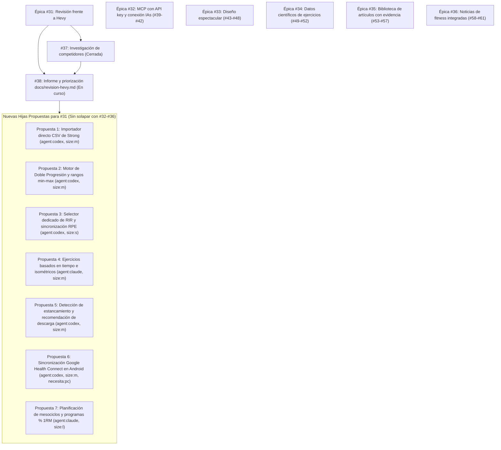

# Revisión exhaustiva frente a Hevy y priorización de huecos

> **Documento de análisis y priorización funcional**  
> **Fecha de redacción:** 29 de octubre de 2026  
> **Épica relacionada:** Parte de [#31](https://github.com/adriarroyo08/WorkStation/issues/31) (Épica: revisión exhaustiva frente a Hevy)  
> **Issue resuelta:** [#38](https://github.com/adriarroyo08/WorkStation/issues/38) (Redactar docs/revision-hevy.md y priorizar los huecos comprobados)  
> **Dependencia completada:** [#37](https://github.com/adriarroyo08/WorkStation/issues/37) / [docs/investigacion-competidores.md](file:///home/ubuntu/orca/workspaces/WorkStation/auto-implementar-antigravity-workstation-orac-20261029T2300/docs/investigacion-competidores.md)  
> **Objetivo:** Transformar la evidencia recopilada sobre Hevy, Strong, Fitbod y Boostcamp en una matriz comparativa función → Hevy / Workstation / hueco, evaluar y priorizar los huecos confirmados según impacto, esfuerzo y dependencias, proponer una cola de issues hijas listas para implementar sin solapar con las épicas #32–#36, y documentar los puntos clave de decisión pendientes.

---

## 1. Contexto y mapa de épicas del proyecto

El objetivo de la épica [#31](https://github.com/adriarroyo08/WorkStation/issues/31) es que Workstation iguale y supere a **Hevy** (el estándar de referencia del mercado de registro de fuerza) y tome lo mejor de **Strong**, **Fitbod** y **Boostcamp**, manteniendo los principios irrenunciables de Workstation: **gratuito, privado, sin publicidad, offline-first y extensible mediante IA abierta**.

Para evitar duplicidades o dispersión de esfuerzos, se mapea a continuación la relación de este informe con todas las épicas e issues hijas ya creadas en el repositorio:



### 1.1. Delimitación frente a las épicas existentes (#32–#36)

Para garantizar que ninguna de las tareas propuestas para la épica [#31](https://github.com/adriarroyo08/WorkStation/issues/31) entre en conflicto ni solape con el trabajo en marcha, se comprueba la cobertura de las otras épicas activas:

| Épica | Alcance definido | Hijas existentes | Estado frente a la comparación con Hevy |
| :--- | :--- | :--- | :--- |
| **[#32](https://github.com/adriarroyo08/WorkStation/issues/32)**: MCP con API key y conexión con IAs | Servidor MCP remoto seguro, gestión de claves `ws_...`, rate limiting y guías de conexión para Claude, Cursor y Gemini. | [#39](https://github.com/adriarroyo08/WorkStation/issues/39), [#40](https://github.com/adriarroyo08/WorkStation/issues/40), [#41](https://github.com/adriarroyo08/WorkStation/issues/41), [#42](https://github.com/adriarroyo08/WorkStation/issues/42) | **Cubre y supera** la API para desarrolladores de Hevy Pro (`hevy.com/settings?developer`). No proponer tareas de MCP ni API keys en #31. |
| **[#33](https://github.com/adriarroyo08/WorkStation/issues/33)**: Diseño espectacular | Sistema de diseño en `docs/diseno.md`, tokens, microinteracciones y rediseño de las 5 pantallas principales. | [#43](https://github.com/adriarroyo08/WorkStation/issues/43), [#44](https://github.com/adriarroyo08/WorkStation/issues/44), [#45](https://github.com/adriarroyo08/WorkStation/issues/45), [#46](https://github.com/adriarroyo08/WorkStation/issues/46), [#47](https://github.com/adriarroyo08/WorkStation/issues/47), [#48](https://github.com/adriarroyo08/WorkStation/issues/48) | **Cubre** la modernización visual frente a la UI pulida de Hevy. No proponer rediseños de pantallas base en #31. |
| **[#34](https://github.com/adriarroyo08/WorkStation/issues/34)**: Datos científicos de ejercicios | Patrones de movimiento, mapeo muscular con intensidades 0-100 y evidencia científica comprobada (citas y DOI reales). | [#49](https://github.com/adriarroyo08/WorkStation/issues/49), [#50](https://github.com/adriarroyo08/WorkStation/issues/50), [#51](https://github.com/adriarroyo08/WorkStation/issues/51), [#52](https://github.com/adriarroyo08/WorkStation/issues/52) | **Supera** el catálogo estándar de Hevy añadiendo rigor biomecánico. No proponer ampliación de metadatos de ejercicios en #31. |
| **[#35](https://github.com/adriarroyo08/WorkStation/issues/35)**: Artículos con evidencia | Sección educativa con al menos 10 artículos en Markdown con fuentes verificadas, offline y citables por el Coach. | [#53](https://github.com/adriarroyo08/WorkStation/issues/53), [#54](https://github.com/adriarroyo08/WorkStation/issues/54), [#55](https://github.com/adriarroyo08/WorkStation/issues/55), [#56](https://github.com/adriarroyo08/WorkStation/issues/56), [#57](https://github.com/adriarroyo08/WorkStation/issues/57) | Ventaja diferencial de Workstation ausente en Hevy, Strong y Boostcamp. No proponer contenido educativo en #31. |
| **[#36](https://github.com/adriarroyo08/WorkStation/issues/36)**: Noticias de fitness | Agregador RSS/Atom con proxy y caché offline para investigación y novedades de entrenamiento. | [#58](https://github.com/adriarroyo08/WorkStation/issues/58), [#59](https://github.com/adriarroyo08/WorkStation/issues/59), [#60](https://github.com/adriarroyo08/WorkStation/issues/60), [#61](https://github.com/adriarroyo08/WorkStation/issues/61) | Ventaja de contenido ausente en competidores. No proponer fuentes ni pantallas de noticias en #31. |

---

## 2. Tabla comparativa: Función → Hevy / Workstation / Hueco

En esta tabla se detalla cada capacidad funcional evaluada, enlazando la evidencia externa pública ([Hevy](https://hevy.com), [Strong](https://www.strong.app/), [Fitbod](https://fitbod.me/), [Boostcamp](https://www.boostcamp.app/)) y los ficheros concretos de la base de código de Workstation (`app/`, `shared/`, `mcp/`, `android/`), identificando el estado exacto del hueco funcional.

### 2.1. Categoría 1: Registro de entrenamiento (Entreno)

| Función | Hevy | Contexto (Strong / Fitbod / Boostcamp) | Workstation (ficheros y rutas) | Diagnóstico del hueco |
| :--- | :--- | :--- | :--- | :--- |
| **Registro de series, repeticiones y peso** | Ilimitado y gratuito en [hevy.com](https://hevy.com). Soporte kg/lb. | Ilimitado y gratis en [strong.app](https://www.strong.app/) y [boostcamp.app](https://www.boostcamp.app/). Fitbod bloquea tras 3 entrenos ([fitbod.me/faq](https://fitbod.me/faq/)). | **Implementado**: [WorkoutLogger.tsx](file:///home/ubuntu/orca/workspaces/WorkStation/auto-implementar-antigravity-workstation-orac-20261029T2300/app/src/components/WorkoutLogger.tsx), [session.ts](file:///home/ubuntu/orca/workspaces/WorkStation/auto-implementar-antigravity-workstation-orac-20261029T2300/shared/session.ts), [types.ts](file:///home/ubuntu/orca/workspaces/WorkStation/auto-implementar-antigravity-workstation-orac-20261029T2300/shared/types.ts), [units.ts](file:///home/ubuntu/orca/workspaces/WorkStation/auto-implementar-antigravity-workstation-orac-20261029T2300/shared/units.ts). Datos en kg, conversión a lb al mostrar. | **Sin hueco**: completa paridad funcional. |
| **Tipos de series (calentamiento, drop set, fallo)** | 4 tipos en Free: Normal, Calentamiento (W), Drop Set (D), Al Fallo (F). | Strong ofrece los 4 tipos en Free ([strongapp.io/features](https://strongapp.io/features)). Boostcamp soporta los 4 tipos. | **Implementado**: [types.ts](file:///home/ubuntu/orca/workspaces/WorkStation/auto-implementar-antigravity-workstation-orac-20261029T2300/shared/types.ts#L47-L57), [WorkoutLogger.tsx](file:///home/ubuntu/orca/workspaces/WorkStation/auto-implementar-antigravity-workstation-orac-20261029T2300/app/src/components/WorkoutLogger.tsx). Selector visual e iconos por tipo. | **Sin hueco**: paridad total. |
| **Referencia a serie previa y autorrelleno** | En Free muestra peso y reps de la última sesión en columna "Previo". | Strong muestra marcas previas por serie. Fitbod ajusta pesos con algoritmo. | **Implementado**: [WorkoutLogger.tsx](file:///home/ubuntu/orca/workspaces/WorkStation/auto-implementar-antigravity-workstation-orac-20261029T2300/app/src/components/WorkoutLogger.tsx), [stats.ts](file:///home/ubuntu/orca/workspaces/WorkStation/auto-implementar-antigravity-workstation-orac-20261029T2300/shared/stats.ts). Columna "Anterior" con un toque para rellenar. | **Sin hueco**: paridad total. |
| **Temporizador de descanso por ejercicio** | Cuenta atrás con alerta sonora y ajuste manual de descanso en Free. | Strong temporizador en Free. Boostcamp inicio automático al marcar serie completada. | **Implementado**: [RestPicker.tsx](file:///home/ubuntu/orca/workspaces/WorkStation/auto-implementar-antigravity-workstation-orac-20261029T2300/app/src/components/RestPicker.tsx), [rest.ts](file:///home/ubuntu/orca/workspaces/WorkStation/auto-implementar-antigravity-workstation-orac-20261029T2300/app/src/rest.ts), [RestAlarmReceiver.kt](file:///home/ubuntu/orca/workspaces/WorkStation/auto-implementar-antigravity-workstation-orac-20261029T2300/android/phone/src/main/java/com/workstation/app/RestAlarmReceiver.kt). Alarma sonora, vibración y alarma exacta en Android con pantalla apagada. | **Sin hueco**: supera a Hevy en Android gracias al receptor de alarma exacto. |
| **Calculadora de discos (plate calculator)** | Disponible gratis para barra de 20 kg / estándar en [hevyapp.com/barbell-plate-calculator](https://hevyapp.com/barbell-plate-calculator/). | Strong exige PRO ($4.99/mes) para calculadora de discos. Boostcamp limita a 10 usos en Free ([boostcamp.app/pro](https://boostcamp.app/pro)). | **Implementado**: [session.ts](file:///home/ubuntu/orca/workspaces/WorkStation/auto-implementar-antigravity-workstation-orac-20261029T2300/shared/session.ts), [WorkoutLogger.tsx](file:///home/ubuntu/orca/workspaces/WorkStation/auto-implementar-antigravity-workstation-orac-20261029T2300/app/src/components/WorkoutLogger.tsx), [Settings.tsx](file:///home/ubuntu/orca/workspaces/WorkStation/auto-implementar-antigravity-workstation-orac-20261029T2300/app/src/components/Settings.tsx). Totalmente gratuita con colores olímpicos y configuración de discos disponibles. | **Sin hueco**: ventaja sobre Strong y Boostcamp. |
| **Calculadora de series de calentamiento** | Exclusiva de [Hevy Pro](https://hevyapp.com/hevy-pro/) ($23.99/año). | Strong exige PRO. Boostcamp exige Pro para series de calentamiento ilimitadas. | **Implementado**: [session.ts](file:///home/ubuntu/orca/workspaces/WorkStation/auto-implementar-antigravity-workstation-orac-20261029T2300/shared/session.ts#L180-L215), [WorkoutLogger.tsx](file:///home/ubuntu/orca/workspaces/WorkStation/auto-implementar-antigravity-workstation-orac-20261029T2300/app/src/components/WorkoutLogger.tsx). Gratuita en Workstation: calcula series al 40%, 60%, 80% y peso de barra. | **Sin hueco**: supera a Hevy al ofrecerla gratis. |
| **Superseries y reordenación** | Agrupación de ejercicios en superseries con código de color en Free. | Strong soporta superseries en Free. Boostcamp soporta superseries y circuitos. | **Implementado**: [session.ts](file:///home/ubuntu/orca/workspaces/WorkStation/auto-implementar-antigravity-workstation-orac-20261029T2300/shared/session.ts), [Reorder.tsx](file:///home/ubuntu/orca/workspaces/WorkStation/auto-implementar-antigravity-workstation-orac-20261029T2300/app/src/components/Reorder.tsx), [WorkoutLogger.tsx](file:///home/ubuntu/orca/workspaces/WorkStation/auto-implementar-antigravity-workstation-orac-20261029T2300/app/src/components/WorkoutLogger.tsx). Agrupación por `supersetId` y reordenación accesible por teclado/arrastre. | **Sin hueco**: paridad total. |
| **Selector de RIR (Reps In Reserve)** | Permite alternar visualización o registro de RPE (escala 6-10) y RIR (0-4 reps en recámara). | Boostcamp integra guía de RIR en todas las series ([boostcamp.app](https://www.boostcamp.app/)). Fitbod pide RPE cualitativo. | **Parcial**: [types.ts](file:///home/ubuntu/orca/workspaces/WorkStation/auto-implementar-antigravity-workstation-orac-20261029T2300/shared/types.ts#L53), [WorkoutLogger.tsx](file:///home/ubuntu/orca/workspaces/WorkStation/auto-implementar-antigravity-workstation-orac-20261029T2300/app/src/components/WorkoutLogger.tsx). Solo dispone de selector numérico de RPE (6 a 10). Falta selector directo de RIR (0 a 4+) y conversión bidireccional. | **Hueco confirmado (H3)**: necesario para usuarios de hipertrofia moderna acostumbrados a pensar en RIR. |
| **Series por duración / isométricos (TUT)** | Hevy permite conmutar ejercicios a modo "Tiempo" (ej. planchas, hang, sentadilla isométrica) con cronómetro de serie. | Strong permite ejercicios basados en duración en segundos ([strongapp.io/features](https://strongapp.io/features)). Boostcamp soporta tiempo. | **Parcial**: [types.ts](file:///home/ubuntu/orca/workspaces/WorkStation/auto-implementar-antigravity-workstation-orac-20261029T2300/shared/types.ts#L54) tiene `durationSec?: number` tipado, pero [WorkoutLogger.tsx](file:///home/ubuntu/orca/workspaces/WorkStation/auto-implementar-antigravity-workstation-orac-20261029T2300/app/src/components/WorkoutLogger.tsx) solo muestra campos para peso y reps, y carece de cronómetro por serie en la interfaz. | **Hueco confirmado (H4)**: imposibilita registrar adecuadamente ejercicios de abdomen o agarre por tiempo. |

---

### 2.2. Categoría 2: Rutinas y programas

| Función | Hevy | Contexto (Strong / Fitbod / Boostcamp) | Workstation (ficheros y rutas) | Diagnóstico del hueco |
| :--- | :--- | :--- | :--- | :--- |
| **Editor de rutinas y límite de plantillas** | Máximo 4 rutinas en Free; ilimitadas en [Hevy Pro](https://hevyapp.com/hevy-pro/). | Strong limita a 3 plantillas en Free ([strongapp.io](https://strongapp.io/)). Fitbod genera entrenos dinámicos. Boostcamp permite ilimitadas en web y app. | **Implementado**: [RoutineEditor.tsx](file:///home/ubuntu/orca/workspaces/WorkStation/auto-implementar-antigravity-workstation-orac-20261029T2300/app/src/components/RoutineEditor.tsx), [types.ts](file:///home/ubuntu/orca/workspaces/WorkStation/auto-implementar-antigravity-workstation-orac-20261029T2300/shared/types.ts#L80-L95). Creador y editor sin ninguna limitación, 100% gratuito. | **Sin hueco**: gran ventaja competitiva de Workstation. |
| **Organización en carpetas** | Exclusivo de Hevy Pro. | Strong no dispone de sistema de carpetas. Boostcamp organiza por programas. | **Implementado**: [Train.tsx](file:///home/ubuntu/orca/workspaces/WorkStation/auto-implementar-antigravity-workstation-orac-20261029T2300/app/src/components/Train.tsx), [types.ts](file:///home/ubuntu/orca/workspaces/WorkStation/auto-implementar-antigravity-workstation-orac-20261029T2300/shared/types.ts#L96-L99). Creación, edición y ordenación por carpetas totalmente gratis. | **Sin hueco**: supera a Hevy y Strong. |
| **Compartir rutinas** | Compartición vía enlace web o código QR a través del backend centralizado de Hevy. | Strong comparte por enlace o texto plano. Boostcamp comparte programas por link web. | **Implementado**: [routine-share.ts](file:///home/ubuntu/orca/workspaces/WorkStation/auto-implementar-antigravity-workstation-orac-20261029T2300/shared/routine-share.ts), [SharedRoutine.tsx](file:///home/ubuntu/orca/workspaces/WorkStation/auto-implementar-antigravity-workstation-orac-20261029T2300/app/src/components/SharedRoutine.tsx). Compresión LZ-string autónoma en la URL sin depender de backend. | **Sin hueco**: máxima privacidad y portabilidad. |
| **Programas prediseñados y sugerencia "Hoy toca"** | Rutinas preestablecidas y rotación en app. | Boostcamp ofrece >130 programas pautados por entrenadores ([boostcamp.app/programs](https://boostcamp.app/programs)). | **Implementado**: [templates.ts](file:///home/ubuntu/orca/workspaces/WorkStation/auto-implementar-antigravity-workstation-orac-20261029T2300/shared/templates.ts), [Explore.tsx](file:///home/ubuntu/orca/workspaces/WorkStation/auto-implementar-antigravity-workstation-orac-20261029T2300/app/src/components/Explore.tsx), [planning.ts](file:///home/ubuntu/orca/workspaces/WorkStation/auto-implementar-antigravity-workstation-orac-20261029T2300/shared/planning.ts), [Train.tsx](file:///home/ubuntu/orca/workspaces/WorkStation/auto-implementar-antigravity-workstation-orac-20261029T2300/app/src/components/Train.tsx). 7 programas integrados y rotación "Hoy toca". | **Sin hueco**: paridad funcional. |
| **Rangos objetivo min-max de repeticiones en rutinas** | Hevy y plantillas avanzadas de fuerza permiten definir rangos de repeticiones (ej. "8-12 reps") en lugar de un número fijo. | Boostcamp estructura todas las series con rangos (ej. 3×6-8) y doble progresión. | **Parcial**: [types.ts](file:///home/ubuntu/orca/workspaces/WorkStation/auto-implementar-antigravity-workstation-orac-20261029T2300/shared/types.ts#L85) solo almacena `reps?: number` fijo por serie en `RoutineExercise`. Falta soporte para rango objetivo (`minReps`, `maxReps`) en el modelo y en [RoutineEditor.tsx](file:///home/ubuntu/orca/workspaces/WorkStation/auto-implementar-antigravity-workstation-orac-20261029T2300/app/src/components/RoutineEditor.tsx). | **Hueco confirmado (H2)**: necesario para habilitar la sobrecarga de doble progresión. |
| **Mesociclos estructurados y cargas por % 1RM** | Hevy Pro / Trainer ofrece planes de progresión por semanas. | Boostcamp destaca por programas estructurados de 4 a 12 semanas con porcentajes de 1RM formalizados ([boostcamp.app](https://www.boostcamp.app/)). | **Parcial**: [planning.ts](file:///home/ubuntu/orca/workspaces/WorkStation/auto-implementar-antigravity-workstation-orac-20261029T2300/shared/planning.ts) permite planificar días de la semana, pero no periodización multi-semana con semanas de carga/descarga ni cálculo de pesos según % del 1RM del usuario. | **Hueco confirmado (H7)**: deseable para atletas intermedios y avanzados. |

---

### 2.3. Categoría 3: Estadísticas y analítica

| Función | Hevy | Contexto (Strong / Fitbod / Boostcamp) | Workstation (ficheros y rutas) | Diagnóstico del hueco |
| :--- | :--- | :--- | :--- | :--- |
| **Historial de sesiones** | Bloqueado a los últimos 3 meses en Free; ilimitado en [Hevy Pro](https://hevyapp.com/hevy-pro/). | Strong ofrece historial ilimitado en Free. Fitbod bloquea tras 3 entrenos. Boostcamp historial completo en Free. | **Implementado**: [History.tsx](file:///home/ubuntu/orca/workspaces/WorkStation/auto-implementar-antigravity-workstation-orac-20261029T2300/app/src/components/History.tsx), [stats.ts](file:///home/ubuntu/orca/workspaces/WorkStation/auto-implementar-antigravity-workstation-orac-20261029T2300/shared/stats.ts). Historial ilimitado y búsqueda por ejercicio totalmente gratis. | **Sin hueco**: gran ventaja frente a Hevy. |
| **Estimación de 1RM y marcas personales (PRs)** | Récords de 1RM, mejor volumen y marcas por repetición (1, 3, 5, 10 reps). | Strong bloquea gráficas de 1RM en Free. Boostcamp incluye insignias de PRs y Strength Score. | **Implementado**: [stats.ts](file:///home/ubuntu/orca/workspaces/WorkStation/auto-implementar-antigravity-workstation-orac-20261029T2300/shared/stats.ts), [LineChart.tsx](file:///home/ubuntu/orca/workspaces/WorkStation/auto-implementar-antigravity-workstation-orac-20261029T2300/app/src/components/LineChart.tsx), [WorkoutLogger.tsx](file:///home/ubuntu/orca/workspaces/WorkStation/auto-implementar-antigravity-workstation-orac-20261029T2300/app/src/components/WorkoutLogger.tsx). 1RM con fórmula Epley, detección en directo y gráfico temporal. | **Sin hueco**: paridad total. |
| **Mapa muscular de volumen y recuperación** | Desglose muscular avanzado de series semanales exclusivo de Hevy Pro. | Fitbod incluye mapa de calor de recuperación dinámico ([fitbod.me/how-it-works](https://fitbod.me/how-it-works/)). Boostcamp *Muscle Tracker* en Pro. | **Implementado**: [muscle-detail.ts](file:///home/ubuntu/orca/workspaces/WorkStation/auto-implementar-antigravity-workstation-orac-20261029T2300/shared/muscle-detail.ts), [BodyMap.tsx](file:///home/ubuntu/orca/workspaces/WorkStation/auto-implementar-antigravity-workstation-orac-20261029T2300/app/src/components/BodyMap.tsx), [Train.tsx](file:///home/ubuntu/orca/workspaces/WorkStation/auto-implementar-antigravity-workstation-orac-20261029T2300/app/src/components/Train.tsx). Mapa interactivo por periodo (30d, 3m, 1a) y porcentaje de recuperación a 3 días. | **Sin hueco**: supera a Hevy al ofrecerlo gratis. |
| **Seguimiento de medidas y fotos de progreso** | Solo peso y cintura en Free; todas las medidas corporales en Hevy Pro. | Strong bloquea medidas corporales en Free. | **Implementado**: [types.ts](file:///home/ubuntu/orca/workspaces/WorkStation/auto-implementar-antigravity-workstation-orac-20261029T2300/shared/types.ts#L101-L106), [Measurements.tsx](file:///home/ubuntu/orca/workspaces/WorkStation/auto-implementar-antigravity-workstation-orac-20261029T2300/app/src/components/Measurements.tsx). 11 perímetros, peso, grasa y comparador deslizador de fotos privadas en local. | **Sin hueco**: supera a Hevy y Strong. |
| **Gamificación y resúmenes anuales** | Resumen anual y comparación de amigos en red social. | Boostcamp insignias de constancia. | **Implementado**: [achievements.ts](file:///home/ubuntu/orca/workspaces/WorkStation/auto-implementar-antigravity-workstation-orac-20261029T2300/shared/achievements.ts) (21 logros), [strength.ts](file:///home/ubuntu/orca/workspaces/WorkStation/auto-implementar-antigravity-workstation-orac-20261029T2300/shared/strength.ts) (niveles de fuerza), [wrapped.ts](file:///home/ubuntu/orca/workspaces/WorkStation/auto-implementar-antigravity-workstation-orac-20261029T2300/shared/wrapped.ts), [YearHeatmap.tsx](file:///home/ubuntu/orca/workspaces/WorkStation/auto-implementar-antigravity-workstation-orac-20261029T2300/app/src/components/YearHeatmap.tsx). | **Sin hueco**: superior en analítica personal. |

---

### 2.4. Categoría 4: Progresión y sobrecarga

| Función | Hevy | Contexto (Strong / Fitbod / Boostcamp) | Workstation (ficheros y rutas) | Diagnóstico del hueco |
| :--- | :--- | :--- | :--- | :--- |
| **Sugerencia de sobrecarga progresiva** | Consulta manual de la sesión anterior en la pantalla de entreno. | Strong requiere cálculo manual del usuario. Fitbod recalcula con *mStrength™* ([fitbod.me](https://fitbod.me/)). Boostcamp incluye *Auto Progression* en Pro. | **Implementado**: [progression.ts](file:///home/ubuntu/orca/workspaces/WorkStation/auto-implementar-antigravity-workstation-orac-20261029T2300/shared/progression.ts), [WorkoutLogger.tsx](file:///home/ubuntu/orca/workspaces/WorkStation/auto-implementar-antigravity-workstation-orac-20261029T2300/app/src/components/WorkoutLogger.tsx). Sugerencia directa "Hoy: X kg × Y reps" según cumplimiento previo y salto de carga. | **Sin hueco**: paridad con Hevy. |
| **Comparativa "Frente a la última vez"** | Vista comparativa en detalle del entreno. | Strong vista de sesión previa. | **Implementado**: [stats.ts](file:///home/ubuntu/orca/workspaces/WorkStation/auto-implementar-antigravity-workstation-orac-20261029T2300/shared/stats.ts), [WorkoutDetail.tsx](file:///home/ubuntu/orca/workspaces/WorkStation/auto-implementar-antigravity-workstation-orac-20261029T2300/app/src/components/WorkoutDetail.tsx). Comparación de volumen total, repeticiones y tiempo. | **Sin hueco**: paridad total. |
| **Motor formal de Doble Progresión (Double Progression)** | Hevy no automatiza la doble progresión sesión a sesión. | Boostcamp Pro aplica doble progresión algorítmica: mantener carga hasta alcanzar el tope del rango en todas las series; luego subir peso y volver al suelo del rango ([boostcamp.app/pro](https://boostcamp.app/pro)). | **Parcial**: [progression.ts](file:///home/ubuntu/orca/workspaces/WorkStation/auto-implementar-antigravity-workstation-orac-20261029T2300/shared/progression.ts) tiene `suggestNext`, pero solo con un número fijo `targetReps`. Carece de la lógica que evalúa si todas las series alcanzaron `maxReps` para incrementar carga o mantenerse buscando repeticiones dentro del rango `[minReps, maxReps]`. | **Hueco confirmado (H2)**: automatiza el método de sobrecarga más extendido en musculación. |
| **Detección de estancamiento y descarga (*deload*)** | Ni Hevy ni Strong lo incorporan; delegan en el criterio del usuario. | Fitbod reduce intensidad si detecta fatiga. Boostcamp programa semanas fijas de descarga en sus planes. | **Ausente**: no existe detección en `shared/` de fallo reiterado en el mismo peso durante 3 o más sesiones consecutivas ni sugerencia de descarga programada del volumen o peso. | **Hueco confirmado (H5)**: oportunidad para superar a Hevy y Strong con base científica. |

---

### 2.5. Categoría 5: Importación, exportación y sincronización

| Función | Hevy | Contexto (Strong / Fitbod / Boostcamp) | Workstation (ficheros y rutas) | Diagnóstico del hueco |
| :--- | :--- | :--- | :--- | :--- |
| **Exportación de datos a CSV** | Exportación completa a CSV desde app móvil en Free ([hevyapp.com/export-data](https://hevyapp.com/export-data/)). | Strong exporta CSV en Free ([help.strongapp.io/article/18-export-data](https://help.strongapp.io/article/18-export-data)). Fitbod exporta CSV. Boostcamp carece de exportación oficial en app. | **Implementado**: [hevy.ts](file:///home/ubuntu/orca/workspaces/WorkStation/auto-implementar-antigravity-workstation-orac-20261029T2300/shared/hevy.ts), [Settings.tsx](file:///home/ubuntu/orca/workspaces/WorkStation/auto-implementar-antigravity-workstation-orac-20261029T2300/app/src/components/Settings.tsx). Exporta en formato CSV compatible con Hevy. | **Sin hueco**: paridad total. |
| **Importación de CSV de Hevy** | Hevy importa CSV de Strong y de Hevy. | Strong **no permite importar CSV** (esclusa cerrada). | **Implementado**: [hevy.ts](file:///home/ubuntu/orca/workspaces/WorkStation/auto-implementar-antigravity-workstation-orac-20261029T2300/shared/hevy.ts), [Settings.tsx](file:///home/ubuntu/orca/workspaces/WorkStation/auto-implementar-antigravity-workstation-orac-20261029T2300/app/src/components/Settings.tsx). Parser con mapeo de ejercicios, series, reps, notas y RPE. | **Sin hueco**: paridad total. |
| **Importación por API oficial de Hevy Pro** | API REST oficial para usuarios Pro ([hevy.com/settings?developer](https://hevy.com/settings?developer)). | Strong no tiene API. Fitbod no tiene API. Boostcamp no tiene API. | **Implementado**: [hevy.ts](file:///home/ubuntu/orca/workspaces/WorkStation/auto-implementar-antigravity-workstation-orac-20261029T2300/shared/hevy.ts), [index.ts](file:///home/ubuntu/orca/workspaces/WorkStation/auto-implementar-antigravity-workstation-orac-20261029T2300/mcp/src/index.ts), [mcp-tools.ts](file:///home/ubuntu/orca/workspaces/WorkStation/auto-implementar-antigravity-workstation-orac-20261029T2300/shared/mcp-tools.ts). Descarga directa de entrenamientos mediante API key de Hevy Pro. | **Sin hueco**: función avanzada ya completada. |
| **Copias de seguridad automáticas y manuales JSON** | Solo sincronización en servidores de Hevy (sin backups locales automáticos versionados). | Strong copias en la nube propietaria. | **Implementado**: [backups.ts](file:///home/ubuntu/orca/workspaces/WorkStation/auto-implementar-antigravity-workstation-orac-20261029T2300/shared/backups.ts), [backups.ts](file:///home/ubuntu/orca/workspaces/WorkStation/auto-implementar-antigravity-workstation-orac-20261029T2300/app/src/backups.ts), [AutoBackups.tsx](file:///home/ubuntu/orca/workspaces/WorkStation/auto-implementar-antigravity-workstation-orac-20261029T2300/app/src/components/AutoBackups.tsx), [Settings.tsx](file:///home/ubuntu/orca/workspaces/WorkStation/auto-implementar-antigravity-workstation-orac-20261029T2300/app/src/components/Settings.tsx). Backups diarios automáticos (7 días) y pre-importación (5 copias). | **Sin hueco**: supera ampliamente a Hevy en soberanía de datos. |
| **Sincronización en la nube (Supabase)** | Sincronización en tiempo real en la infraestructura de Hevy. | Strong Sync en la nube. | **Implementado**: [sync.ts](file:///home/ubuntu/orca/workspaces/WorkStation/auto-implementar-antigravity-workstation-orac-20261029T2300/shared/sync.ts), [cloud.ts](file:///home/ubuntu/orca/workspaces/WorkStation/auto-implementar-antigravity-workstation-orac-20261029T2300/app/src/cloud.ts), [001_records.sql](file:///home/ubuntu/orca/workspaces/WorkStation/auto-implementar-antigravity-workstation-orac-20261029T2300/supabase/migrations/001_records.sql), [003_sync_hardening.sql](file:///home/ubuntu/orca/workspaces/WorkStation/auto-implementar-antigravity-workstation-orac-20261029T2300/supabase/migrations/003_sync_hardening.sql). Sincronización en la nube multi-dispositivo y offline con resolución LWW. | **Sin hueco**: paridad técnica. |
| **Importador nativo directo de CSV de Strong** | Hevy cuenta con importador específico para el formato CSV exportado por Strong. | Strong no importa datos. | **Parcial**: actualmente [hevy.ts](file:///home/ubuntu/orca/workspaces/WorkStation/auto-implementar-antigravity-workstation-orac-20261029T2300/shared/hevy.ts) solo admite el formato de columnas de Hevy. Los usuarios que proceden de Strong deben transformar las columnas o pasar por Hevy para migrar a Workstation. | **Hueco confirmado (H1)**: barrera de entrada para la gran base de usuarios históricos de Strong. |
| **Sincronización con Google Health Connect en Android** | Hevy sincroniza entrenamientos y calorías con Google Health Connect ([hevyapp.com](https://hevyapp.com)). | Strong sincroniza con Google Fit. Fitbod sincroniza con Health Connect ([fitbod.me/android](https://fitbod.me/android/)). | **Parcial**: la app nativa Android ([android/phone/](file:///home/ubuntu/orca/workspaces/WorkStation/auto-implementar-antigravity-workstation-orac-20261029T2300/android/phone/)) gestiona el servicio en primer plano y alarmas exactas, pero no vuelca sesiones en el almacén de Health Connect. | **Hueco confirmado (H6)**: requiere desarrollo nativo en Kotlin y verificación en PC. |

---

### 2.6. Categoría 6: Conexión IA y Coach

| Función | Hevy | Contexto (Strong / Fitbod / Boostcamp) | Workstation (ficheros y rutas) | Diagnóstico del hueco |
| :--- | :--- | :--- | :--- | :--- |
| **Servidor MCP nativo (Model Context Protocol)** | No ofrece soporte oficial para MCP (solo conectores comunitarios hacia su API REST de pago). | Strong no ofrece IA ni MCP. Fitbod IA cerrada propietaria. Boostcamp sin MCP. | **Implementado**: [index.ts](file:///home/ubuntu/orca/workspaces/WorkStation/auto-implementar-antigravity-workstation-orac-20261029T2300/mcp/src/index.ts) (stdio local), [edge.ts](file:///home/ubuntu/orca/workspaces/WorkStation/auto-implementar-antigravity-workstation-orac-20261029T2300/mcp/src/edge.ts) / [mcp-http.ts](file:///home/ubuntu/orca/workspaces/WorkStation/auto-implementar-antigravity-workstation-orac-20261029T2300/shared/mcp-http.ts) (remoto HTTP/SSE en Edge Function), [002_api_keys.sql](file:///home/ubuntu/orca/workspaces/WorkStation/auto-implementar-antigravity-workstation-orac-20261029T2300/supabase/migrations/002_api_keys.sql). | **Sin hueco (Cubierto y ampliado en Épica #32)**: gran ventaja pionera de Workstation. |
| **Herramientas de entrenador para LLMs** | Conector ChatGPT `@hevy` ([hevyapp.com/chatgpt-ai-workout-tracker](https://hevyapp.com/chatgpt-ai-workout-tracker/)). | Ausente en competidores tradicionales. | **Implementado**: [mcp-tools.ts](file:///home/ubuntu/orca/workspaces/WorkStation/auto-implementar-antigravity-workstation-orac-20261029T2300/shared/mcp-tools.ts) con 17 herramientas (consultas, historial, récords, creación de rutinas, logging de entreno). | **Sin hueco (Auditado en #42)**: paridad y superioridad técnica. |
| **Coach IA conversacional multimodelo en la PWA** | No tiene asistente conversacional dentro de la propia app móvil. | Fitbod usa IA algorítmica cerrada no conversacional. Boostcamp generador estático por cuestionario. | **Implementado**: [ai.ts](file:///home/ubuntu/orca/workspaces/WorkStation/auto-implementar-antigravity-workstation-orac-20261029T2300/shared/ai.ts), [Coach.tsx](file:///home/ubuntu/orca/workspaces/WorkStation/auto-implementar-antigravity-workstation-orac-20261029T2300/app/src/components/Coach.tsx), [Settings.tsx](file:///home/ubuntu/orca/workspaces/WorkStation/auto-implementar-antigravity-workstation-orac-20261029T2300/app/src/components/Settings.tsx). Compatible con Gemini, Groq, OpenRouter y Ollama local. | **Sin hueco**: función estrella de Workstation ausente en Hevy. |

---

### 2.7. Categoría 7: Reloj y wearables

| Función | Hevy | Contexto (Strong / Fitbod / Boostcamp) | Workstation (ficheros y rutas) | Diagnóstico del hueco |
| :--- | :--- | :--- | :--- | :--- |
| **App Wear OS nativa con modo autónomo** | App Wear OS 3+ en [hevyapp.com/wear-os-apple-watch-workout-tracker](https://hevyapp.com/wear-os-apple-watch-workout-tracker/). | Strong descontinuó Wear OS (ausente). Fitbod Wear OS limitado. Boostcamp carece de app para reloj. | **Implementado**: [MainActivity.kt](file:///home/ubuntu/orca/workspaces/WorkStation/auto-implementar-antigravity-workstation-orac-20261029T2300/android/wear/src/main/java/com/workstation/app/MainActivity.kt), [WatchUi.kt](file:///home/ubuntu/orca/workspaces/WorkStation/auto-implementar-antigravity-workstation-orac-20261029T2300/android/wear/src/main/java/com/workstation/app/WatchUi.kt), [Local.kt](file:///home/ubuntu/orca/workspaces/WorkStation/auto-implementar-antigravity-workstation-orac-20261029T2300/android/wear/src/main/java/com/workstation/app/Local.kt). Compose for Wear OS autónomo: inicia, registra series, descanso y guarda sin teléfono. | **Sin hueco**: paridad total con Hevy y gran ventaja frente a Strong y Boostcamp. |
| **Sincronización en vivo reloj ↔ teléfono** | Live Sync bidireccional entre reloj y teléfono en Hevy. | Strong Live Sync solo en iOS / watchOS. | **Implementado**: [PhoneLink.kt](file:///home/ubuntu/orca/workspaces/WorkStation/auto-implementar-antigravity-workstation-orac-20261029T2300/android/wear/src/main/java/com/workstation/app/PhoneLink.kt), [PhoneListenerService.kt](file:///home/ubuntu/orca/workspaces/WorkStation/auto-implementar-antigravity-workstation-orac-20261029T2300/android/phone/src/main/java/com/workstation/app/PhoneListenerService.kt), [WatchBus.kt](file:///home/ubuntu/orca/workspaces/WorkStation/auto-implementar-antigravity-workstation-orac-20261029T2300/android/phone/src/main/java/com/workstation/app/WatchBus.kt). Comunicación en tiempo real por Wearable Data Layer (`MessageClient`). | **Sin hueco**: paridad total. |
| **Medición continua de frecuencia cardíaca** | Lectura del sensor del reloj y cálculo de FC media en Hevy. | Strong y Fitbod leen FC en Apple Watch. | **Implementado**: [HeartRateService.kt](file:///home/ubuntu/orca/workspaces/WorkStation/auto-implementar-antigravity-workstation-orac-20261029T2300/android/wear/src/main/java/com/workstation/app/HeartRateService.kt), [hr.ts](file:///home/ubuntu/orca/workspaces/WorkStation/auto-implementar-antigravity-workstation-orac-20261029T2300/app/src/hr.ts). Lectura del sensor de Wear OS y compatibilidad con bandas Web Bluetooth. | **Sin hueco**: paridad total. |
| **App nativa para Apple Watch (watchOS)** | Hevy dispone de app completa para watchOS con Live Sync ([hevyapp.com/apple-watch](https://hevyapp.com/apple-watch/)). | Strong destaca principalmente en watchOS ([strongapp.io](https://strongapp.io/)). Fitbod app watchOS. | **Ausente**: Workstation es una PWA multiplataforma (Web/iOS/Android) con wrapper y Wear OS nativo en Android. No dispone de código Swift ni app empaquetada para watchOS. | **Punto de decisión estratégico**: ver sección 4.1. |

---

## 3. Priorización y evaluación de huecos confirmados

De los huecos detectados, se descartan los que ya están cubiertos por las épicas activas ([#32](https://github.com/adriarroyo08/WorkStation/issues/32) a [#36](https://github.com/adriarroyo08/WorkStation/issues/36)) y se priorizan exclusivamente los huecos comprobados pertenecientes a la épica [#31](https://github.com/adriarroyo08/WorkStation/issues/31):

| ID | Hueco comprobado | Impacto en usuario | Esfuerzo | Dependencias técnicas | Prioridad asignada |
| :---: | :--- | :---: | :---: | :--- | :---: |
| **H1** | **Importador nativo de CSV de Strong** | **Muy Alto** (elimina fricción de migración de usuarios de Strong) | **M** (shared + parser + tests) | Ninguna (`shared/hevy.ts` sirve como patrón de arquitectura) | **P1 (Inmediata)** |
| **H2** | **Motor de Doble Progresión y rangos min-max en rutinas** | **Muy Alto** (método principal de hipertrofia y sobrecarga) | **M** (shared types, logic y PWA UI) | Ninguna | **P1 (Inmediata)** |
| **H3** | **Selector dedicado de RIR y equivalencia con RPE** | **Alto** (mejora usabilidad inmediata durante la serie) | **S** (UI en `WorkoutLogger` y compatibilidad en `types.ts`) | Ninguna | **P2 (Alta)** |
| **H4** | **Soporte de ejercicios basados en tiempo e isométricos** | **Medio-Alto** (habilita planchas, cuelgues, estiramientos) | **M** (UI cronómetro en serie + validación en `types.ts`) | Requiere compatibilidad con `durationSec` existente | **P2 (Alta)** |
| **H5** | **Detección de estancamiento y recomendación de descarga (*deload*)** | **Alto** (diferenciador científico frente a Hevy y Strong) | **M** (algoritmo en `shared/` + card en PWA / Coach) | Se apoya en historial de `shared/stats.ts` | **P2 (Alta)** |
| **H6** | **Sincronización con Google Health Connect en Android** | **Medio** (integración en el ecosistema Android de salud) | **M** (código Kotlin en `android/phone/`) | Requiere dispositivo físico o emulador (`necesita:pc`) | **P3 (Media / necesita:pc)** |
| **H7** | **Planificación de mesociclos y programas multi-semana con % 1RM** | **Medio** (valor para usuarios avanzados de powerlifting) | **L** (modelo de datos complejo + nuevas vistas) | Conviene definir antes el sistema de diseño (#33) | **P3 (Postergada)** |

---

## 4. Puntos pendientes de decisión antes de implementar

Antes de iniciar la codificación de las propuestas de hijas, es indispensable que el equipo de desarrollo y producto acuerde las siguientes decisiones de diseño y arquitectura:

### 4.1. Decisión 1: App para Apple Watch (watchOS) vs foco en PWA y Android
- **Situación:** Hevy y Strong cuentan con aplicaciones nativas en Swift para Apple Watch con Live Sync. Workstation actualmente cuenta con app nativa en Jetpack Compose para Wear OS (relojes Android), pero carece de código para watchOS.
- **Alternativas:**
  1. *Desarrollar una app nativa en Swift / watchOS:* Requiere añadir un proyecto Xcode al repositorio, dependencias de compilación macOS y credenciales de Apple Developer.
  2. *Mantener Workstation centrada en PWA Web + Android (teléfono y Wear OS):* Documentar explícitamente que los usuarios de iOS utilizan la PWA completa mediante Safari ("Añadir a pantalla de inicio") y los usuarios de smartwatch disfrutan de soporte de primer nivel en el ecosistema abierto Wear OS.
- **Recomendación:** **Opción 2**. Workstation es un proyecto de código abierto y privado enfocado en tecnologías web y Android libres. No intentar abordar watchOS en el servidor CI actual (no dispone de macOS ni entorno Xcode) y no crear una issue para ello en esta fase.

### 4.2. Decisión 2: Compatibilidad de esquemas para RIR (Reps In Reserve)
- **Situación:** En la literatura de entrenamiento de fuerza, $\text{RIR} = 10 - \text{RPE}$ (un RPE 8 equivale a 2 repeticiones en recámara; RPE 10 equivale a 0 RIR).
- **Alternativa A:** Añadir un campo `rir?: number` independiente a `WorkoutSet` en `shared/types.ts`.
- **Alternativa B:** Mantener `rpe?: number` como única fuente de verdad en el almacenamiento y exponer en la configuración de la app un selector de modo de entrada preferido (`'rpe' | 'rir'`), calculando el mapeo en la capa de interfaz.
- **Recomendación:** **Alternativa B con soporte opcional de lectura**. Mantener `rpe` como valor canónico en la base de datos de Supabase y en los backups JSON evita migraciones de esquemas o roturas de compatibilidad con versiones antiguas, permitiendo que la UI muestre `RIR` o `RPE` de forma transparente al usuario según su preferencia en Ajustes.

### 4.3. Decisión 3: Formato de rangos de repeticiones en el modelo de Rutinas
- **Situación:** En `RoutineExercise.sets`, las series tienen `reps?: number`. Para soportar doble progresión se necesita un rango `[min, max]` (ej. 8 a 12 reps).
- **Alternativa A:** Cambiar el tipo de `reps` a `number | [number, number]` o `{ min: number; max: number }`. (Riesgo: romper la serialización comprimida en URL de `shared/routine-share.ts`).
- **Alternativa B:** Mantener `reps?: number` (que representa el valor por defecto o tope) y añadir campos opcionales `targetRepsMin?: number` y `targetRepsMax?: number` en `RoutineExercise` o por serie.
- **Recomendación:** **Alternativa B**. Garantiza compatibilidad hacia atrás total con todas las rutinas guardadas en localStorage, copias JSON de seguridad y enlaces compartidos existentes.

### 4.4. Decisión 4: Robustez del dialecto CSV de exportación de Strong
- **Situación:** Las exportaciones de Strong presentan pequeñas discrepancias según la versión regional de la app (cabeceras en inglés `Date,Workout Name,Duration,Exercise Name,Set Order,Weight,Reps,Distance,Seconds,Notes,Workout Notes,RPE` vs comas o puntos decimales según configuración de idioma).
- **Recomendación:** El parser en `shared/strong.ts` debe admitir tanto punto como coma para decimales en los pesos, omitir filas con valores vacíos sin lanzar excepciones y mapear los nombres comunes de ejercicios mediante un diccionario `STRONG_EXERCISES` equivalente al que ya tiene `shared/hevy.ts`.

---

## 5. Cola de propuestas de issues hijas para la Épica #31

A continuación se detallan las propuestas de especificación para las hijas confirmadas, redactadas siguiendo exactamente la plantilla formal de `.github/ISSUE_TEMPLATE/tarea.yml`:

---

### Propuesta H1: Implementar importador nativo de archivos CSV de Strong

- **Título:** `Implementar importador nativo de archivos CSV de Strong`
- **Etiquetas:** `agent:codex`, `size:m`
- **Parte de:** `#31`

#### Objetivo
Permitir a los usuarios que migran desde la aplicación Strong importar directamente su archivo CSV exportado (*Perfil → Ajustes → Exportar entrenamientos*) sin necesidad de manipular columnas a mano ni utilizar herramientas puente de terceros, logrando paridad con el importador de CSV de Hevy ya existente.

#### Criterios de aceptación
- [ ] Crear módulo `shared/strong.ts` con la función `parseStrongCsv(csvText: string): { workouts: Workout[]; exercisesCreated: number; skippedRows: number }`.
- [ ] Mapear los nombres de ejercicios más comunes de Strong hacia los identificadores estándar de la biblioteca de Workstation en `STRONG_EXERCISES`; los ejercicios no reconocidos se crean automáticamente como ejercicios personalizados con `custom: true`.
- [ ] Soportar las columnas estándar de exportación de Strong: `Date`, `Workout Name`, `Duration`, `Exercise Name`, `Set Order`, `Weight`, `Reps`, `Distance`, `Seconds`, `Notes`, `Workout Notes`, `RPE`.
- [ ] Manejar de forma robusta números con coma decimal o punto decimal, y comillas o saltos de línea dentro de los campos de notas.
- [ ] Añadir selector e integrarlo en la interfaz de Ajustes (`app/src/components/Settings.tsx`) junto a la opción existente de importar CSV de Hevy, con modal de confirmación, resumen de entrenamientos detectados y copia de seguridad preventiva automática.
- [ ] Tests unitarios exhaustivos en `shared/strong.test.ts` que cubran archivos CSV reales de Strong (series normales, calentamiento, fallos, notas con caracteres especiales y casos con campos vacíos).

#### Cómo verificar
```bash
npm run check
```
Verificar que la suite completa de pruebas unitarias pasa sin fallos y que la cobertura supera los umbrales exigidos por el proyecto.

#### Ficheros o pistas
- `shared/hevy.ts` (referencia de arquitectura y manejo de CSV)
- `shared/strong.ts` (nuevo)
- `shared/strong.test.ts` (nuevo)
- `app/src/components/Settings.tsx`
- `shared/types.ts`

---

### Propuesta H2: Motor de Doble Progresión y rangos de repeticiones en rutinas

- **Título:** `Motor de Doble Progresión y rangos de repeticiones en rutinas`
- **Etiquetas:** `agent:codex`, `size:m`
- **Parte de:** `#31`

#### Objetivo
Implementar el soporte para rangos de repeticiones objetivo (ej. 8-12 reps) en el creador de rutinas y calcular la sobrecarga progresiva según el principio clásico de doble progresión: mantener la carga hasta que el usuario complete el máximo de repeticiones en todas las series efectivas, incrementando entonces el peso en la siguiente sesión y reiniciando al suelo del rango.

#### Criterios de aceptación
- [ ] Extender `RoutineExercise` en `shared/types.ts` con los campos opcionales `targetRepsMin?: number` y `targetRepsMax?: number` (o `targetRepsRange?: [number, number]`), manteniendo compatibilidad retroactiva total con rutinas que usen `reps` fijo.
- [ ] Permitir configurar el rango de repeticiones objetivo en la interfaz de edición de rutinas (`app/src/components/RoutineEditor.tsx`).
- [ ] Actualizar la función `suggestNext` en `shared/progression.ts` para evaluar rangos: si todas las series de trabajo cumplieron `targetRepsMax`, sugerir incremento de carga (`action: 'up'`) al peso siguiente (`weightStep`); si no, sugerir mantener peso y sumar repeticiones hacia el objetivo (`action: 'reps'` o `'repeat'`).
- [ ] Mostrar en `WorkoutLogger.tsx` la indicación visual clara de la doble progresión (ej. "Objetivo: 8-12 reps · Si completas 3×12, la próxima vez subes a 82,5 kg").
- [ ] Tests en `shared/progression.test.ts` que validen todos los escenarios de doble progresión (alcanzar techo, quedarse en el rango medio, no llegar al suelo, incrementos por material barra/mancuernas).

#### Cómo verificar
```bash
npm run check
```

#### Ficheros o pistas
- `shared/types.ts`
- `shared/progression.ts`
- `shared/progression.test.ts`
- `app/src/components/RoutineEditor.tsx`
- `app/src/components/WorkoutLogger.tsx`

---

### Propuesta H3: Selector dedicado de RIR (Reps In Reserve) en el registro de entreno

- **Título:** `Selector dedicado de RIR y sincronización de escala con RPE`
- **Etiquetas:** `agent:codex`, `size:s`
- **Parte de:** `#31`

#### Objetivo
Facilitar a los practicantes de hipertrofia registrar su esfuerzo en la escala RIR (repeticiones en recámara: 0, 1, 2, 3, 4+) con un selector rápido en la pantalla de entrenamiento, sincronizado bidireccionalmente con la escala canónica RPE (donde $\text{RIR} = 10 - \text{RPE}$).

#### Criterios de aceptación
- [ ] Añadir en `Settings` (`shared/types.ts`) la preferencia `effortScale?: 'rpe' | 'rir'` (por defecto `'rpe'`).
- [ ] Crear selector en `app/src/components/WorkoutLogger.tsx` que, cuando la preferencia sea RIR, permita seleccionar de 0 a 4+ reps en recámara de forma rápida (un toque), almacenando internamente el RPE equivalente en el set (`10 - rir`).
- [ ] Mostrar en el resumen de la serie la etiqueta clara (ej. `RIR 2` o `RPE 8`).
- [ ] Añadir conmutador en Ajustes (`app/src/components/Settings.tsx`) para alternar la preferencia de visualización entre RPE y RIR.
- [ ] Pruebas unitarias de conversión en `shared/session.test.ts` o `shared/units.test.ts`.

#### Cómo verificar
```bash
npm run check
```

#### Ficheros o pistas
- `shared/types.ts`
- `app/src/components/Settings.tsx`
- `app/src/components/WorkoutLogger.tsx`
- `shared/session.ts`

---

### Propuesta H4: Soporte de ejercicios basados en tiempo e isométricos

- **Título:** `Soporte de ejercicios basados en tiempo con cronómetro integrado`
- **Etiquetas:** `agent:claude`, `size:m`
- **Parte de:** `#31`

#### Objetivo
Permitir el registro y cronometraje adecuado de ejercicios isométricos o basados en tiempo (planchas abdominales, cuelgues pasivos, sentadillas isométricas en pared), sustituyendo el campo de repeticiones por un cronómetro de duración en segundos durante el entrenamiento.

#### Criterios de aceptación
- [ ] Distinguir en `Exercise` (`shared/types.ts`) los ejercicios de tipo tiempo mediante el campo existente `kind: 'duration'`.
- [ ] En `WorkoutLogger.tsx`, cuando el ejercicio sea de tipo duración, mostrar columna de segundos en lugar de repeticiones y ofrecer un botón rápido de cronómetro de serie (iniciar / pausar / guardar tiempo transcurrido en `durationSec`).
- [ ] Adaptar la sugerencia de sobrecarga en `shared/progression.ts` para proponer incrementos de tiempo graduales (ej. +5 segundos si se alcanzó el tiempo objetivo).
- [ ] Reflejar la duración en el historial (`app/src/components/History.tsx` y `WorkoutDetail.tsx`), mostrando `mm:ss` o `X s` en lugar de `reps`.
- [ ] Tests unitarios en `shared/progression.test.ts` y `shared/session.test.ts` cubriendo la creación, cálculo y guardado de series de duración.

#### Cómo verificar
```bash
npm run check
```

#### Ficheros o pistas
- `shared/types.ts`
- `shared/exercises.ts`
- `shared/progression.ts`
- `app/src/components/WorkoutLogger.tsx`
- `app/src/components/WorkoutDetail.tsx`

---

### Propuesta H5: Detección heurística de estancamiento y recomendación de descarga (*deload*)

- **Título:** `Detección heurística de estancamiento y recomendación de descarga (deload)`
- **Etiquetas:** `agent:codex`, `size:m`
- **Parte de:** `#31`

#### Objetivo
Incorporar un algoritmo con base científica en `shared/` que analice el historial reciente y detecte situaciones de estancamiento reiterado en ejercicios multiarticulares (3 o más sesiones consecutivas sin aumento de carga ni repeticiones a RPE máximo) o fatiga sistémica acumulada, recomendando una sesión o semana de descarga programada (*deload*).

#### Criterios de aceptación
- [ ] Crear función `detectStagnation(history: Workout[], exerciseId: string): { isStalled: boolean; sessionsCount: number; recommendation?: string }` en `shared/stats.ts` o `shared/deload.ts`.
- [ ] Crear función `generateDeloadPlan(exercise: Exercise, lastWeight: number): { deloadWeight: number; deloadSets: number; deloadReps: number; reason: string }` que reduzca la carga habitual al 60-70% o reduzca el número de series al 50%.
- [ ] Mostrar un aviso no intrusivo en la tarjeta del ejercicio o en la sugerencia de sobrecarga de `WorkoutLogger.tsx` cuando se detecte estancamiento, sugiriendo la descarga con base científica.
- [ ] Integrar la consulta de estado de fatiga/descarga en las herramientas del MCP (`shared/mcp-tools.ts`) para que el Coach IA pueda interpretar la necesidad de descarga.
- [ ] Suite de pruebas con fixtures históricas en `shared/deload.test.ts`.

#### Cómo verificar
```bash
npm run check
```

#### Ficheros o pistas
- `shared/stats.ts`
- `shared/deload.ts` (nuevo)
- `shared/deload.test.ts` (nuevo)
- `shared/mcp-tools.ts`
- `app/src/components/WorkoutLogger.tsx`

---

### Propuesta H6: Sincronización de entrenamientos con Health Connect en Android

- **Título:** `Sincronización de entrenamientos finalizados con Google Health Connect en Android`
- **Etiquetas:** `agent:codex`, `size:m`, `necesita:pc`
- **Parte de:** `#31`

#### Objetivo
Integrar la biblioteca oficial de Google Health Connect en el módulo Android (`android/phone/`) para que cada vez que el usuario finalice un entrenamiento en la aplicación, la sesión se registre en el repositorio central de salud del dispositivo con su duración, calorías estimadas y datos de frecuencia cardíaca.

#### Criterios de aceptación
- [ ] Añadir dependencias de `androidx.health.connect:connect-client` en `android/phone/build.gradle.kts`.
- [ ] Solicitar permisos de escritura para `ExerciseSessionRecord` y `HeartRateRecord` siguiendo las pautas de Android 14+.
- [ ] Implementar servicio o clase helper en Kotlin que reciba la sesión finalizada desde el bus de eventos de la app y la inserte en Health Connect.
- [ ] Opción en los ajustes de la app para activar o revocar la sincronización con Health Connect.
- [ ] Compilación correcta del proyecto Android con `./gradlew :phone:assembleDebug` y pruebas unitarias de integración en local.

#### Cómo verificar
```bash
npm run check
./gradlew :phone:testDebugUnitTest
```

#### Ficheros o pistas
- `android/phone/build.gradle.kts`
- `android/phone/src/main/AndroidManifest.xml`
- `android/phone/src/main/java/com/workstation/app/`

---

### Propuesta H7: Estructuración de mesociclos y programas multi-semana con % 1RM

- **Título:** `Estructuración de mesociclos y programas multi-semana con cargas relativas a 1RM`
- **Etiquetas:** `agent:claude`, `size:l`
- **Parte de:** `#31`

#### Objetivo
Permitir la creación y seguimiento de programas periodizados de 4 a 12 semanas (mesociclos de fuerza o hipertrofia) donde las cargas se definen como porcentajes del 1RM del usuario (ej. Semana 1: 70% 1RM × 8 reps; Semana 3: 80% 1RM × 5 reps), emulando las funciones más valoradas de Boostcamp.

#### Criterios de aceptación
- [ ] Definir el tipo `ProgramMesocycle` en `shared/types.ts` con semanas, días y prescripción por porcentaje de 1RM o RPE objetivo.
- [ ] Crear función en `shared/planning.ts` que calcule automáticamente los pesos absolutos recomendados para la sesión en función del 1RM vigente del usuario.
- [ ] Vista de seguimiento del programa con barra de progreso de semanas y fases (acumulación, intensificación, descarga).
- [ ] Tests unitarios en `shared/planning.test.ts`.

#### Cómo verificar
```bash
npm run check
```

#### Ficheros o pistas
- `shared/types.ts`
- `shared/planning.ts`
- `shared/planning.test.ts`
- `app/src/components/Explore.tsx`
- `app/src/components/Train.tsx`

---

## 6. Conclusiones y siguientes pasos

1. **Estado de paridad:** Workstation ya iguala a Hevy en todas las funciones esenciales de registro (series, repeticiones, descansos, superseries, RPE, notas y calculadora de discos), y lo **supera ampliamente** en privacidad (offline-first, sin suscripciones obligatorias, historial y rutinas ilimitadas gratis) y en conectividad con IA (servidor MCP nativo de lectura y escritura).
2. **Acción prioritaria recomendada:** Abrir las issues hijas correspondientes a **H1** (Importador de Strong), **H2** (Doble progresión) y **H3** (Selector de RIR). Estas tres tareas consolidan el liderazgo funcional de Workstation en usabilidad y migración de usuarios sin requerir entorno de escritorio (`necesita:pc`) ni introducir dependencias de alto riesgo arquitectónico.
